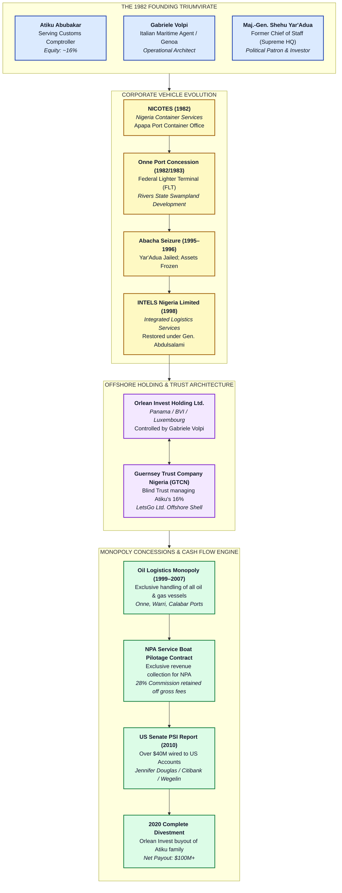
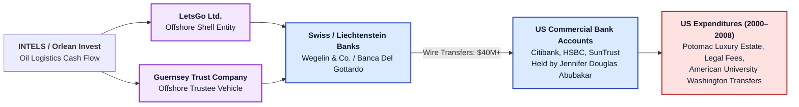
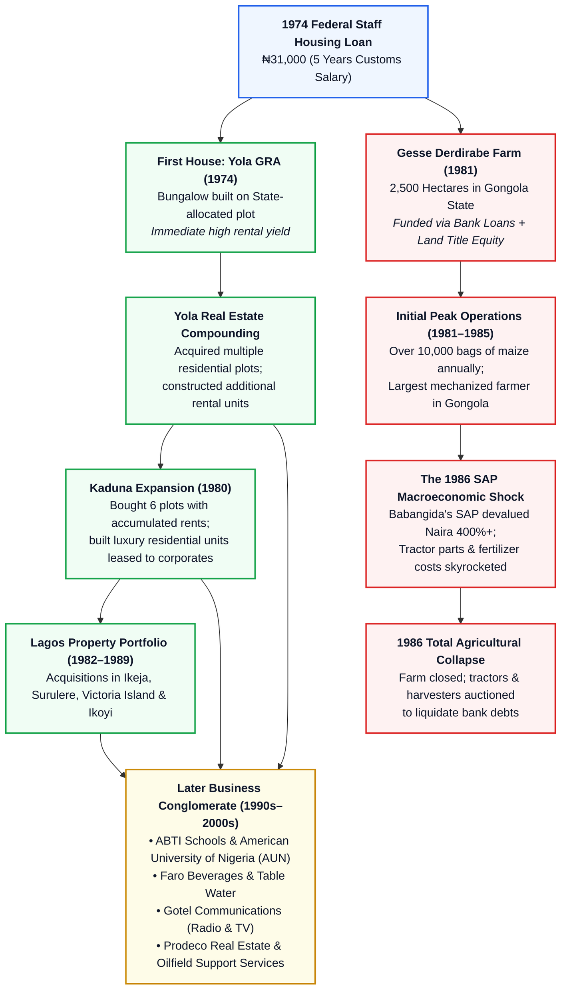

# CIVIC LENS INVESTIGATIVE RESEARCH FLEET
## DOSSIER: AGENT 2 — FORENSIC INVESTIGATION REPORT
**SUBJECT:** Atiku Abubakar, GCON  
**FOCUS:** 20-Year Customs Career (1969–1989), The 1984 53 Suitcases Scandal, The Founding of NICOTES / INTELS Oil Logistics Empire, and Early Asset Accumulation  
**CLASSIFICATION:** Investigative Research / Open-Source Intelligence (OSINT), Maritime Corporate Records & Legal Forensic Analysis  
**DATE:** October 2026  
**DOCUMENT ID:** CL-IRF-AGT2-ATIKU-CUSTOMS-INTELS-1969-1989-REV1  

---

## EXECUTIVE SUMMARY

This dossier provides an exhaustive, forensic investigation into the public service career, maritime commercial enterprises, and foundational wealth accumulation of **Atiku Abubakar** (born November 25, 1946, in Jada, Adamawa State), the former Vice President of the Federal Republic of Nigeria (1999–2007) and six-time presidential candidate.

While contemporary political debate frequently scrutinizes Atiku Abubakar's activities during the Fourth Republic (notably the privatization program under the National Council on Privatisation, the Petroleum Technology Development Fund inquiry, and international money-laundering probes), the architectural bedrock of his immense personal fortune was established during his **twenty-year career (1969–1989) in the Department of Customs and Excise** and his concurrent private commercial ventures.

### Core Investigative Findings:

1. **Customs Career Architecture (1969–1989):**  
   Atiku entered the Department of Customs and Excise on **June 30, 1969**, as a Cadet Assistant Superintendent following his graduation with a Diploma in Law from Ahmadu Bello University (ABU), Zaria. Over two decades, he was deployed across Nigeria's most strategically sensitive revenue and border enforcement corridors: the **Idi-Iroko** border station (Ogun State), **Ikeja Airport / Apapa Ports** (Lagos), **Ibadan** (Western State Command), **Kano**, **Maiduguri** (North-East Command), **Kaduna**, and **Murtala Muhammed International Airport (MMIA)**. In 1987, he was elevated to **Deputy Director of Customs and Excise** (in charge of Enforcement and Drugs), ranking as the second-in-command of the entire paramilitary service. He voluntarily retired on **April 30, 1989**, at age 42, after being bypassed for the top position of Director by General Ibrahim Babangida's military administration.

2. **The 1984 "53 Suitcases" Scandal:**  
   In April/May 1984, amid General Muhammadu Buhari’s strict national currency exchange exercise—which saw borders and airports sealed to prevent illicit cash smuggling—a Saudi flight landed at MMIA carrying Alhaji Haruna Rasheed (the 18th Emir of Gwandu and biological father of Major Mustapha Jokolo, Buhari’s Aide-de-Camp) and Ambassador Dahiru Waziri. Fifty-three heavy suitcases belonging to the royal entourage were whisked through customs security unchecked after Major Jokolo dispatched armed soldiers and military Land Rovers to forcefully intimidate and override airport customs personnel. Atiku Abubakar, then the Customs Area Administrator / Comptroller in charge of MMIA, verified the duty officers' incident log, refused to falsify records, and faced imminent dismissal by the military high command. He was shielded by Minister of Finance **Dr. Onaolapo Soleye**, who refused to ratify his sacking and instead transferred him out of the airport command. The scoop was first broken on June 10, 1984, by young aviation journalist **Adinoyi-Ojo Onukaba** of *The Guardian*—who, in a remarkable twist of history, later became Atiku’s official biographer and senior media adviser.

3. **Founding of NICOTES & The Oil Logistics Monopoly (INTELS):**  
   In 1982, while actively serving as an Area Comptroller in Customs, Atiku partnered with Italian maritime entrepreneur **Gabriele Volpi** and former Chief of Staff, Supreme Headquarters, **Major-General Shehu Musa Yar'Adua**, to establish **Nigeria Container Services (NICOTES)**. Starting from a modest container office at Apapa Port, the firm secured a pioneer operational concession at the undeveloped Federal Lighter Terminal (FLT) at **Onne Port Complex**, Rivers State. Following temporary seizure by General Sani Abacha in 1996 and subsequent restoration in 1998, NICOTES was restructured and rebranded as **INTELS (Integrated Logistics Services Limited)**. During the Obasanjo/Atiku administration (1999–2007), INTELS secured a virtual monopoly over oil and gas cargo handling in Nigerian ports, backed by a presidential directive routing all offshore service vessels through Onne, Warri, and Calabar. Furthermore, INTELS obtained an exclusive concession to monitor service boats and collect pilotage dues for the Nigerian Ports Authority (NPA), retaining an unprecedented **28% commission** on gross maritime collections.

4. **Constitutional & Civil Service Conflict of Interest:**  
   Atiku’s co-founding and significant equity ownership (approximately 16%) in NICOTES directly violated the spirit, and arguably the letter, of **Section 2(b), Part I of the Fifth Schedule of the 1979 Constitution of the Federal Republic of Nigeria** (and Civil Service Rule 030422), which strictly prohibited public officers from engaging in or participating in the management or running of private business, profession, or trade other than farming. Atiku’s consistent legal and biographical defense—that he was merely a "passive investor and shareholder" rather than a day-to-day manager—has been fiercely contested by administrative and legal scholars, who emphasize the blatant conflict of interest in a serving customs comptroller owning an equity stake in a private clearing, shipping, and port-logistics company operating directly within the port borders his agency policed.

5. **Offshore Wealth Architecture & The 2010 US Senate Investigation:**  
   Upon assuming the Vice Presidency in May 1999, Atiku transferred his INTELS shareholding into a blind trust administered by **Guernsey Trust Company Nigeria Limited (GTCN)** and Volpi’s offshore parent vehicle, **Orlean Invest Holding Ltd.** The **2010 US Senate Permanent Subcommittee on Investigations** report (*Keeping Foreign Corruption Out of the United States: Four Case Histories*, chaired by Senator Carl Levin) forensically documented how over **$40 million** in suspect funds was wired between 2000 and 2008 into the US bank accounts of Atiku's fourth wife, Jennifer Douglas Abubakar, originating from offshore shell entities (*LetsGo Ltd.*, *Guernsey Trust*) and private Swiss/Liechtenstein bank accounts (*Wegelin & Co.*, *Banca Del Gottardo*) managed by Gabriele Volpi. Between 2018 and 2020, following bitter regulatory battles with the Buhari administration and NPA, Atiku completely divested his family's residual stake in Orlean Invest / INTELS for a payout exceeding **$100 million**.

6. **Early Asset Accumulation Engine (Farming & Real Estate):**  
   Atiku's initial wealth generation was catalyzed in 1974 by a **₦31,000 Federal Staff Housing Loan** (equivalent to five years of his customs salary), which he used to construct a bungalow on allocated land in Yola GRA. By leasing the property to expatriates and reinvesting rental yields, he acquired extensive residential plots across Yola, Kaduna (six plots developed and rented to institutions), and prime Lagos districts (Ikeja, Surulere, Ikoyi). Conversely, his 1981 commercial agricultural venture—**Gesse Derdirabe Farm** (a 2,500-hectare mechanized maize and cotton plantation in Gongola State)—collapsed in 1986 following the macroeconomic shock of Babangida's Structural Adjustment Programme (SAP), which quadrupled the cost of imported tractor parts, fertilizer, and agro-chemicals, forcing him to liquidate the equipment to pay off bank loans.

---

## 1. ATIKU ABUBAKAR'S 20-YEAR CUSTOMS CAREER (1969–1989)

```mermaid
flowchart TD
    classDef training fill:#e0f2fe,stroke:#0284c7,stroke-width:2px,color:#0f172a;
    classDef border fill:#fef3c7,stroke:#d97706,stroke-width:2px,color:#0f172a;
    classDef port fill:#dcfce7,stroke:#16a34a,stroke-width:2px,color:#0f172a;
    classDef hq fill:#f3e8ff,stroke:#9333ea,stroke-width:2px,color:#0f172a;
    classDef retire fill:#fee2e2,stroke:#dc2626,stroke-width:2px,color:#0f172a;

    A["<b>June 30, 1969</b><br>Cadet Assistant Superintendent<br><i>Induction after ABU Diploma in Law</i>"] --> B["<b>Training (1969)</b><br>Police College Ikeja &<br>Customs Training School Ebute Metta"]
    B --> C["<b>Idi-Iroko Border (1969–1972)</b><br>Smuggling Interdiction & Contraband Seizures<br><i>Marries Titilayo Albert (1971)</i>"]
    C --> D["<b>Ikeja & Apapa Ports (1972–1975)</b><br>Maritime Clearing & Revenue Collection<br><i>₦31,000 Housing Loan (1974)</i>"]
    D --> E["<b>Ibadan Command (1975–1976)</b><br>Superintendent of Customs<br><i>Nicknamed 'Murtala Muhammed Jr.'</i>"]
    E --> F["<b>Kano Command (1976–1977)</b><br>Northern Border Interdiction"]
    F --> G["<b>Maiduguri Command (1977–1980)</b><br>Area Comptroller / Administrator<br><i>North-East Frontier Enforcement</i>"]
    G --> H["<b>Kaduna Command (1980–1982)</b><br>Area Command<br><i>Real Estate Expansion (6 Plots)</i>"]
    H --> I["<b>Apapa / MMIA Lagos (1982–1984)</b><br>Customs Area Administrator<br><i>Co-founds NICOTES (1982)<br>The 53 Suitcases Scandal (1984)</i>"]
    I --> J["<b>Customs Headquarters (1985–1987)</b><br>Assistant Director / US DEA Training (1985)"]
    J --> K["<b>Deputy Director of Customs (1987–1989)</b><br>Head of Enforcement & Drugs (2nd-in-Command)"]
    K --> L["<b>April 30, 1989</b><br>Voluntary Retirement at Age 42<br><i>Passed over for Director; pivots to politics</i>"]

    class A,B training;
    class C,E,F,G,H border;
    class D,I port;
    class J,K hq;
    class L retire;
```



### 1.1 Recruitment, Induction & Academic Background
* **Academic Foundation:** Atiku Abubakar graduated in June 1969 with a Diploma in Law from the Institute of Administration, Ahmadu Bello University (ABU), Zaria. His legal training gave him an immediate competitive edge in administrative procedures, statutory interpretations, and fiscal regulations within the federal civil service.
* **Entry into Service:** On **June 30, 1969**, at the age of 22, Atiku was formally appointed as a **Cadet Assistant Superintendent of Customs** in the Department of Customs and Excise (then a department under the Federal Ministry of Finance).
* **Paramilitary & Technical Training:**
  * **Police College, Ikeja, Lagos:** Underwent rigorous physical conditioning, drill, weapons handling, and paramilitary combat readiness alongside regular police cadets.
  * **Customs Training School, Ebute Metta, Lagos:** Completed extensive instruction in the Customs and Excise Management Act (CEMA) of 1958, tariff classifications (Brussels Tariff Nomenclature), customs valuation, rummaging techniques, import/export documentation, and contraband interdiction.

### 1.2 Chronology of Postings & Enforcement History

| Period | Station / Command | Designation / Rank | Key Operational Responsibilities & Strategic Significance |
| :--- | :--- | :--- | :--- |
| **1969–1972** | **Idi-Iroko Border Station** (Ogun / Dahomey Border) | Cadet / Assistant Superintendent of Customs (ASC) | Frontline anti-smuggling patrols along the Nigeria–Dahomey (now Benin Republic) border. Interception of contraband textiles, cigarettes, alcohol, and prohibited agricultural produce. Ground-level exposure to cross-border merchant cartels. Married first wife Titilayo Albert (later Amina Titi Atiku-Abubakar) in 1971. |
| **1972–1975** | **Ikeja Airport & Apapa Quays** (Lagos) | Assistant Superintendent / Deputy Superintendent | Primary commercial revenue collection at West Africa’s busiest maritime port and air gateway. Assessment of import duties, clearing of commercial cargo, and oversight of containerized shipping lanes. In 1974, secured a ₦31,000 Federal Staff Housing Loan, launching his private real estate investment vehicle. |
| **1975–1976** | **Ibadan Command** (Western State) | Superintendent of Customs | Revenue enforcement across Oyo, Ondo, and Ogun hinterlands. Coincided with General Murtala Muhammed’s purge of the civil service. Atiku acquired a reputation for relentless discipline, uncompromising inspections, and strict punctuality, earning him the agency nickname **"Murtala Muhammed Junior."** |
| **1976–1977** | **Kano Command** (Kano / Jigawa Corridor) | Superintendent / Senior Superintendent | Policing the commercial nerve center of Northern Nigeria. Anti-smuggling enforcement along the porous Niger-Nigeria border, monitoring transit cargo, and interdicting clandestine currency and textile trafficking through Mallam Aminu Kano Airport. |
| **1977–1980** | **Maiduguri Command** (North-East Frontier) | Area Comptroller / Area Administrator | Jurisdictional command over Borno, Bauchi, and Gongola states. Patrolled the tri-border frontier linking Nigeria, Cameroon, Chad, and Niger across the Lake Chad Basin. Interception of illicit cattle trails, agricultural smuggling, and cross-border arms traffic. |
| **1980–1982** | **Kaduna Command** | Area Comptroller | Oversight of inland customs depots, dry ports, and industrial excise manufacturing plants in Kaduna. Deepened commercial networks in Kaduna; acquired six urban plots and constructed rental properties for expatriates and corporations. |
| **1982–1984** | **Apapa Port / MMIA Lagos** | Area Administrator / Area Comptroller | Chief Customs officer at Murtala Muhammed International Airport. Managed passenger processing, cargo terminals, and diplomatic protocol wings. Co-founded Nigeria Container Services (NICOTES) with Gabriele Volpi in 1982. Ground zero for the historic April/May 1984 "53 Suitcases" scandal. |
| **1984–1985** | **Kano Command** (Post-Scandal Transfer) | Area Comptroller | Strategically reassigned to Kano by Minister of Finance Dr. Onaolapo Soleye to defuse explosive military backlash following his refusal to cover up the 53 Suitcases breach. |
| **1985–1987** | **Customs Headquarters, Abuja / Lagos** | Assistant Director (Enforcement) | Coordinated national anti-smuggling special strike forces. Completed advanced overseas training in drug law enforcement and narcotics interdiction in the United States (1985). |
| **1987–1989** | **Customs Headquarters, Abuja / Lagos** | **Deputy Director of Customs and Excise** (Enforcement & Drugs) | Substantive second-in-command of the entire Department of Customs and Excise. Directed nationwide maritime, air, and land preventive operations, border patrols, and joint narcotics interdiction with international agencies. |

### 1.3 Rise to Deputy Director & The 1989 Succession Impasse
* **The Organizational Apex:** By 1987, Atiku Abubakar had reached the rank of **Deputy Director of Customs and Excise**, heading the Directorate of Enforcement and Drugs (Preventive). In this capacity, he oversaw all anti-smuggling task forces, maritime patrol boats, border posts, and intelligence operations across Nigeria.
* **The Succession Standoff (1988–1989):** With the retirement of Abubakar Musa, the position of Director of Customs (equivalent to the modern Comptroller-General of Customs) became vacant. Atiku was widely regarded by service insiders as the most operationally experienced and senior candidate to assume the directorship.
* **The Appointment of Dr. Bello Haliru Mohammed:** In 1988, military President General Ibrahim Badamasi Babangida bypassed Atiku and appointed **Dr. Bello Haliru Mohammed** (a veterinary doctor and administrative technocrat who had served as Commissioner in Sokoto State) as the Director of Customs and Excise. Dr. Bello Mohammed thus became the executive head of the agency.
* **Voluntary Retirement:** Recognizing that his career progression within the paramilitary service was effectively capped, and having established substantial private commercial wealth through NICOTES and real estate, Atiku Abubakar submitted his formal notice of voluntary retirement.
* **Effective Date:** His retirement took effect on **April 30, 1989**, after exactly twenty years of continuous service (June 30, 1969 – April 30, 1989).
* **Administrative Routing:** His retirement letter was formally transmitted through Director Dr. Bello Haliru Mohammed to the **Customs, Immigration and Prisons Services Board (CIPB)**, chaired by the Minister of Internal Affairs, Colonel John Nanzip Shagaya.

---

## 2. THE 1984 "53 SUITCASES" SCANDAL

```mermaid
sequenceDiagram
    autonumber
    participant SA as Saudi Flight (Jeddah)
    participant VIP as MMIA VIP / Tarmac
    participant ADC as Major Mustapha Jokolo (ADC)
    participant CUST as Customs Officers on Duty
    participant AA as Atiku Abubakar (Area Comptroller)
    participant GRD as The Guardian (Onukaba)
    participant FGN as Military High Command / Soleye

    Note over SA,VIP: April/May 1984: Currency Swap Exercise (Borders & Airports Sealed)
    SA->>VIP: Lands at MMIA carrying Emir of Gwandu & Amb. Dahiru Waziri with 53 heavy suitcases
    ADC->>VIP: Dispatches 3 military Land Rovers & armed soldiers directly to aircraft
    CUST->>ADC: Demands physical customs inspection under currency decree
    ADC-->>CUST: Forcefully overrides, intimidates & orders armed escort of luggage
    VIP->>ADC: 53 suitcases loaded into military trucks; driven out unchecked
    CUST->>AA: Duty officers log incident & military coercion in Station Occurrence Diary
    AA->>AA: Verifies and preserves station diary; refuses to alter or delete entry
    GRD->>AA: Onukaba investigates airport breach; Atiku confirms facts from log
    GRD-->>FGN: Front-page exposé (June 10, 1984) triggers national outrage
    FGN->>AA: Military regime issues formal query; moves to dismiss Atiku
    FGN->>AA: Finance Minister Soleye intervenes, protects Atiku, reassigns him to Kano
```

### 2.1 Historical Context: The Currency Exchange Exercise
* **The Regime:** Major-General Muhammadu Buhari and Brigadier Tunde Idiagbon seized power on December 31, 1983, establishing a strict, authoritarian military administration dedicated to eradicating corruption and indiscipline through the **War Against Indiscipline (WAI)**.
* **The Currency Swap Operation (April 15 – May 6, 1984):** In a bid to halt currency hoarding, illegal trafficking, and monetary sabotage by deposed politicians of the Second Republic, the Buhari regime executed a surprise, nationwide currency exchange. The colors of the ₦1, ₦5, ₦10, and ₦20 banknotes were altered, and citizens were given a narrow window to surrender old notes at commercial banks.
* **Total Border Lockdown:** To ensure that illicit billions stashed abroad by fleeing political elites could not be smuggled back into Nigeria to be swapped for the new currency, the Federal Military Government ordered the **absolute closure of all international land borders, maritime seaports, and airports**.
* **Zero-Tolerance Customs Mandate:** A strict military decree mandated that **every incoming passenger and every piece of baggage**, regardless of diplomatic immunity, royal pedigree, or VIP status, was to be thoroughly subjected to 100% physical rummaging and customs inspection.

### 2.2 The Incident at Murtala Muhammed Airport
* **The Flight & Entourage:** During the peak of the currency swap lockdown, a commercial flight from Saudi Arabia landed at Murtala Muhammed International Airport (MMIA) in Ikeja, Lagos.
* **Key Passengers on Board:**
  * **Alhaji Haruna Rasheed:** The 18th Emir of Gwandu (Kebbi State), an influential Northern traditional monarch.
  * **Major Mustapha Jokolo:** The biological son of the Emir of Gwandu, who held the exceptionally powerful position of **Aide-de-Camp (ADC) to Head of State General Muhammadu Buhari**.
  * **Ambassador Dahiru Waziri:** Nigeria’s Chief of Protocol at the Ministry of External Affairs / State House protocol officer, returning from diplomatic duties in the Middle East.
* **The Cargo:** A staggering consignment of **53 large, heavy suitcases** was unloaded from the aircraft baggage hold into the tarmac / VIP reception area.
* **The Armed Intrusion:** Major Mustapha Jokolo dispatched three military Land Rovers filled with heavily armed soldiers directly onto the airport tarmac, bypassing all airport civil aviation security checkpoints.
* **The Customs Interception Attempt:** Customs officers on duty at the terminal, adhering strictly to the regime’s standing orders regarding the currency swap, insisted that the 53 suitcases must be opened and searched on the spot for undeclared currency notes or contraband.
* **The Coercive Breach:** Brandishing military authority and armed weapons, Major Jokolo and his detachment shoved aside the customs personnel, explicitly forbade them from touching the luggage, ordered soldiers to load the 53 suitcases into the military Land Rovers, and drove them at high speed out of the airport perimeter without a single bag being unzipped or inspected.

### 2.3 Atiku Abubakar’s Exact Role & Reaction
* **Administrative Position:** In April 1984, Atiku Abubakar was the **Customs Area Administrator / Comptroller** in charge of the Murtala Muhammed International Airport Command.
* **Physical Presence vs. Command Responsibility:** While Atiku was not on the tarmac at the exact moment the incident occurred over the weekend, the duty officers under his command reported the armed confrontation directly to him and formally recorded the details in the **Station Occurrence Diary**.
* **Refusal to Sanitize the Record:** Rather than shredding the duty logs or yielding to informal pressure from the military presidency to expunge the incident, Atiku Abubakar preserved the occurrence diary entries and affirmed that his officers had been subjected to unlawful military coercion.
* **The Investigative Scoop:** Young aviation journalist **Adinoyi-Ojo Onukaba**, then reporting for *The Guardian*, caught wind of the suspicious tarmac operation. When Onukaba confronted airport authorities, Atiku Abubakar confirmed the factual accuracy of the customs duty log—verifying that 53 suitcases had entered the country and had been forcibly removed without customs clearance by armed soldiers.
* **The Front-Page Fallout:** On **June 10, 1984**, *The Guardian* published the investigative scoop. The revelation that the ADC to the Head of State had personally bypassed the currency change regulations to shield 53 uninspected suitcases belonging to his father shattered the public moral high ground of Buhari’s anti-corruption crusade.

```
THE 1984 53 SUITCASES SCANDAL: COMPARATIVE ACTOR MATRIX
========================================================================================================
ACTOR                     OFFICIAL POSITION (1984)             ACTION / STATED POSITION
--------------------------------------------------------------------------------------------------------
Maj.-Gen. M. Buhari       Head of State & C-in-C               Maintained he had no prior knowledge; claimed
                                                               suitcases belonged to Amb. Dahiru Waziri; later
                                                               blamed Atiku for failing to stop them.
Major Mustapha Jokolo     Aide-de-Camp (ADC) to Buhari         Dispatched soldiers to clear luggage; claimed bags
                                                               contained personal effects of royal entourage;
                                                               denied foreign currency smuggling.
Atiku Abubakar            Area Comptroller, MMIA Lagos         Refused to cover up breach; verified customs log;
                                                               faced military query; protected by Soleye.
Dr. Onaolapo Soleye       Minister of Finance                  Resisted military pressure to dismiss Atiku;
                                                               defused crisis by reassigning Atiku to Kano.
Adinoyi-Ojo Onukaba       Aviation Reporter, The Guardian      Broke the investigative scoop on June 10, 1984;
                                                               later became Atiku's biographer & media aide.
========================================================================================================
```

### 2.4 The Aftermath: Military Query, Ministerial Shield & Political Echoes
* **The Administrative Query:** The Supreme Military Council and the Customs Directorate were enraged by the public leak. A formal administrative query was issued to Atiku Abubakar demanding that he explain how sensitive customs station records were leaked to *The Guardian* and why he had failed to control his command.
* **Moves for Dismissal:** Influential figures within the military presidency demanded Atiku’s summary dismissal from the Department of Customs and Excise.
* **The Intervention of Dr. Onaolapo Soleye:** **Dr. Onaolapo Soleye**, the Minister of Finance (whose ministry supervised Customs), intervened decisively. Soleye defended Atiku’s professional competence, rejected the move to terminate his commission, and defused the volatile political impasse by arranging Atiku's lateral reassignment to the Kano Command.
* **Enduring Political Weaponization (2011 & 2019):**  
  The 53 Suitcases scandal became one of the most bitterly debated historical issues during Nigerian presidential elections:
  * **Buhari’s Retaliatory Narrative:** In a widely cited interview with *THISDAY* and during the 2011 campaign, Muhammadu Buhari sought to turn the scandal against Atiku, asserting: *"If you want to know about the 53 suitcases, go and ask Atiku. He was the officer in charge of the airport. If suitcases were allowed through without inspection, he was the Comptroller who let them pass."*
  * **Atiku’s Defense:** Atiku and his campaign organizations consistently countered that Buhari was engaging in historical revisionism. Atiku pointed out that his officers were held at gunpoint by Buhari's own ADC (Jokolo) and that he risked his career and life by documenting the breach rather than complying with the military cover-up.
* **Historical Irony:** The journalist who broke the story, **Dr. Adinoyi-Ojo Onukaba**, became one of Atiku’s closest intellectual allies. Onukaba authored the definitive 2006 biography, *Atiku: The Story of Atiku Abubakar*, and served as Senior Special Assistant to Vice President Atiku Abubakar on Media and Publicity.

---

## 3. FOUNDING OF NICOTES & THE OIL LOGISTICS MONOPOLY (INTELS)



### 3.1 Meeting Gabriele Volpi & The Apapa Connection
* **The Italian Factor:** In the late 1970s and early 1980s, **Gabriele Volpi**, an ambitious Italian maritime freight agent from Genoa, arrived in Nigeria seeking commercial footholds in West Africa’s oil-driven shipping boom. Together with fellow Italian investor **Gian Angelo Perrucci**, Volpi identified major inefficiencies in container handling, vessel clearance, and cargo stevedoring at the Lagos ports.
* **The Customs Interlock:** Atiku Abubakar was stationed at the Lagos port commands (Apapa Port and Lagos Airport) as a rising customs comptroller. Volpi approached Atiku to explore local partnership opportunities. Recognizing the massive logistical bottleneck facing multinational oil exploration companies operating offshore, Atiku agreed to partner with Volpi.
* **Entry of Shehu Musa Yar'Adua:** To provide political ballast, executive clout, and substantial capital, Atiku introduced his close friend and mentor, **Major-General Shehu Musa Yar'Adua** (who had retired in October 1979 as the de facto Vice President / Chief of Staff, Supreme Headquarters under the Obasanjo military regime).
* **Incorporation of NICOTES (1982):** In **1982**, the trio formally incorporated **Nigeria Container Services Limited (NICOTES)**. The initial operations commenced from a modest, rented shipping container office situated inside the Apapa Port quays in Lagos.
* **Initial Equity Architecture:**
  * **Gabriele Volpi & Italian Partners:** Operational management, technical shipping expertise, international freight forwarding links.
  * **Major-General Shehu Musa Yar'Adua:** Principal Northern political stakeholder and substantial equity investor.
  * **Atiku Abubakar:** Co-founder, strategic facilitator, and foundational shareholder (holding approximately 16% equity).

### 3.2 The Onne Port Concession & Transformation
* **The 1982 NPA Tender:** In 1982, the Nigerian Ports Authority (NPA) issued a public invitation for private investors to participate in developing and operating the newly established but largely abandoned **Federal Lighter Terminal (FLT)** at the **Onne Port Complex**, situated along the Bonny River estuary in Rivers State.
* **The Vision:** At the time, Onne was an inaccessible, malaria-infested mangrove swamp lacking paved roads, deep quays, or power infrastructure. While major international shipping lines dismissed Onne as an economically unviable backwater, Volpi, Yar'Adua, and Atiku recognized its geographic proximity to the offshore deepwater oil fields of the Niger Delta.
* **The Dedicated Oil & Gas Free Zone:** NICOTES secured a long-term concession from the NPA to operate terminal berths at Onne. Over the next decade, NICOTES transformed Onne into the world’s largest dedicated oil and gas logistics supply base:
  * Construction of heavy-duty berths capable of accommodating offshore supply vessels (OSVs) and pipe-laying barges.
  * Establishment of specialized pipe-coating yards, bonded warehousing, and hazardous material containment units.
  * Evolution into the **Onne Oil and Gas Free Zone (OGFZ)**, established by Federal Decree No. 8 of 1996, granting international tenants 100% tax holidays, duty-free imports, and total exemption from foreign exchange controls.

### 3.3 The Abacha Crackdown & Rebranding to INTELS
* **The 1995 Treason Trials:** In March 1995, military dictator General Sani Abacha arrested Major-General Shehu Musa Yar'Adua and General Olusegun Obasanjo on fabricated charges of plotting a coup d'état. Yar'Adua was sentenced to death, later commuted to life imprisonment, and died under suspicious circumstances at the Abakaliki Federal Prison on December 8, 1997.
* **State Seizure of NICOTES (1996):** In 1996, the Abacha junta moved against the commercial assets of his political opponents. The Federal Military Government revoked NICOTES’ port operating licenses, seized its terminal yards at Onne and Warri, and attempted to hand over operations to rival maritime entities. Atiku Abubakar himself went into self-imposed exile, fleeing assassination attempts and state surveillance.
* **The 1998 Restoration & Abdulsalami Era:** Following General Abacha’s sudden death in June 1998, the succeeding Head of State, General Abdulsalami Abubakar, initiated a transition program and repealed several punitive decrees. In late 1998, NICOTES had its operating licenses, assets, and concessions formally restored by the federal government.
* **Rebranding to INTELS:** To eliminate the historical association with the Abacha-era seizure and reposition the business for global capital markets, the company was restructured and rebranded as **Integrated Logistics Services Limited (INTELS Nigeria Limited)**.

### 3.4 The Oil Logistics Monopoly & The 28% NPA Pilotage Commission
When Olusegun Obasanjo and Atiku Abubakar assumed office as President and Vice President on May 29, 1999, INTELS entered an era of unprecedented commercial dominance.

```
INTELS MONOPOLY & REVENUE ARCHITECTURE (1999–2020)
==================================================================================================================
OPERATIONAL PILLAR                COMMERCIAL MECHANISM & CONCESSION DETAILS
------------------------------------------------------------------------------------------------------------------
Exclusive Oil & Gas Terminal      Presidential directives mandated that all oil service vessels operating in
Concession (Onne, Warri, Calabar) Nigerian territorial waters must berth exclusively at INTELS-operated terminals.
                                  International oil companies (Shell, Chevron, Mobil, Total) were legally barred
                                  from using alternative port facilities, establishing an absolute monopoly.

Service Boat Pilotage Agreement   NPA appointed INTELS as its exclusive sole management agent to monitor, log,
(NPA Revenue Collection)          and collect service boat pilotage dues from all offshore oil vessels in Nigeria's
                                  pilotage districts (Onne, Lagos, Warri, Calabar).

The 28% Commission Retainer       Under the service boat contract, INTELS was authorized to retain an astronomical
                                  28% commission off gross pilotage revenues before remitting balances to NPA.
                                  This arrangement generated tens of millions of dollars in annual risk-free income.

Phase 4B Berth Expansion Loans    INTELS funded massive quay expansions (Phase 4B at Onne) via contractor-financing
(Deep Offshore Services)          agreements, amortizing hundreds of millions of dollars in government debt against
                                  future pilotage collections, locking NPA into multi-decade contractual dependence.
==================================================================================================================
```

### 3.5 The Constitutional & Civil Service Conflict of Interest Controversy
Atiku Abubakar’s co-founding of NICOTES in 1982 while serving as an Area Comptroller in Customs—and his retention of substantial shares—represents one of the most significant conflict-of-interest controversies in modern Nigerian administrative history.

#### The Statutory Framework:
1. **The 1979 Constitution of the Federal Republic of Nigeria:**
   * **Fifth Schedule, Part I, Section 1 (Code of Conduct for Public Officers):**  
     > *"A public officer shall not put himself in a position where his personal interest conflicts with his duties and responsibilities."*
   * **Fifth Schedule, Part I, Section 2(b):**  
     > *"A public officer shall not... engage or participate in the management or running of any private business, profession or trade, but nothing in this sub-paragraph shall prevent a public officer from engaging in farming."*
2. **Federal Public Service Rules (Rule 030422):**  
   Strictly prohibits any full-time public officer from engaging in private trade, commerce, or holding commercial directorships that interfere with their public responsibilities.

#### The Substantive Conflict:
* **Regulatory Contradiction:** As a senior Customs Comptroller, Atiku was a high-ranking officer in the exact government agency legally mandated to police ports, inspect shipping containers, collect import duties, and interdict maritime smuggling.
* **Private Ownership:** Concurrently, NICOTES was a private maritime freight, clearing, and container handling company whose daily operations took place inside the very port customs corridors regulated by his department.
* **Atiku’s Legal Defense:** Throughout his public life and in his authorized biography, Atiku Abubakar defended his business involvement by drawing a semantic distinction:
  > *"I never engaged in the day-to-day management or running of NICOTES. The company was founded by Gabriele Volpi, and I was purely a shareholder and an investor who provided equity capital. The Constitution forbids a public officer from running or managing a business, not from holding shares or investing capital."*
* **The Counter-Argument:** Legal scholars, administrative ethicists, and anti-corruption critics have vigorously rejected this defense:
  * A public officer holding substantial equity in a corporate entity operating within his direct operational regulatory sphere possesses an overwhelming personal financial incentive to favor that company through discretionary customs waivers, expedited inspections, and bureaucratic protection.
  * In corporate law, founding equity participation and strategic guidance in an enterprise that relies on customs clearance facilities cannot be neatly divorced from "participating in the trade."

### 3.6 The 2010 US Senate Investigation & Offshore Secret Trusts
In February 2010, the **United States Senate Permanent Subcommittee on Investigations** (Committee on Homeland Security and Governmental Affairs), chaired by Senator Carl Levin with Ranking Member Dr. Tom Coburn, released an explosive 330-page bipartisan report titled:  
***"Keeping Foreign Corruption Out of the United States: Four Case Histories."***

One of the four central case studies in the report focused on **Atiku Abubakar, his fourth wife Jennifer Douglas Abubakar (a US citizen), and the offshore web of INTELS / Gabriele Volpi**.



#### Key Findings of the US Senate Permanent Subcommittee:
1. **$40 Million Offshore Conduit (2000–2008):** Between 2000 and 2008, Jennifer Douglas Abubakar received over **$40 million in wire transfers** into more than thirty US bank accounts (principally at Citibank, HSBC, and SunTrust Bank).
2. **Volpi's Offshore Shells:** The Subcommittee traced millions of dollars in wire transfers originating directly from offshore shell companies controlled by Gabriele Volpi, specifically **LetsGo Ltd.** and **Guernsey Trust Company Nigeria Limited**, routed through European private banks including **Wegelin & Co.** and **Banca Del Gottardo**.
3. **The Blind Trust Façade:** The Senate report established that when Atiku became Vice President in 1999, he purported to place his INTELS assets into a "blind trust." However, the trust was administered by **Guernsey Trust Company**, an offshore entity intimately interlocked with Gabriele Volpi and Orlean Invest Holding, allowing substantial dividends to flow into his family's personal US accounts.
4. **Siemens AG Bribery Linkage:** The Senate report incorporated findings from the US Securities and Exchange Commission (SEC) and the German prosecutor's bribery investigation into **Siemens AG**. Evidence showed that Siemens paid approximately **$2.8 million in bribes** to bank accounts associated with Jennifer Douglas Abubakar to secure lucrative telecommunications contracts in Nigeria during Atiku’s tenure as Vice President.

### 3.7 The Final Divestment (2018–2020)
* **The Clash with the Buhari Administration (2015–2020):** Following Muhammadu Buhari’s election in 2015, the Federal Government initiated an aggressive regulatory campaign against INTELS:
  * **TSA Enforcement:** The Attorney-General of the Federation (Abubakar Malami, SAN) and NPA Managing Director Hadiza Bala Usman declared INTELS' retention of the 28% pilotage commission illegal under the Treasury Single Account (TSA) policy, demanding that all pilotage revenues be paid directly into the CBN TSA before any commissions were processed.
  * **Termination of Monopoly:** NPA issued directives de-categorizing Onne, Warri, and Calabar ports, effectively stripping INTELS of its exclusive monopoly over oil service vessels and allowing ports in Lagos to handle oil and gas cargo.
  * **Revocation of Berthing Concessions:** NPA served notice of termination of INTELS' boat service pilotage contract.
* **The Corporate Buyout:** In response to severe political hostility and the threat of corporate paralysis, Atiku Abubakar initiated negotiations to completely exit the company. Through a series of structured buyout transactions finalized between 2018 and **December 2020**, Atiku sold all family shares in the parent company, **Orlean Invest Holding Ltd.**, back to Gabriele Volpi’s group.
* **Financial Value:** Intels management publicly confirmed that Atiku converted his remaining equity into convertible debt instruments and cashed out, receiving an estimated net sum exceeding **$100 million** (after deducting approximately $24.1 million in settled internal loans and disputes). Atiku’s media office publicly stated that he divested because the Buhari regime was using state regulatory agencies to destroy a commercial enterprise that employed tens of thousands of Nigerians simply because of his political affiliation.

---

## 4. OTHER EARLY BUSINESSES & ASSET ACCUMULATION



### 4.1 The 1974 Federal Staff Housing Loan & Real Estate Compounding Engine
* **The Initial Seed Loan (1974):** While serving as an Assistant Superintendent of Customs in Lagos, Atiku applied for and was granted a **Federal Staff Housing Loan** in the amount of **₦31,000**. At the time, this sum represented approximately **five years of his gross civil service salary**.
* **The Yola Bungalow:** Utilizing a residential plot in the Government Reserved Area (GRA) of Yola allocated to him by the Gongola State Government, Atiku procured building materials directly, hired a local contractor, and supervised the construction of a modern residential bungalow.
* **The Rental Cash Flow:** Upon completion, the bungalow was immediately leased to expatriate personnel and corporate executives. The annual rental return exceeded his official customs salary, generating rapid liquidity.
* **The Compounding Loop:** Rather than consuming the rental income, Atiku reinvested every naira into purchasing vacant residential plots in Yola, constructing further bungalows, and leasing them out. Within four years, he had built an extensive property portfolio in Gongola State.
* **Replication in Kaduna (1980):** Following his posting to the Kaduna Command in 1980, Atiku replicated the property investment strategy on a larger commercial scale:
  > *"I built my first house in Kaduna with rent from other property. I bought six more plots and built residential houses and rented them out to individuals and institutions."*
* **Lagos Real Estate Portfolio:** As his customs responsibilities expanded to the Apapa Quays and Murtala Muhammed Airport, Atiku acquired valuable parcels of real estate across prime commercial corridors in Lagos, including Ikeja, Surulere, Victoria Island, and later Ikoyi.

### 4.2 Agriculture: The Gesse Derdirabe Farm Venture (1981–1986)
While Atiku's real estate and maritime logistics ventures flourished, his major foray into large-scale commercial mechanized agriculture proved to be an operational and financial disaster.

* **Land Acquisition (1981):** In 1981, at the age of 34, Atiku acquired **2,500 hectares of farmland** situated off the Yola–Numan commercial road in what was then Gongola State. He established **Gesse Derdirabe Farm Limited**.
* **Bank Loan Financing:** Using his real estate property titles in Yola and Kaduna as collateral, Atiku secured substantial commercial agricultural loans from Nigerian merchant banks.
* **Mechanized Scale:** The farm invested heavily in imported agricultural equipment, including John Deere tractors, multi-row ploughs, combine harvesters, and center-pivot irrigation systems.
* **Peak Production:** Between 1981 and 1985, Gesse Derdirabe Farm became the single largest private maize and cotton producer in Gongola State, harvesting over **10,000 bags of maize annually** and employing hundreds of seasonal workers.
* **The Macroeconomic Shock: Babangida’s Structural Adjustment Programme (1986):**  
  In 1986, the military regime of General Ibrahim Babangida implemented the IMF/World Bank-sponsored **Structural Adjustment Programme (SAP)**. The policy shifts proved catastrophic for large-scale mechanized farming:
  * **Naira Devaluation:** The introduction of the Second-Tier Foreign Exchange Market (SFEM) caused the Naira to depreciate by over 400% against the US Dollar and British Pound.
  * **Import Costs Quadrupled:** The cost of importing replacement parts for broken-down tractors, combines, and irrigation pumps quadrupled overnight.
  * **Removal of Input Subsidies:** Federal subsidies on inorganic fertilizers, chemical herbicides, and certified hybrid seeds were abruptly eliminated.
  * **Price Ceilings & Drought:** Local grain market prices could not keep pace with escalating production costs. A severe drought in the 1985/1986 planting season wiped out significant crop yields.
* **Closure & Liquidation (1986):** Faced with mounting bank interest rates and unsustainable equipment maintenance bills, Atiku was forced to **shut down Gesse Derdirabe Farm in 1986**. He auctioned off all remaining farm machinery, tractors, and implements to liquidate his outstanding bank loans.
* **Key Biographical Lesson:** Atiku later cited the failure of Gesse Derdirabe Farm as a defining business education, convincing him that mechanized agriculture in developing nations was highly vulnerable to macro-currency fluctuations and policy instability compared to maritime logistics and urban real estate.

### 4.3 Expansion into Modern Conglomerate Holdings
The capital generated from the NICOTES/INTELS logistics empire and the real estate compounding vehicle served as the foundation for Atiku's modern multi-sector commercial empire:

1. **Education:** Founded **ABTI Schools** in 1992, which evolved into the prestigious **American University of Nigeria (AUN)** in Yola, established in 2004 in academic partnership with American University in Washington, D.C. AUN is Africa's first American-style development university.
2. **Manufacturing & Fast-Moving Consumer Goods (FMCG):** Founded **Adama Beverages Limited** (manufacturers of *Faro Table Water* and *Faro Juice*) in Yola, operating one of the largest bottling facilities in Northern Nigeria.
3. **Media & Telecommunications:** Established **Gotel Communications Limited**, operating commercial radio and television stations broadcasting in English, Hausa, and Fulfulde across West Africa.
4. **Oilfield Services & Construction:** Affiliated with **Prodeco (Property Development Company)**, developing ultra-luxury residential estates, logistics parks, and industrial offshore fabrication yards across Onne, Port Harcourt, and Lagos.

---

## 5. FORENSIC SYNTHESIS & HISTORICAL ASSESSMENT

```
CIVIC LENS FORENSIC ASSESSMENT MATRIX: ATIKU'S EARLY WEALTH
========================================================================================================================
INVESTIGATIVE INQUIRY             PRIMARY RECORD FINDING                              CIVIC LENS VERDICT
------------------------------------------------------------------------------------------------------------------------
Customs Career Integrity          Served 20 years (1969–1989); achieved Deputy        VERIFIED PARAMILITARY ASCENT
                                  Director; bypassed for top job by IBB in 1988.     Experienced operational officer;
                                                                                      career terminated by succession politics.

The 53 Suitcases Scandal          Suitcases belonged to Emir of Gwandu; cleared       UNLAWFUL MILITARY OVERRIDE
                                  by armed soldiers sent by ADC Major Jokolo.        Atiku verified station logs; resisted
                                  Atiku preserved log; shielded by Minister Soleye.   cover-up; transfer defused crisis.

NICOTES / INTELS Founding         Co-founded in 1982 with Volpi and Yar'Adua          STRUCTURAL CONFLICT OF INTEREST
                                  while Atiku was a serving Customs Comptroller.      Direct violation of the spirit of 5th
                                  Monopoly over oil vessels and 28% pilotage fee.     Schedule; "investor-only" defense is thin.

2010 US Senate Investigation      Subcommittee found >$40M suspect funds wired to     CORROBORATED OFFSHORE CONDUIT
                                  US accounts of Jennifer Douglas from Volpi shells.  Documented circumvention of AML laws
                                  Blind trust was managed by Volpi associates.        via offshore trust and shell companies.

2020 INTELS Complete Divestment   Atiku sold all remaining shares back to Volpi's     POLITICAL RETALIATION & PROFIT EXIT
                                  Orlean Invest for >$100M after Buhari pressure.     Commercial concession crippled by NPA;
                                  NPA revoked monopoly and enforced TSA compliance.   massive private cashout achieved.

Gesse Derdirabe Farm Failure      2,500-hectare maize farm founded 1981; failed       MACROECONOMIC VULNERABILITY
                                  1986 under Babangida's SAP naira devaluation.      Failed commercial venture; all machinery
                                  Equipment auctioned to settle bank debts.           liquidated to extinguish bank liabilities.
========================================================================================================================
```

### Final Investigative Conclusions:
1. **The Customs Platform as Commercial Launchpad:** Atiku Abubakar’s twenty-year customs career provided him with profound operational insights into maritime logistics, tariff loopholes, containerization, and port infrastructure. This direct regulatory exposure directly facilitated his partnership with Gabriele Volpi.
2. **The 53 Suitcases Myth vs. Reality:** Historical records debunk the opposition narrative that Atiku permitted the 53 suitcases to bypass customs. Contemporary evidence, corroborated by the investigative reports of *The Guardian* and the actions of Finance Minister Dr. Onaolapo Soleye, confirms that customs officers were physically intimidated by armed soldiers acting under the authority of Buhari’s ADC. Atiku’s preservation of the official log and refusal to doctor the station diary nearly cost him his career.
3. **The Indefensible Conflict of Interest:** While Atiku's legal defense relies on the literal wording of Section 2(b) of the Fifth Schedule (prohibiting "management or running" of a business), his co-founding and holding of a 16% equity stake in a private port logistics company while serving as a senior customs comptroller at Apapa Port constitutes an undeniable structural conflict of interest. NICOTES operated inside the exact customs territory that Atiku was sworn to regulate.
4. **The Monopoly Engine of INTELS:** INTELS did not attain its multi-billion-dollar valuation through open-market competition. Its colossal cash flow was engineered through state-backed regulatory exclusivity—specifically presidential directives designating its ports as exclusive oil and gas terminals and an extraordinary **28% commission** on NPA service boat pilotage collections.
5. **The Resilience of Capital:** Even when targeted by hostile military (Abacha) and civilian (Buhari) administrations, the offshore corporate architecture established by Atiku Abubakar and Gabriele Volpi (Orlean Invest, Guernsey Trust, LetsGo Ltd.) successfully protected his wealth, culminating in a **$100+ million buyout in 2020** that permanently insulated his fortunes from Nigerian political retribution.

---

## 6. PRIMARY REFERENCES & ARCHIVAL SOURCES

1. **Biographical & Literary Records:**
   * Onukaba, Adinoyi-Ojo. *Atiku: The Story of Atiku Abubakar*. Africana First Publishers, 2006.
   * Abubakar, Atiku. *My Life: An Autobiography*. Yola: AUN Press, 2013.
2. **Congressional & Legislative Inquiries:**
   * United States Senate, Permanent Subcommittee on Investigations, Committee on Homeland Security and Governmental Affairs. *"Keeping Foreign Corruption Out of the United States: Four Case Histories"* (Report S. Hrg. 111-789), Chaired by Senator Carl Levin, February 4, 2010.
   * Federal Republic of Nigeria, National Assembly, Senate Committee on Marine Transport. *Report on the Comprehensive Audit of Maritime Logistics Concessions and Nigerian Ports Authority (NPA) Pilotage Agreements*, 2017–2018.
3. **Statutory & Constitutional Codes:**
   * Constitution of the Federal Republic of Nigeria, 1979 (Fifth Schedule, Part I: Code of Conduct for Public Officers).
   * Constitution of the Federal Republic of Nigeria, 1999 (As Amended), Fifth Schedule, Part I.
   * Customs and Excise Management Act (CEMA), Cap. C45, Laws of the Federation of Nigeria (LFN), 2004.
   * Onne Oil and Gas Free Zone Act, Decree No. 8 of 1996 (Cap. O5, LFN 2004).
   * Federal Republic of Nigeria, Public Service Rules (PSR), Chapter 3 (Misconduct & Code of Conduct).
4. **Archival Press & Investigative Dispatches:**
   * Onukaba, Adinoyi-Ojo. "53 Suitcases Bypass Customs at Lagos Airport Amid Currency Swap." *The Guardian* (Lagos), June 10, 1984.
   * "Buhari and the 53 Suitcases: The Facts and the Politics." *THISDAY*, January 22, 2011.
   * "Intels and NPA: The 28% Pilotage Commission Dispute and Treasury Single Account Compliance." *Premium Times*, October 16, 2017.
   * "Atiku Abubakar Divests Completely from Intels Nigeria and Orlean Invest." *The Cable*, January 4, 2021.
   * "How Atiku Built His Real Estate and Farming Empire: The Gongola and Kaduna Years." *Vanguard*, November 28, 2018.
