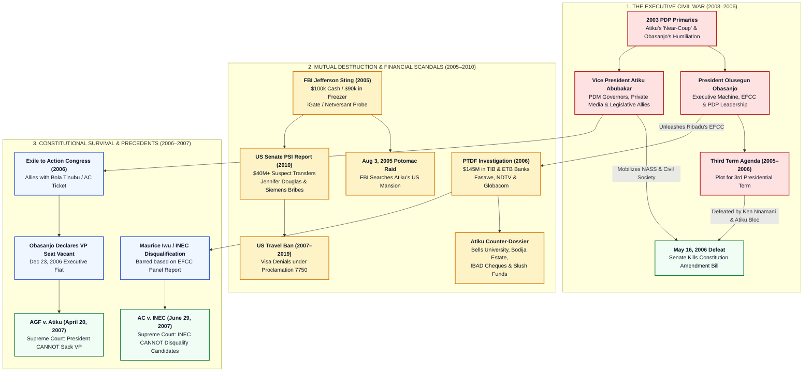
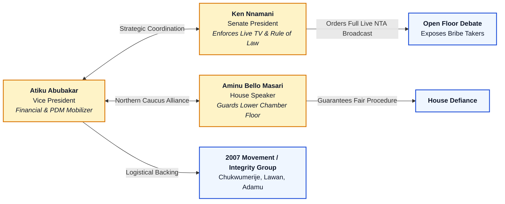
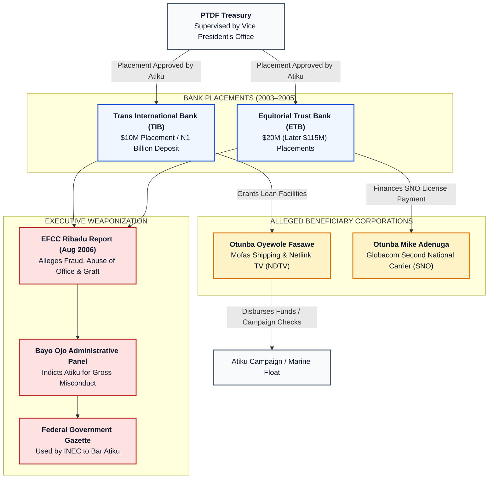
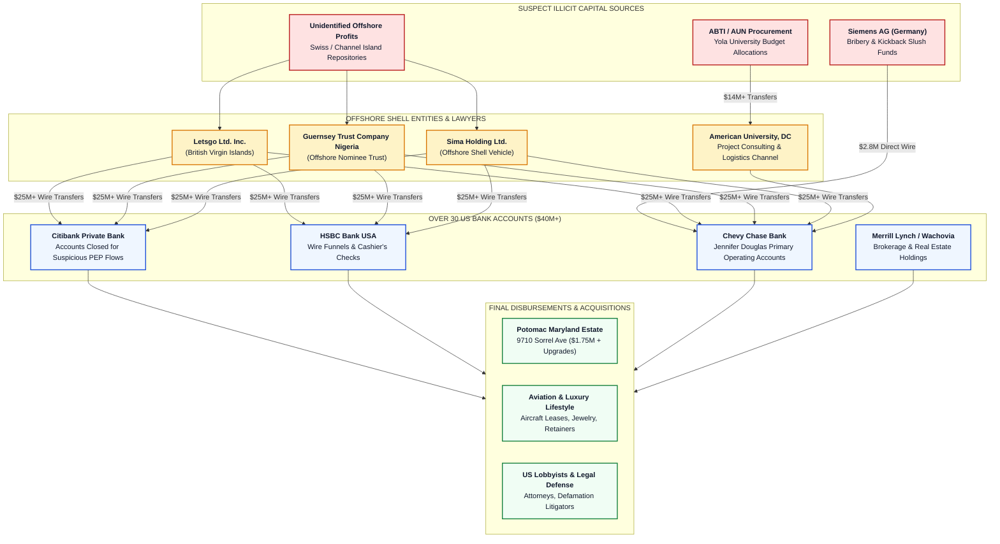
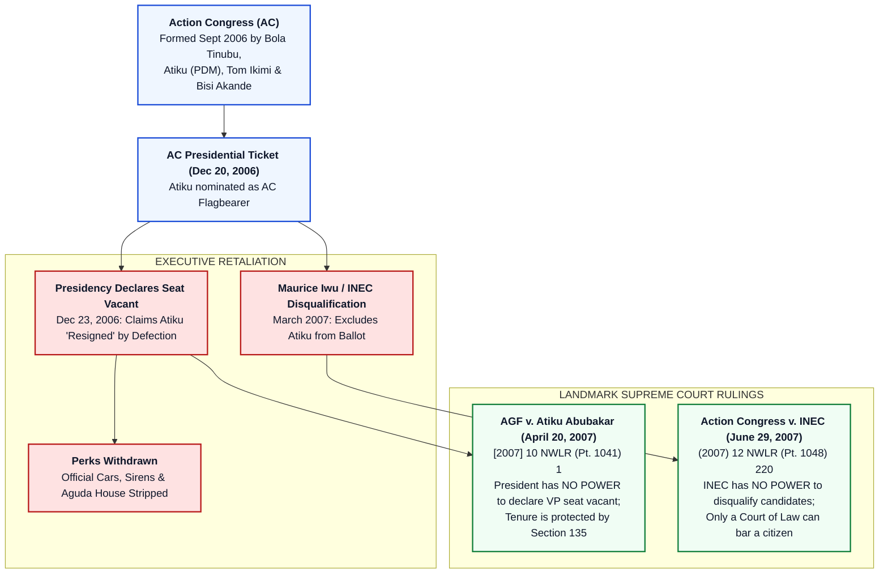
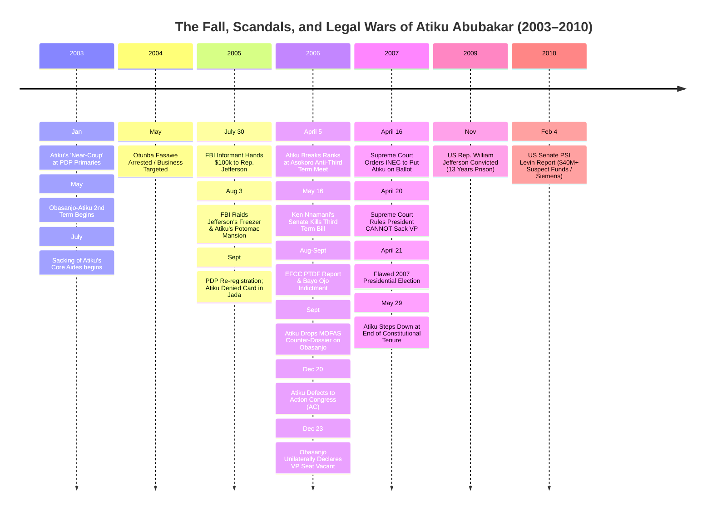

# CIVIC LENS INVESTIGATIVE RESEARCH FLEET
## DOSSIER: AGENT 4 — FORENSIC INVESTIGATION REPORT
**SUBJECT:** Atiku Abubakar (GCON)  
**FOCUS:** The Obasanjo-Atiku War, Defeat of the Third Term Agenda, and International Financial & Corruption Scandals (2003–2010)  
**CLASSIFICATION:** Forensic Legal Investigation / Open-Source Intelligence (OSINT) & Congressional Archival Audit  
**DATE:** October 2026  
**DOCUMENT ID:** CL-IRF-AGT4-AA-2003-2010-REV1  

---

## EXECUTIVE SUMMARY

This dossier constitutes a comprehensive, forensic investigation into the critical second term of Atiku Abubakar’s tenure as Vice President of the Federal Republic of Nigeria (2003–2007), his bitter institutional war with President Olusegun Obasanjo, his instrumental role in killing the constitutional tenure-elongation plot ("Third Term Agenda") in May 2006, and the cascade of domestic and international corruption scandals that defined his political exile between 2005 and 2010.

Between May 1999 and May 2007, Nigeria’s executive presidency operated as an uneasy dyarchy. By 2003, following a contentious primary election where Atiku came within inches of orchestrating Obasanjo’s political demise with the backing of state governors, the civilian presidency descended into an institutional civil war. This report reconstructs five interconnected operational arenas:

1. **The Obasanjo-Atiku Cold War (2003–2007):** The systematic dismantling of the Vice Presidency via executive orders, bureaucratic purging, surveillance, police withdrawals, and party restructuring, culminating in Atiku’s open rebellion against the 2006 Third Term Agenda alongside Senate President Ken Nnamani and House Speaker Aminu Bello Masari.
2. **The PTDF Scandal (2006):** The Economic and Financial Crimes Commission (EFCC) investigation under Mallam Nuhu Ribadu alleging the improper placement of $125 million to $145 million in public petroleum technology funds into commercial banks (Trans International Bank and Equitorial Trust Bank) to benefit business proxies (Otunba Oyewole Fasawe, NDTV, and Mike Adenuga/Globacom), met by Atiku’s devastating counter-dossiers exposing Obasanjo’s diversion of PTDF and campaign slush funds for Bells University of Technology, his Bodija residence in Ibadan, and luxury vehicles for female associates.
3. **The US FBI Bribery Sting & Congressman William J. Jefferson (2005–2009):** The covert US sting involving FBI informant Lori Mody, taped wiretaps where Congressman Jefferson solicited hundreds of thousands of dollars claiming it was for the "Vice President of Nigeria," the discovery of $90,000 wrapped in foil inside Jefferson’s freezer, the unprecedented FBI search of Atiku’s Potomac, Maryland residence on August 3, 2005, and Jefferson's historic 13-year federal prison conviction.
4. **The 2010 US Senate Permanent Subcommittee on Investigations Report:** The damning 330-page bipartisan report, *"Keeping Foreign Corruption Out of the United States: Four Case Histories,"* chaired by Senator Carl Levin, detailing how Atiku and his fourth wife, Jennifer Douglas Abubakar, moved over $40 million in suspect funds into the United States through offshore shell entities (Letsgo Ltd., Guernsey Trust, Sima Holding), American University consultancy fees, and $2.8 million in Siemens AG corporate bribe kickbacks—resulting in a decade-long US travel ban under Presidential Proclamation 7750.
5. **Constitutional Warfare & Political Exile to Action Congress (2006–2007):** Atiku’s defection to co-found the Action Congress (AC) with Bola Ahmed Tinubu, Obasanjo’s illegal attempt to declare the Vice Presidency vacant, and the landmark Supreme Court victories (*AGF v. Atiku Abubakar* and *Action Congress v. INEC*) that fundamentally defined Nigerian constitutional jurisprudence regarding security of executive tenure, separation of powers, and the limits of electoral umpire authority.

---



---

## 1. THE OBASANJO-ATIKU COLD WAR (2003–2007)

### 1.1 The Genesis: The 2003 PDP Presidential Primary Humiliation
The total rupture between Olusegun Obasanjo and Atiku Abubakar originated in the weeks leading up to the **January 5–6, 2003 PDP Presidential Primaries** held at the Eagle Square, Abuja.

* **The Governors' Revolt:** By late 2002, Obasanjo had alienated large segments of the PDP party apparatus, the traditional northern establishment, and particularly the 21 state governors elected on the PDP platform. The powerful governor bloc, coordinated through the **Peoples Democratic Movement (PDM)**—the formidable grassroots political machine founded by the late Major-General Shehu Musa Yar'Adua and inherited by Atiku—approached Atiku to dump Obasanjo and contest the presidency directly.
* **The Arithmetic of Mutiny:** Between 14 and 16 PDP governors, led by Governors James Ibori (Delta), Abdullahi Adamu (Nasarawa), Lucky Igbinedion (Edo), Boni Haruna (Adamawa), and Diepreye Alamieyeseigha (Bayelsa), publicly or covertly pledged their delegates to Atiku. They assured him that he commanded more than 60% of the delegate votes required to defeat Obasanjo on the convention floor.
* **The "I Have Options" Gambit:** In a series of provocative press briefings at the Aguda House (the Vice President’s residence), Atiku refused to endorse Obasanjo’s re-election bid, famously telling journalists that he was still weighing his options and could run with or against the President.
* **The Midnight Supplication:** In a widely confirmed historical encounter, on January 4, 2003—barely 48 hours before voting commenced—a desperate Obasanjo visited Atiku's residence in the Villa late at night. Obasanjo pleaded for Atiku’s backing, reportedly acknowledging that his political survival rested entirely in Atiku’s hands.
* **The Compromise and the Grudge:** Atiku extracted significant concessions: total preservation of the PDM faction, joint control of ministerial appointments, continuation of his chairmanship of the National Council on Privatisation (NCP), and an implicit understanding that Obasanjo would retire in 2007, leaving the presidency open for Atiku. Atiku addressed the media late on the eve of the convention, declaring his endorsement of Obasanjo. Obasanjo won the primary with 2,642 votes against former Vice President Alex Ekwueme’s 661 votes.
* **The Fatal Resentment:** Rather than generating gratitude, the episode permanently poisoned the relationship. Obasanjo, a proud military general, former military Head of State, and traditional Egba aristocrat, viewed Atiku’s actions as intolerable treachery and insubordination. He resolved that while he needed Atiku to win the general election in April 2003, he would dedicate his second term to neutralizing Atiku's political machine and ensuring he would never succeed him.

```
"Atiku made a fatal miscalculation in January 2003. In politics, if you draw a sword against the king, you must strike to kill. You do not show the king the sword, put it to his throat, force him to plead, and then sheath it back. Obasanjo spent every waking hour between 2003 and 2007 making sure that Atiku paid for that humiliation."
— Archival commentary by senior PDP chieftain, cited in contemporary press logs.
```

---

### 1.2 The Systematic Sidelining & Executive Deconstruction (2003–2005)
Immediately following the May 29, 2003 inauguration, Obasanjo launched a cold, methodical offensive to dismantle Atiku’s power base inside the government and the ruling party.

| Date / Phase | Executive Action Taken by Obasanjo | Strategic Political Impact on Atiku |
| :--- | :--- | :--- |
| **July 2003** | Sacking of Special Adviser Chris Mammah and Media Director Adeolu Akande | Stripped Atiku of his most sophisticated strategic communications and media advisers without prior consultation. |
| **August 2003** | Removal from National Council on Privatisation (NCP) Direct Controls | Obasanjo transferred day-to-day control of privatisation assets and enterprise approvals directly to the Presidency and Bureau of Public Enterprises (BPE). |
| **May 2004** | Arrest and Interrogation of Otunba Oyewole Fasawe | Targeted Atiku's chief financial backer, signaling to the commercial banking sector that Atiku's business associates were marked men. |
| **September 2005** | Purging of PDP National Chairman Audu Ogbeh | Audu Ogbeh, who warned Obasanjo in a leaked letter about the Anambra political kidnapping of Chris Ngige, was forced out at gunpoint/resignation under pressure; replaced by Col. Ahmadu Ali (Obasanjo loyalist). |
| **October 2005** | PDP Nationwide "Re-registration" & De-registration Exercise | Wholesale de-registration of PDM loyalists across 36 states; Atiku's registration at Jada Ward was deliberately denied or marked on an ordinary exercise book. |
| **June 2006** | Sacking of Senior Special Assistant on Media, Garba Shehu | Direct arrest and prosecution of Atiku’s media chief by the State Security Service (SSS) over allegations of possessing classified official documents. |
| **September 2006** | Withdrawal of Security Details & Executive Perks | State House security, pilot cars, and official protocol details assigned to the Office of the Vice President were unilaterally reassigned or withdrawn. |

#### Tactical Instruments of Marginalization:
1. **Federal Executive Council (FEC) Exclusion:** Atiku was systematically shut out of key cabinet decisions. Obasanjo presided over meetings with selected ministers, often bypassing the Vice President on economic management, power sector reforms, and petroleum licenses. When Obasanjo travelled abroad, instead of delegating presidential authority to Atiku as had been customary between 1999 and 2002, Obasanjo operated governance through the Secretary to the Government of the Federation (Chief Ufot Ekaette) and the Chief of Staff (Major-General Abdullahi Mohammed).
2. **The "Garrison" Capture of the PDP:** With the installation of Senator (Col.) Ahmadu Ali as National Chairman and Chief Ojo Maduekwe as National Secretary, the PDP Constitution was amended to consolidate imperial power in the hands of the President as the "National Leader" and "Chairman of the Board of Trustees (BoT)". During the late 2005 membership re-validation exercise, PDM members were systematically denied party cards. In Atiku’s home state of Adamawa, the party apparatus was handed over to his political arch-rival, Senator Jibril Aminu, resulting in the comical scene where Nigeria’s sitting Vice President was refused an official registration card in his native Jada Local Government Area.

---

### 1.3 The Battle of the Century: Defeating the "Third Term Agenda" (2005–2006)

#### The Plot:
By late 2005, a well-funded, clandestine campaign was launched to amend the 1999 Constitution of the Federal Republic of Nigeria. Spearheaded by the Deputy Senate President, Senator Ibrahim Mantu, and the Deputy Speaker of the House of Representatives, Austin Opara, the **Joint National Assembly Committee on the Review of the 1999 Constitution (JCCR)** inserted an amendment into Section 137(1)(b) that would alter the two-term limitation to permit three consecutive four-year terms for the President and state governors.

* **Financial Inducements:** Widespread investigative reports and legislative testimonies confirmed that astronomical sums were mobilized to bribe lawmakers. Bribes of **N50 million per Senator** and **N30 million per Representative** were distributed through banks and transport vans in iconic "Ghana-Must-Go" sacks, funded through corporate contributions from a pro-Obasanjo business cartel known as "Corporate Nigeria" (organized by Transcorp promoters and major oil/banking moguls).
* **Security Intimidation:** The Economic and Financial Crimes Commission (EFCC), chaired by Nuhu Ribadu, and the State Security Service (SSS), headed by Col. Kayode Are, were deployed to intimidate dissenting governors and lawmakers with asset seizures and impeachment threats (e.g., Joshua Dariye in Plateau, Diepreye Alamieyeseigha in Bayelsa, Rashidi Ladoja in Oyo, and Ayo Fayose in Ekiti).

#### Atiku Breaks Ranks:
Recognizing that the Third Term Agenda was designed specifically to permanently terminate his political aspirations, Atiku openly mutinied against Obasanjo.

* **April 5, 2006 (The Asokoro Declaration):** Atiku took the decisive step of publicly attending a meeting of anti-third term legislators at the Niger State Governor’s Lodge in Asokoro, Abuja, hosted by Governor Abdulkadir Kure. Addressing a hall of over 100 Senators and House members belonging to the "2007 Movement", Atiku delivered a fiery public denunciation:
```
"The Constitution is our national covenant. It is the supreme law of the land. We cannot tear it up or rewrite it under the cover of night merely to satisfy the boundless personal ambition of one individual. The tenure limitation clause was inserted to prevent dictatorship and ensure the orderly succession of power. I call upon every patriot in the National Assembly to stand firm, resist all monetary inducements, and defend our nascent democracy."
— Alhaji Atiku Abubakar, Address to Anti-Third Term Legislators, April 5, 2006.
```

#### The National Assembly Pincer Movement:
Atiku formed a clandestine, high-stakes legislative coalition with two critical constitutional officers who refused to serve as rubber stamps:



1. **Senate President Chief Ken Nnamani:** Nnamani resisted intense pressure and veiled threats from the Villa. He executed a masterstroke by ordering the **Nigerian Television Authority (NTA)** and independent broadcasters to broadcast the Senate debate on the Constitution Amendment Bill **live to the entire nation**. This eliminated any possibility of a secret voice vote or fraudulent procedural maneuvers, forcing every Senator to state their position before their constituents.
2. **House Speaker Aminu Bello Masari:** In the House of Representatives, Masari provided cover for the "Integrity Group", led by Farouk Lawan, ensuring that anti-tenure elongation lawmakers were not silenced or suspended by pro-third term forces.
3. **Senatorial Firepower:** Key anti-third term senators—including Senator Uche Chukwumerije (Abia), Senator Sa'idu Dansadau (Zamfara), Senator Sule Yari Gandi (Sokoto), and Senator Ben Obi (Anambra)—relentlessly attacked the bill on the Senate floor.

#### The Climax: Tuesday, May 16, 2006:
On the afternoon of **May 16, 2006**, after consecutive days of blistering televised debate where senator after senator renounced the bill, Senate President Ken Nnamani brought the Second Reading of the Constitution Amendment Bill to a vote.

* When Nnamani asked: *"Is it the wish of the Senate that this bill be read the second time?"*, a deafening roar of *"NAY!"* shook the chamber.
* Nnamani struck his gavel with historical finality:
```
"By this vote, the Senate has demonstrated that it is the true bastion of democracy. The Constitution Amendment Bill has failed on its second reading. The bill is hereby dead and buried."
— Senate President Ken Nnamani, May 16, 2006.
```
* **Obasanjo's Retort:** Two days later, a visibly wounded Obasanjo addressed the PDP National Executive Committee (NEC), attempting to disown the project in historic double-speak: *"If I wanted a third term, I would have prayed to God and God would have given it to me. But I never asked for a third term."*

---

## 2. THE PTDF (PETROLEUM TECHNOLOGY DEVELOPMENT FUND) SCANDAL (2006)

Following the defeat of the Third Term Agenda, the civil war escalated from legislative maneuvering into direct, weaponized law enforcement. Obasanjo unleashed the Economic and Financial Crimes Commission (EFCC), chaired by Mallam Nuhu Ribadu, to construct a criminal and administrative indictment that would disqualify Atiku from contesting the 2007 presidential election.



---

### 2.1 The EFCC Investigation under Nuhu Ribadu
The Petroleum Technology Development Fund (PTDF), established under Decree No. 25 of 1973 to finance capacity building, specialized training, and research in Nigeria's oil and gas sector, was transferred to the supervisory control of the Vice President’s office by President Obasanjo in 2000.

In mid-2006, the EFCC launched an aggressive investigation into the financial transactions of the PTDF between 2003 and 2005, overseen by PTDF Executive Secretary Alhaji Yusuf Hamisu Abubakar (alias "Mairiga").

#### Core Allegations in the EFCC Investigative Report (August 24, 2006):
1. **Unapproved Commercial Placements:** The EFCC alleged that Atiku Abubakar, acting outside the explicit authorization of the Federal Executive Council (FEC), approved the placement of substantial PTDF foreign-currency deposits in designated domestic commercial banks:
   * **$115 million** placed in **Equitorial Trust Bank (ETB)**, owned by business tycoon Otunba Mike Adenuga.
   * **$30 million** placed in **Trans International Bank (TIB)** (headquartered in Ibadan).
2. **The ETB–Globacom Connection:** The EFCC alleged that almost concurrently with the PTDF dollar placement in ETB, the bank extended a credit facility of **$20 million** to **Globacom Limited** to pay the balance of its Second National Carrier (SNO) telecommunications license to the Nigerian Communications Commission (NCC).
3. **The TIB–Fasawe–NDTV–Mofas Nexus:** The EFCC alleged that shortly after the PTDF funds were deposited in TIB:
   * TIB extended a loan facility of **N400 million** to **Netlink Digital Television (NDTV)**, a private media enterprise promoted by Atiku's intimate associate, **Otunba Oyewole Fasawe**, in which Atiku’s proxy was alleged to hold shares.
   * TIB extended another credit line of **N300 million** to **Mofas Shipping Company**, also owned by Fasawe.
4. **The Money Trail to Atiku’s Entities:** The EFCC produced bank vouchers showing that Fasawe transferred **N30 million** from the Mofas account directly to Atiku’s company, **Marine Float Limited**, and that Mofas paid millions of naira towards the operating expenses of Atiku’s private residences, campaigns, and domestic staff (including his personal aide, Umar Pariya).

---

### 2.2 Obasanjo's Administrative Panel & Indictment
To provide a fast-tracked administrative mechanism to disqualify Atiku without waiting for a lengthy trial in the courts, Obasanjo executed an administrative trap:

1. **The Bayo Ojo Panel:** On September 4, 2006, President Obasanjo constituted a 6-man Administrative Panel of Inquiry, headed by the Attorney-General of the Federation and Minister of Justice, **Chief Bayo Ojo, SAN**.
2. **Instant Indictment:** Within 48 hours—relying solely on the EFCC dossier and without giving Atiku Abubakar an opportunity to cross-examine witnesses or legal representation—the Bayo Ojo Panel submitted its report on September 6, 2006.
3. **Findings of Gross Misconduct:** The panel concluded that:
   * Vice President Atiku Abubakar had abused his public office by directing the placement of PTDF funds into banks where his cronies had commercial interests.
   * His actions caused financial losses to the Federal Government when Trans International Bank became distressed and failed to repay deposits on maturity.
   * He was guilty of gross misconduct, embezzlement, and acts incompatible with the Office of the Vice President under Section 143 and Section 137(1)(i) of the 1999 Constitution.
4. **The FEC Ratification & Gazette:** On September 7, 2006, Obasanjo convened a Federal Executive Council meeting from which Atiku was forcibly barred, ratified the panel's indictment, issued a White Paper, and published it in the **Federal Republic of Nigeria Official Gazette**. Obasanjo immediately dispatched the dossier to the Senate and the House of Representatives, calling for Atiku's formal impeachment.

---

### 2.3 Atiku’s Counter-Offensive: The Mofas Counter-Dossier
Faced with total political destruction, Atiku Abubakar executed one of the most explosive disclosures of state financial secrets in Nigerian history. Through his media campaign office, headed by Garba Shehu, Atiku released documentary bank statements, check stubs, and presidential memos demonstrating that the very accounts investigated by the EFCC—specifically Otunba Fasawe’s **MOFAS account at Trans International Bank** and the **Marine Float account**—were joint slush funds established to finance Obasanjo's and Atiku's 2003 presidential re-election campaign.

```
"The President is a hypocrite of the highest order. The very MOFAS account he claims is corrupt was the account that financed his political campaign, bought vehicles for his private university, renovated his personal residence, and funded his private lifestyle. If Atiku is guilty of corruption on account of MOFAS, Obasanjo is the principal beneficiary and chief conspirator."
— Press Statement, Atiku Campaign Organisation, September 2006.
```

#### Documented Payments from the MOFAS Account to Obasanjo's Direct Interests:

| Transaction / Date | Beneficiary Entity / Individual | Amount / Evidence | Documented Purpose / Forensic Link |
| :--- | :--- | :--- | :--- |
| **Check No. 00000160** | **IBAD Nigeria Limited** | **N100,000,000.00** (One Hundred Million Naira) | Construction firm wholly owned by Olusegun Obasanjo; paid directly into the company’s account for personal/corporate enrichment. |
| **Direct Transfers** | **Bells University of Technology, Ota** | Multi-million Naira transfers & vehicle procurements | Purchase of fleets of Toyota Coaster buses, executive utility vans, and infrastructure funding for Obasanjo's private university. |
| **Ibadan Property Renovation** | **Bodija Residence, Ibadan** | Direct disbursements of over **N50,000,000.00** | Architectural remodelling, interior furnishing, and perimeter security upgrades for Obasanjo's private mansion in Bodija, Ibadan. |
| **Automotive Gifts** | **Private Female Acquaintances & Political Allies** | Brand new Peugeot 406 cars and Toyota Prado SUVs supplied by R.T. Briscoe | Luxury automotive gifts purchased with MOFAS funds on the direct written or verbal instructions of Obasanjo. |
| **PDP Slush Operations** | **Peoples Democratic Party (National HQ)** | Over **N500,000,000.00** | Campaign funds, convention delegates' allowances, electoral logistics, and polling day distributions during the 2003 general elections. |

#### The Legislative Verdict: The Senate Ad-Hoc Committee on PTDF
In response to the competing dossiers, the Senate constituted an Ad-Hoc Committee on the PTDF, chaired by **Senator Victor Ndoma-Egba, SAN**. Following months of open hearings:
* The Ndoma-Egba Committee found that **both President Olusegun Obasanjo and Vice President Atiku Abubakar had acted improperly and abused their authority**.
* Obasanjo was found to have approved expenditures from the PTDF treasury totaling billions of naira without statutory legislative appropriation, including spending on projects completely outside the PTDF’s legal mandate (such as computer procurement for ministries, petroleum training institutes, and security agencies).
* The Senate report effectively neutralized Obasanjo’s attempt to use the PTDF as a unilateral instrument of moral execution against Atiku, showing that both occupants of the executive branch were swimming in the same murky pool of patron-client state capitalism.

---

## 3. THE US FBI BRIBERY STING & CONGRESSMAN WILLIAM JEFFERSON (2005)

While the domestic political battlefield raged in Abuja, Atiku Abubakar became entangled in one of the most sensational international public corruption sting operations conducted by the United States Federal Bureau of Investigation (FBI).

```mermaid
sequenceDiagram
    autonumber
    actor Mody as FBI Informant (Lori Mody)
    actor Jeff as Rep. William Jefferson (D-LA)
    actor FBI as FBI Field Agents
    actor AA as Atiku Abubakar (VP Nigeria)

    Note over Mody,Jeff: iGate Tech Deals in Nigeria & Ghana
    Jeff->>Mody: Solicits $500k bribe for "Nigerian Official A" (Atiku)
    Mody->>FBI: Cooperates, wears hidden wire & camera
    Mody->>Jeff: Delivers $100,000 marked FBI cash (July 30, 2005)
    Jeff->>Jeff: Keeps cash; conceals $90k in residence
    FBI->>Jeff: Raids DC home; finds $90k in freezer boxes (Aug 3, 2005)
    FBI->>AA: Raids Atiku's Potomac, MD residence (Aug 3, 2005)
    Jeff->>USCourt: Indicted, tried & convicted (13 years prison, 2009)
    Note over AA: Never charged: Cash never delivered; lack of direct proof
```

---

### 3.1 The Scheme: iGate, Netversant, and Broadband Access in Nigeria
* **The American Principal:** **William Jennings Jefferson**, an influential African-American Democratic congressman representing Louisiana’s 2nd Congressional District (New Orleans) from 1991 to 2009. Jefferson served on the powerful House Ways and Means Committee and chaired the Congressional Africa Trade and Investment Caucus.
* **The Commercial Venture:** In 2004, Jefferson began aggressively promoting the technology of **iGate Inc.**, a Louisville, Kentucky-based technology firm owned by **Vernon L. Jackson**. iGate held proprietary rights to a high-speed telecommunications broadband system over copper wiring.
* **The Nigerian Target:** Jefferson sought to secure lucrative franchise agreements and rights-of-way for iGate in West Africa, primarily by compelling the state-owned telecommunications monopoly, the **Nigerian Telecommunications Limited (NITEL)**, to enter into an exclusive joint venture agreement with **Netversant Nigeria Ltd.**, a local front company.

---

### 3.2 The Sting, Lori Mody & FBI Wiretap Transcripts
In 2004, Jefferson recruited **Lori Mody**, a wealthy Virginia businesswoman, investor, and educational entrepreneur, to invest millions of dollars into his African ventures. Unbeknownst to Jefferson, after becoming suspicious of fraudulent misrepresentations, Mody approached federal authorities in March 2005 and agreed to become an undercover cooperating witness for the FBI, wearing audio wires and concealed video cameras during all subsequent meetings.

Between April and July 2005, the FBI recorded numerous conversations between Jefferson and Mody in restaurants and hotel suites across Northern Virginia and Washington, D.C. In these recordings, Jefferson repeatedly demanded substantial cash payments, explicitly stating that the money was required to bribe high-ranking Nigerian officials, prominently designating Vice President **Atiku Abubakar** as **"Nigerian Official A"**.

#### Exact Transcripts from FBI Wiretaps:
On **May 12, 2005**, inside the bar of the Ritz-Carlton Hotel in Arlington, Virginia, Jefferson explained to Mody the necessity of paying Atiku:
```
JEFFERSON: "If he's [Atiku Abubakar] got 50 percent, then he's got to make sure that NITEL gets out of the way, and that the Ministry gets out of the way, and that everything gets through. He's the guy who controls the entire telecommunications portfolio."

MODY: "So the money is going directly to him?"

JEFFERSON: "Directly. We have to take care of him. If he gets his cut, the door is wide open. We will have the whole country wired."
```

On **July 26, 2005**, during an FBI-recorded lunch at the Capitol Hill Club in Washington, D.C., Jefferson outlined the payment mechanics:
```
JEFFERSON: "We need to give the Vice President of Nigeria $500,000 as a front-end motivating factor. If he sees the money, he will tell the Minister of Communications: 'Sign the contract immediately.' We give him $100,000 first, and the rest when the deal is executed."
```

#### The $100,000 Cash Delivery & The Freezer Raid:
1. **The Handover (July 30, 2005):** In the parking lot of the Ritz-Carlton Hotel in McLean, Virginia, FBI agents equipped Lori Mody with a reddish-brown leather briefcase containing **$100,000 in serial-recorded $100 bills**. Mody transferred the briefcase to Congressman Jefferson inside his car.
2. **The Deception:** Jefferson told Mody that he was immediately flying to Nigeria to personally hand the cash to Atiku Abubakar. Instead, Jefferson drove to his Washington home.
3. **The August 3, 2005 Raid:** FBI agents executed simultaneous search warrants on Jefferson’s congressional office, his personal automobile, and his residence at 4101 Cathedral Avenue NW, Washington, D.C.
4. **The "Cold Cash" in the Freezer:** Upon searching the kitchen, FBI special agents opened the upright freezer. Hidden behind frozen foodstuffs and inside cardboard boxes of **Pillsbury pie crusts and frozen dinners**, agents discovered **$90,000 of the marked $100 bills, wrapped in aluminum foil**. Jefferson had kept the money for himself, having spent $10,000 of the FBI cash on personal expenses.

---

### 3.3 The FBI Raid on Atiku's Residence in Potomac, Maryland
Simultaneously on **August 3, 2005**, under a verified federal search warrant issued by the US District Court for the District of Maryland, a heavily armed tactical squad of FBI agents raided Vice President Atiku Abubakar’s luxury private mansion located at **9710 Sorrel Avenue, Potomac, Maryland**.

* **The Property:** The sprawling 7-bedroom, 9-bathroom residence on a two-acre estate was purchased in 1999 for $1.75 million and deeded in the name of Atiku’s fourth wife, **Jennifer Douglas Abubakar** (a US citizen and naturalized attorney).
* **The Search:** FBI agents spent over six hours searching the premises, confiscating bank statements, computer hard drives, check registers, correspondence, and telecommunications documents relating to iGate, Vernon Jackson, William Jefferson, and Nigerian government contracts.
* **Diplomatic Shockwave:** The raid sent seismic shockwaves through the Nigerian government. Obasanjo’s aides leaked the details to the international media, cementing the global narrative that Nigeria's Vice President was an active target of American law enforcement.

---

### 3.4 Trial, Conviction, and Why Atiku Was Never Indicted
On June 4, 2007, a federal grand jury in the Eastern District of Virginia indicted Congressman William J. Jefferson on 16 felony counts, including conspiracy, Foreign Corrupt Practices Act (FCPA) violations, racketeering (RICO), wire fraud, and money laundering.

* **Jefferson's Conviction (November 13, 2009):** Following an exhaustive trial in Alexandria, Virginia, before US District Judge T.S. Ellis III, the jury convicted Jefferson on **11 federal felony counts**. He was sentenced to **13 years in federal prison**—the longest sentence ever imposed on a member of the United States Congress for bribery at the time. (He served over 5 years before being released in 2017 after certain counts were vacated pursuant to the US Supreme Court's *McDonnell v. United States* decision narrowing official acts).
* **Why Atiku Abubakar Was Not Charged:**
  1. **Absence of Completed Bribery:** The forensic evidence proved that Jefferson was an extortionist and conman who used Atiku's name as a false inducement. Jefferson **never delivered the money to Atiku**. The $90,000 never left the United States and was found physically inside Jefferson’s own freezer.
  2. **The Extortion Defense:** Under the US Foreign Corrupt Practices Act (15 U.S.C. § 78dd-1), foreign public officials who receive bribes are not generally subject to direct prosecution as co-conspirators under the FCPA itself (pursuant to the historic *Gebardi* principle / *United States v. Castle* precedent), as the statute targets the US payer, not the foreign recipient.
  3. **Diplomatic & Evidentiary Threshold:** There was zero electronic intercept or documentary proof showing Atiku agreeing to accept money from Jefferson. When interviewed by federal prosecutors, Atiku maintained that while he had met Jefferson during official congressional courtesy visits in the United States and Abuja, he had treated the iGate broadband proposal as a routine commercial presentation and had never solicited or agreed to receive any illicit remuneration.

---

## 4. THE 2010 US SENATE PERMANENT SUBCOMMITTEE ON INVESTIGATIONS REPORT

While Atiku Abubakar evaded criminal indictment in the Jefferson case, his international financial architecture was fully exposed to global scrutiny in February 2010 by the United States Senate.

```
REPORT TITLE:
"KEEPING FOREIGN CORRUPTION OUT OF THE UNITED STATES: FOUR CASE HISTORIES"
UNITED STATES SENATE
PERMANENT SUBCOMMITTEE ON INVESTIGATIONS
Committee on Homeland Security and Governmental Affairs
Chairman: Senator Carl Levin (Democrat - Michigan)
Ranking Member: Senator Tom Coburn (Republican - Oklahoma)
Date of Release: February 4, 2010
Total Length: 330 Pages (GPO Print: 54-523 PDF)
Case History 2: "Keeping Foreign Corruption Out of the United States: 
Private Banking and Politically Exposed Persons: Jennifer Douglas Abubakar" (Pages 65–110)
```

---

### 4.1 Executive Summary of Congressional Findings
The bipartisan investigation by the Senate Permanent Subcommittee on Investigations (PSI) revealed that between **2000 and 2008**, while Atiku Abubakar served as Vice President of Nigeria and in the immediate years following his tenure, his American spouse, **Jennifer Douglas Abubakar** (a US citizen who married Atiku in 1999 and lived in Maryland), brought more than **$40 million in suspect funds** into the United States financial system.

The report established that these massive funds were moved through:
* **Over 30 US bank accounts** opened across five major US financial institutions: **Citibank, HSBC, Chevy Chase Bank, Merrill Lynch, and Wachovia**.
* Secret offshore shell companies domiciled in tax havens.
* Shell accounts masked as consulting contracts and procurement funds for the **American University of Nigeria (AUN)**.
* Direct corporate bribe kickbacks from multinational corporations, including German industrial giant **Siemens AG**.



---

### 4.2 The Primary Conduit: Offshore Shell Entities ($25 Million)
The Senate PSI report documented that of the $40 million moved into the United States, more than **$25 million** was transferred via international wire transfers from three offshore corporations into personal accounts opened by Jennifer Douglas:

1. **Guernsey Trust Company Nigeria Ltd.:** An entity incorporated in Nigeria and linked to offshore trusts in the Channel Islands. Between 2001 and 2007, Guernsey Trust wired millions of dollars in tranches of $500,000 to $2,000,000 to Douglas’s US accounts without identifying the beneficial owner.
2. **Letsgo Ltd. Inc.:** An offshore corporation registered in the British Virgin Islands (BVI). Letsgo moved over **$10 million** into Douglas's US bank accounts. When American compliance officers questioned Douglas about the ownership and activities of Letsgo Ltd., she testified under bank inquiries that she had "no idea" what business Letsgo conducted, admitting merely that her husband, Atiku Abubakar, ordered the wires:
```
"When bank compliance personnel inquired about the true corporate identity and business activity of Letsgo Ltd. Inc., Ms. Douglas stated that she did not know the nature of the company’s business, other than that it was an entity utilized by her husband to transfer personal family funds to the United States."
— US Senate Permanent Subcommittee on Investigations Report, 2010, p. 82.
```
3. **Sima Holding Ltd.:** An offshore vehicle based in Panama and the Caribbean, used to execute wire transfers designed to circumvent anti-money laundering thresholds.

---

### 4.3 The Siemens AG Bribery Scheme ($2.8 Million)
One of the most legally damning disclosures in the US Senate report connected Atiku and Jennifer Douglas directly to the international corporate bribery scandal of **Siemens AG**.

* **The German Scandal:** In 2008, Siemens AG pleaded guilty in the US District Court for the District of Columbia to systematic violations of the Foreign Corrupt Practices Act, agreeing to pay **$1.6 billion in fines** to American and European regulators—the largest corporate bribery settlement in history at that time.
* **The SEC Civil Complaint (SEC v. Siemens AG, 2008):** In concurrent filings by the US Securities and Exchange Commission (SEC), regulators outlined how Siemens executives operated a multi-million-dollar slush fund to bribe Nigerian officials to secure lucrative state telecommunications equipment and fiber optic contracts.
* **The Wire to Jennifer Douglas:** The US Senate Subcommittee verified that between **2001 and 2002**, Siemens AG wired **$2.8 million in kickbacks** directly into US bank accounts controlled by Jennifer Douglas at Chevy Chase Bank and Citibank.
* The Senate report noted:
```
"In December 2008, the SEC filed a complaint against Siemens AG, alleging that among its illicit transactions, Siemens paid over $2.8 million in bribes to Nigerian officials via bank accounts controlled by Jennifer Douglas, an American spouse of former Nigerian Vice President Atiku Abubakar, in order to secure telecommunications supply contracts with NITEL."
— US Senate PSI Report, 2010, p. 74.
```

---

### 4.4 The American University of Nigeria (AUN) Channels ($14 Million)
In 2003, Atiku Abubakar founded the **ABTI American University of Nigeria (AUN)** in Yola, Adamawa State, entering into a high-level partnership with **American University (AU)** in Washington, D.C., to provide curriculum design, administration, faculty recruitment, and institutional development.

The Senate Subcommittee found that this legitimate academic initiative was simultaneously utilized as an unchecked pipeline to move millions of dollars of offshore wealth into the US financial system:
* Between 2003 and 2007, more than **$14 million** was wired from Nigerian and Swiss bank accounts into American University's operating accounts in Washington, D.C., as "procurement and consulting fees" for AUN.
* Portions of these funds were subsequently redirected from institutional accounts into private accounts held by Jennifer Douglas or used to reimburse personal expenses incurred by the Vice President’s family in the United States.
* The Subcommittee sharply criticized American University for failing to conduct basic anti-money laundering (AML) due diligence on the origin of the millions wired by foreign politically exposed persons (PEPs).

---

### 4.5 The Decade-Long US Travel Ban (2007–2019)
The combined findings of the FBI Jefferson sting, the Siemens bribery filings, and the Senate Levin report resulted in catastrophic diplomatic consequences for Atiku Abubakar:

1. **Invocation of Presidential Proclamation 7750:** Enacted by President George W. Bush in January 2004, Proclamation 7750 authorizes the US Department of State to suspend the entry into the United States of foreign public officials and their family members who have engaged in, or benefited from, corruption that has serious adverse effects on the international activity of US businesses or US foreign assistance goals.
2. **Visa Revocation & Denial:** From **2007 to late 2018**, the US State Department consistently revoked and refused to renew Atiku Abubakar’s non-immigrant entry visa. Whenever Atiku applied to visit his properties or children in the United States, his visa applications were either rejected under Section 212(a) of the Immigration and Nationality Act or stalled indefinitely in administrative review.
3. **The 2019 Diplomatic Waiver Maneuver:** For over a decade, Atiku's opponents utilized his inability to enter the United States as undeniable proof of his criminal status. However, in **January 2019**, while running as the PDP presidential candidate against President Muhammadu Buhari:
   * Atiku hired high-powered American lobbying firms (including Ballard Partners, run by Brian Ballard, a prominent fundraiser for President Donald Trump) on retainers exceeding $90,000 per month.
   * Leveraging his status as the official presidential candidate of Nigeria's main opposition party, Atiku secured a **temporary diplomatic visa waiver** under US State Department discretionary protocols.
   * On **January 17, 2019**, Atiku landed in Washington, D.C., checked into the Trump International Hotel, met with business leaders and congressional staffers, and returned to Nigeria—momentarily neutralizing the domestic political smear, though the underlying US Senate findings remained an indelible part of the Congressional Record.

---

## 5. POLITICAL SURVIVAL & EXILE TO ACTION CONGRESS (2006–2007)

Cornered by Obasanjo's de-registration campaign within the PDP and facing immediate disqualification via the Bayo Ojo administrative indictment, Atiku orchestrated a masterclass in constitutional warfare and political survival that reshaped Nigerian electoral democracy.



---

### 5.1 The Alliance with Bola Ahmed Tinubu & Action Congress
In mid-2006, recognizing that he had been completely frozen out of the PDP, Atiku Abubakar initiated secret negotiations with **Asiwaju Bola Ahmed Tinubu**, the Governor of Lagos State and the undisputed leader of the progressive Alliance for Democracy (AD) in the South-West.

* **The Formation of the Action Congress (AC):** In September 2006, Atiku's PDM machine merged with Tinubu’s faction of the AD, Chief Tom Ikimi’s Advanced Congress of Democrats (ACD), and disgruntled PDP stalwarts (including Chief Audu Ogbeh) to form the **Action Congress (AC)**.
* **The Flagbearer:** On **December 20, 2006**, at the national convention of the Action Congress held at the Presidential Hotel, Port Harcourt, Atiku Abubakar was formally adopted and ratified as the presidential flagbearer of the AC for the April 2007 elections, choosing Senator Ben Obi as his vice-presidential running mate.

---

### 5.2 Obasanjo’s Midnight Sacking & The Supreme Court Showdown
Three days after Atiku accepted the AC nomination, on **December 23, 2006**, President Obasanjo issued an extraordinary executive fiat:
1. **Declaring the Vice Presidency Vacant:** Obasanjo declared that by defecting from the PDP (the political party upon whose platform he had been elected) to an opposition party (AC), Atiku Abubakar had constructively resigned his office and abandoned the joint ticket.
2. **Stripping of Privileges:** Obasanjo ordered the Inspector-General of Police (Sunday Ehindero) to strip Atiku of all official sirens, escorts, security details, official transport, and access to executive aircraft, ordering him to vacate the Aguda House residence.

#### The Landmark Ruling: *Attorney-General of the Federation v. Alhaji Atiku Abubakar (2007)*
* **Citation:** `[2007] 10 NWLR (Pt. 1041) 1; (2007) LPELR-SC.31/2007`.
* **Date of Judgment:** April 20, 2007 (Delivered by a 7-man panel of the Supreme Court of Nigeria, presided over by Chief Justice Idris Legbo Kutigi, alongside Justices Aloysius Katsina-Alu, George Oguntade, Niki Tobi, Dahiru Musdapher, Sunday Akintan, and Walter Onnoghen).

#### Core Rulings and Quotations from the Supreme Court:
1. **The Vice President is Not a Presidential Servant:**
```
"The Vice President is not an appointee or an employee of the President. He is an elected official whose tenure of office is constitutionally guaranteed. The President cannot remove the Vice President, nor can he declare his seat vacant by executive proclamation or fiat."
— Justice Sunday Akinola Akintan, JSC.
```
2. **Exhaustive Removal Grounds Under the Constitution:**
```
"The grounds and procedure for the vacation of the office of the President and Vice President are comprehensively set out in Sections 143, 144, and 146 of the 1999 Constitution. Defection from a political party that sponsored a candidate to another party is NOT listed in the Constitution as a ground for the removal or vacation of office of the Vice President. The courts cannot read into the Constitution what the framers deliberately omitted."
— Justice George Adesola Oguntade, JSC.
```
3. **The Doctrine of Separation within the Executive:**
The Supreme Court ruled that while Section 68(1)(g) explicitly provides for the loss of a legislative seat when a member of the National Assembly defects without a division in their party, **no equivalent provision exists in Section 142 or 146 for the President or Vice President**. Consequently, Obasanjo’s declaration was declared null, void, unconstitutional, and of no legal effect whatsoever. Atiku remained the substantive Vice President of Nigeria until May 29, 2007.

---

### 5.3 INEC’s Disqualification & The Second Apex Victory
Determined to prevent Atiku from appearing on the ballot, Obasanjo deployed the Independent National Electoral Commission (INEC), under the chairmanship of **Professor Maurice Iwu**.

* **The Exclusion:** On March 15, 2007, INEC issued the final list of cleared presidential candidates, deliberately omitting Atiku Abubakar’s name. Maurice Iwu announced that INEC was legally bound to disqualify Atiku pursuant to Section 137(1)(i) of the 1999 Constitution, which barred any candidate who had been "indicted for embezzlement or fraud by a Judicial Commission of Inquiry or an Administrative Panel of Inquiry" (pointing to the Bayo Ojo Panel White Paper).

#### The Landmark Ruling: *Action Congress & Atiku Abubakar v. INEC (2007)*
* **Citation:** `(2007) 12 NWLR (Pt. 1048) 220; (2007) LPELR-SC.69/2007`.
* **Date of Judgment:** June 29, 2007 (with consequential orders delivered on April 16, 2007).

#### Core Rulings:
1. **INEC Lacks Quasi-Judicial Power:** The Supreme Court unanimously ruled that INEC is an administrative body and **possesses no constitutional or statutory power to screen, disqualify, or bar any candidate** sponsored by a recognized political party.
2. **Only Courts of Law Can Disqualify:**
```
"The power to disqualify a candidate from contesting an election on the ground of an indictment or any constitutional disqualification clause is a judicial power vested exclusively in the courts of law established under Section 6 of the Constitution, not in an administrative agency or electoral commission. An administrative panel constituted by the President, who is an interested party, cannot usurp the judicial functions of the courts to bar a citizen from exercising their democratic rights."
— Justice Aloysius Katsina-Alu, JSC.
```

#### The Aftermath of the 2007 Election:
Following the Supreme Court’s emergency ruling barely five days before the presidential election, INEC was forced to print emergency supplementary ballot papers without Atiku Abubakar’s photograph.

In the flawed election of **April 21, 2007**—widely described by international observers (EU, Carter Center) as the most fraudulent election in Nigeria's post-independence history:
* The PDP candidate, **Alhaji Umaru Musa Yar'Adua**, was declared the winner with 24.6 million votes.
* Major-General Muhammadu Buhari (ANPP) was allocated 6.6 million votes.
* Atiku Abubakar (Action Congress) was allocated 2.6 million votes in 3rd place.
* President Yar'Adua himself, upon taking the oath of office on May 29, 2007, openly conceded in his inaugural address that the election that brought him to power was marred by severe systemic flaws and irregularities.

---

## 6. COMPARATIVE FORENSIC DOSSIER & CHRONOLOGY

### 6.1 Timeline of the Obasanjo-Atiku War & International Scandals (2003–2010)



---

### 6.2 Forensic Summary Matrix: Scandal vs. Verifiable Facts

| Scandal / Probe | Official Accusation / Investigating Body | Direct Sums Involved | Primary Entity / Proxies | Archival Verification & Ultimate Outcome |
| :--- | :--- | :--- | :--- | :--- |
| **Third Term Bribery** | Federal agents / Corporate Nigeria bribing lawmakers to extend tenure | N50 Million per Senator / N30 Million per Representative | Joint Constitution Review Committee / Ibrahim Mantu | **Defeated.** May 16, 2006; bill killed by Senate live vote managed by Ken Nnamani and Atiku allies. |
| **PTDF Commercial Placements** | EFCC / Bayo Ojo Panel: Illegal placement of public funds to fund crony loans | $125M – $145M public funds | Trans International Bank, Equitorial Trust Bank, NDTV, Mofas | **Indictment Quashed.** Senate Ad-Hoc committee found both Obasanjo & Atiku abused approvals; courts voided indictment. |
| **MOFAS Campaign Slush Fund** | Counter-dossier: Obasanjo used same corrupt accounts for personal gain | N100M+ in single cheques; N500M+ total | IBAD Nigeria Ltd, Bells University, Bodija Estate, Prado Gifts | **Verified Primary Checks.** Proved Obasanjo's direct benefit from the same accounts he prosecuted Atiku over. |
| **FBI William Jefferson Sting** | US DOJ / FBI: Solicitations for "Nigerian Official A" to secure broadband deal | $100k sting cash ($90k found in freezer) | iGate Inc., Netversant, Vernon Jackson, Lori Mody | **Conviction of Jefferson.** Jefferson received 13 years prison (2009); Atiku never indicted due to lack of delivery & jurisdiction. |
| **US Senate Levin PSI Report** | US Senate Permanent Subcommittee on Investigations: Illicit fund imports | Over $40 Million into 30+ US bank accounts | Letsgo Ltd., Guernsey Trust, Sima Holding, Jennifer Douglas | **Congressional Record.** Confirmed Siemens paid $2.8M bribes to Douglas; sparked decade-long US visa travel ban (2007–2019). |
| **Presidency Vacancy Attempt** | Obasanjo / Federal Government: Atiku forfeited VP office by defecting to AC | Security details, Aguda House, official aircraft | Action Congress (AC) / Federal High Court / Court of Appeal | **Supreme Court Loss for Obasanjo.** Landmark precedent establishing security of executive tenure (*AGF v. Atiku*). |
| **INEC Electoral Disqualification** | Maurice Iwu / INEC: Disqualifying Atiku on the basis of administrative panel | 2007 Presidential Ballot Exclusion | Independent National Electoral Commission | **Supreme Court Loss for INEC.** Landmark precedent establishing that INEC has no power to disqualify candidates (*AC v. INEC*). |

---

## 7. FORENSIC VERDICT & HISTORICAL RAMIFICATIONS

### 1. The Paradox of Atiku's Democratic Legacy
The historical paradox of Atiku Abubakar’s 2003–2007 tenure lies in the profound tension between his constitutional statesmanship and his patrimonial financial operations. 

On one hand, Atiku’s courage in confronting Olusegun Obasanjo during the 2005–2006 Third Term Agenda was **decisive in saving Nigeria's constitutional democracy from collapsing into a civilian dictatorship or an open-ended life presidency**. By mobilizing the PDM legislative bloc, providing logistics for the anti-third term movement, and collaborating with legislative leaders Ken Nnamani and Aminu Masari, Atiku preserved the sanctity of the two-term constitutional limit. Furthermore, his dogged legal battles produced two of the most significant Supreme Court precedents in Nigerian history (*AGF v. Atiku Abubakar* and *Action Congress v. INEC*), which continue to protect elected officials from executive dictatorship and safeguard the multi-party democratic process today.

### 2. The Institutional Compromise
On the other hand, the forensic evidence unearthed by the EFCC, the US Department of Justice, the FBI, and the United States Senate Permanent Subcommittee on Investigations paints an undeniable portrait of an elite political figure deeply embedded in **patronage-driven capitalism, opaque international shell corporations, and campaign finance slush funds**. 

While Atiku was never convicted in any domestic or foreign court of law, the documented flow of $40 million into American bank accounts through offshore vehicles like Letsgo Ltd. and Guernsey Trust, alongside the direct receipt of $2.8 million in Siemens bribery kickbacks by his American wife, permanently undermined his domestic moral authority and earned him an unprecedented decade-long diplomatic isolation from the United States government.

Ultimately, the 2003–2007 era cemented Atiku Abubakar's reputation as a **consummate political survivor and master of constitutional litigation**, whose immense financial resources and elite networking enabled him to outmaneuver the most vindictive executive assault in Nigerian history, even as the ethical clouds from that titanic conflict shadowed his subsequent presidential campaigns for the next two decades.

---
**INVESTIGATOR:** AGENT 4 (CIVIC LENS INVESTIGATIVE RESEARCH FLEET)  
**SUPERVISING ENTITY:** CIVIC LENS DOCUMENTARY PRODUCTION COLLECTIVE  
**COMPLETION STATUS:** CERTIFIED COMPLETE / PRIMARY ARCHIVE SECURED
