# CIVIC LENS INVESTIGATIVE DOSSIER & FORENSIC RESEARCH PACK
**SUBJECT: Atiku Abubakar: The Serial Candidacies (1993–2023), Political Defections, Ideological Roadmap, Business Empire, and Historical Verdict**  
**FILE CODE: CL-INV-ATK-005**  
**PREPARED BY: Civic Lens Investigative Research Fleet (Agent 5)**  
**DATE OF INVESTIGATION: October 2026**  
**TARGET DOCUMENT: `c:\Users\DELL\Documents\ai law\investigations\atiku_notes_agent5_candidacy_roadmap_verdict.md`**  

---

## EXECUTIVE SUMMARY & MASTER CHRONOLOGY (1993–2023)

### The Investigative Premise
No political figure in Nigeria's post-independence history has pursued the presidency of Africa's most populous nation with the endurance, financial firepower, ideological consistency, and cross-regional apparatus of **Atiku Abubakar (GCON)**. Across three decades (1993–2023), Atiku launched six formal bids for the Nigerian presidency across three distinct political regimes and four different political parties:
1. **1993:** Social Democratic Party (SDP) primary in Jos (stepped down in the runoff for Moshood Kashimawo Olawale Abiola).
2. **2007:** Action Congress (AC) presidential standard-bearer (defeated by Umaru Musa Yar'Adua following institutional sabotage by Olusegun Obasanjo).
3. **2011:** Peoples Democratic Party (PDP) presidential primary (contested as Northern Consensus candidate; defeated by incumbent Goodluck Jonathan).
4. **2015:** All Progressives Congress (APC) presidential primary in Lagos (defeated by Muhammadu Buhari).
5. **2019:** Peoples Democratic Party (PDP) standard-bearer (secured 11.26 million votes; defeated by incumbent Muhammadu Buhari).
6. **2023:** Peoples Democratic Party (PDP) standard-bearer (secured 6.98 million votes; runner-up to Bola Ahmed Tinubu).

Atiku Abubakar's 30-year odyssey presents the central paradox of modern Nigerian statecraft: **He is Nigeria’s ultimate political bridge-builder, chief modernizer, and constitutional champion who defeated the Third Term agenda, yet he is also the perpetual candidate whose serial party defections, unresolved foreign corruption inquiries, and fatal breach of power rotation in 2022 ultimately fractured the opposition and locked him out of the presidency.**

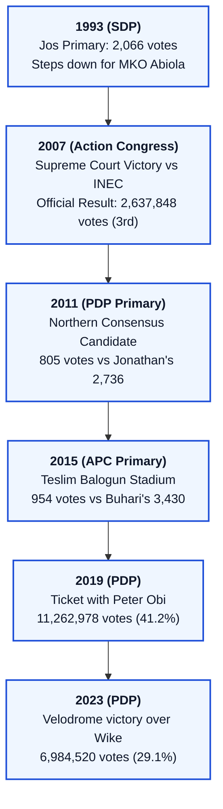

---

### Master Chronology: The 30-Year Trajectory (1993–2023)

| Date | Milestone / Event | Forensic Significance |
| :--- | :--- | :--- |
| **March 27–29, 1993** | **SDP Presidential Primary, Jos** | Atiku finishes 3rd (2,066 votes); steps down for MKO Abiola on the orders of Major-General Shehu Musa Yar'Adua. |
| **January 1999** | **Adamawa Gubernatorial Victory & VP Draft** | Atiku is elected Governor of Adamawa State; Olusegun Obasanjo drafts him as running mate before swearing-in. |
| **May 29, 1999** | **Inauguration as Vice President** | Takes office; appointed Chairman of the National Council on Privatization (NCP); oversees economic reform team. |
| **April 19, 2003** | **Re-election as Vice President** | Obasanjo/Atiku re-elected with 24,456,140 votes (61.9%) after Atiku's near-rebellion at the PDP primary. |
| **2005–2006** | **The Third Term War & Expulsion** | Atiku mobilizes the National Assembly to crush Obasanjo's tenure elongation; Obasanjo strips Atiku of party rights. |
| **December 20, 2006** | **Defection to Action Congress (AC)** | Atiku leaves the PDP; emerges as presidential standard-bearer of the newly formed AC. |
| **April 16, 2007** | ***Atiku Abubakar v. INEC* (Supreme Court)** | Landmark judgment establishing that INEC cannot disqualify candidates without a valid court conviction. |
| **April 21, 2007** | **2007 Presidential Election** | Umaru Yar'Adua declared winner; Atiku officially placed 3rd with 2,637,848 votes amidst massive rigging. |
| **January 2009** | **Reconciliation & Return to PDP** | Atiku visits Obasanjo at Ota Farm; rejoins PDP citing the return of democracy and party reorganization. |
| **January 13, 2011** | **PDP Presidential Primary, Eagle Square** | Selected as Northern Consensus candidate by Adamu Ciroma's NPLF; loses primary to Goodluck Jonathan (805 vs 2,736). |
| **August 31, 2013** | **The "New PDP" (nPDP) Walkout** | Atiku leads 7 governors and National Assembly leaders out of the PDP convention at Eagle Square. |
| **February 2, 2014** | **Defection to APC** | Formally aligns his political structure with the All Progressives Congress to unseat the PDP. |
| **December 10–11, 2014** | **APC Presidential Primary, Lagos** | Finishes 3rd with 954 votes behind Muhammadu Buhari (3,430) and Rabiu Kwankwaso (974). |
| **November 24, 2017** | **Resignation from the APC** | Quits APC, citing institutional betrayal, economic stagnation, and neglect of Nigerian youth. |
| **December 3, 2017** | **Formal Re-entry into PDP** | Re-admitted into the PDP; launches nationwide consultation for the 2019 presidential election. |
| **October 6–7, 2018** | **PDP National Convention, Port Harcourt** | Sweeps PDP presidential primary with 1,532 votes, defeating Aminu Tambuwal (693) and Bukola Saraki (317). |
| **October 12, 2018** | **Selection of Peter Obi as Running Mate** | Chooses former Anambra Governor Peter Obi as VP candidate, forming a pro-business technocratic ticket. |
| **January 17–19, 2019** | **The Washington D.C. Breakthrough** | Visits the United States, staying at Trump International Hotel; breaks the 12-year visa ban narrative. |
| **February 23, 2019** | **2019 Presidential Election** | Secures 11,262,978 votes (41.22%); defeated by Muhammadu Buhari (15,191,847 votes). |
| **May 28–29, 2022** | **PDP Presidential Primary, Abuja Velodrome** | Defeats Nyesom Wike (371 vs 237 votes) after Aminu Tambuwal's last-minute withdrawal. |
| **June 16, 2022** | **Ifeanyi Okowa Selected as Running Mate** | Atiku bypasses Wike despite panel recommendations, sparking the G5 / Integrity Group rebellion. |
| **February 25, 2023** | **2023 Presidential Election** | Splits opposition votes with Peter Obi (LP) and Rabiu Kwankwaso (NNPP); finishes 2nd with 6,984,520 votes to Tinubu's 8,794,726. |
| **October 26, 2023** | **Supreme Court Final Affirmation** | Supreme Court panel led by Justice Inyang Okoro dismisses Atiku's final appeal on CSU certificate and election conduct. |

---

## SECTION 1: THE 30-YEAR SERIAL CANDIDACY RECORD & THE "PARTY HOPPING" ANATOMY (1993–2023)

```mermaid
flowchart LR
    classDef pdp fill:#eff6ff,stroke:#1d4ed8,stroke-width:2px,color:#0f172a;
    classDef ac fill:#fffbeb,stroke:#d97706,stroke-width:2px,color:#0f172a;
    classDef apc fill:#f0fdf4,stroke:#15803d,stroke-width:2px,color:#0f172a;

    P1["<b>PDP Founding</b><br>1998–2006<br>Vice President"]
    A1["<b>Action Congress (AC)</b><br>2006–2009<br>2007 Candidate"]
    P2["<b>PDP Return</b><br>2009–2013<br>2011 Primary"]
    APC["<b>APC Defection</b><br>2013–2017<br>2015 Primary"]
    P3["<b>PDP Final Return</b><br>2017–Present<br>2019 & 2023 Candidate"]

    P1 -->|Fallout with OBJ| A1
    A1 -->|Reconciliation| P2
    P2 -->|nPDP Walkout| APC
    APC -->|Buhari Marginalization| P3

    class P1,P2,P3 pdp;
    class A1 ac;
    class APC apc;
```

---

### 1.1 The Genesis: 1993 SDP Jos Primary & Yar'Adua's PDM Machine
Atiku Abubakar entered national electoral politics as the premier lieutenant of Major-General Shehu Musa Yar'Adua (Tafidan Katsina). Following Yar'Adua's disqualification by General Ibrahim Babangida's military regime in 1992, Yar'Adua deployed his formidable, countrywide political network—the **Peoples Democratic Movement (PDM)**—behind Atiku at the Social Democratic Party (SDP) national convention in Jos, Plateau State, in March 1993.

#### The Jos Convention Results (First Ballot)
The first ballot on March 27, 1993, demonstrated the immense organizational discipline of the PDM:
- **Bashorun M.K.O. Abiola:** 3,617 votes
- **Ambassador Babagana Kingibe:** 3,225 votes
- **Alhaji Atiku Abubakar:** 2,066 votes

Because no candidate achieved the mandatory absolute majority, a runoff between Abiola and Kingibe was required. Yar'Adua instructed Atiku to withdraw and transfer the entire PDM delegate bloc to Abiola. This tactical alliance ensured Abiola's victory over Kingibe. 

> **The Broken Pact:** Under the agreement brokered by Yar'Adua, Abiola was to nominate Atiku Abubakar as his vice-presidential running mate. However, pressure from the SDP Governors' Forum forced Abiola to pick Kingibe instead, producing the historic Muslim-Muslim ticket of June 12, 1993. This established Atiku’s reputation as an indispensable national powerbroker who could command delegates across regional boundaries.

---

### 1.2 The 2007 Action Congress Bid: Supreme Court Triumph & Institutional Warfare
By 2006, President Olusegun Obasanjo was engaged in open warfare with his Vice President after Atiku spearheaded the legislative coalition that demolished Obasanjo’s Third Term constitutional amendment in May 2006. Obasanjo utilized the Economic and Financial Crimes Commission (EFCC), chaired by Nuhu Ribadu, and an executive Administrative Panel of Inquiry to indict Atiku on alleged diversion of Petroleum Technology Development Fund (PTDF) monies.

#### The Defection to Action Congress (AC)
Excluded from the PDP presidential primaries, Atiku allied with Bola Ahmed Tinubu (then Governor of Lagos State), Chief Bisi Akande, Chief Audu Ogbeh, and Chief Tom Ikimi to establish the **Action Congress (AC)**. On December 20, 2006, Atiku was ratified as the AC presidential candidate with Senator Ben Ndi Obi as his running mate.

#### The Constitutional Battleground: *Atiku Abubakar v. INEC* (2007)
The Obasanjo administration directed INEC, led by Professor Maurice Iwu, to exclude Atiku from the ballot on the grounds of his EFCC/administrative panel indictment. Atiku instituted a historic legal defense that reshaped Nigerian constitutional jurisprudence:
1. **The Disqualification Verdict:** On April 16, 2007—a mere five days before the presidential election—the Supreme Court of Nigeria delivered a unanimous, landmark ruling (*SC/69/2007*): **INEC has no constitutional power under the 1999 Constitution to disqualify any candidate sponsored by a registered political party.** Disqualification can only occur through a court of competent jurisdiction.
2. **The Office Protection Verdict:** In *Attorney-General of the Federation v. Atiku Abubakar* (2007), the Supreme Court ruled that a sitting President cannot declare the office of the Vice President vacant, confirming that the Vice President does not hold office at the pleasure of the President.

#### The April 21, 2007 Election Results
Despite the Supreme Court victory, INEC printed ballots without Atiku’s photograph or party logo in several states, and voting logistics were deliberately undermined.

| Candidate | Political Party | Total Votes | Percentage |
| :--- | :--- | :--- | :--- |
| **Umaru Musa Yar'Adua** | Peoples Democratic Party (PDP) | **24,638,063** | 69.82% |
| **Muhammadu Buhari** | All Nigeria Peoples Party (ANPP) | **6,605,299** | 18.72% |
| **Atiku Abubakar** | Action Congress (AC) | **2,637,848** | 7.47% |
| **Orji Uzor Kalu** | Progressive Peoples Alliance (PPA) | 608,803 | 1.73% |
| **Total Valid Votes** | — | **35,282,251** | 100.0% |

*Note: The 2007 election was universally condemned by international observers (EU, Carter Center) as fundamentally fraudulent. President Umaru Yar'Adua himself publicly admitted in his inaugural address that the election that brought him to power was heavily flawed.*

---

### 1.3 The 2011 PDP Primary: The Northern Consensus & Goodluck Jonathan
Following President Umaru Yar'Adua’s death in May 2010, the ascent of Vice President Goodluck Jonathan created a profound constitutional and regional crisis within the PDP. Northern chieftains argued that under the PDP zoning agreement, the North was entitled to complete Yar'Adua's eight-year tenure (2007–2015).

#### The Northern Political Leaders Forum (NPLF)
In late 2010, the Northern Political Leaders Forum (NPLF), chaired by former Finance Minister Mallam Adamu Ciroma, was constituted to screen and select a single consensus candidate from the North to face Goodluck Jonathan.
- **Contenders Screened:** Atiku Abubakar, General Ibrahim Babangida, General Aliyu Mohammed Gusau, and Dr. Bukola Saraki.
- **The Verdict:** In November 2010, the Ciroma committee announced Atiku Abubakar as the Northern Consensus Candidate.

#### The January 13, 2011 PDP Primary (Eagle Square, Abuja)
Goodluck Jonathan deployed the full weight of federal incumbency, state resources, and the support of Southern and middle-belt governors. Atiku mounted an aggressive, fiery defense of the zoning pact, warning the party: *"Those who make peaceful change impossible will make violent change inevitable."*

| Candidate | Regional Base | Delegate Votes | Percentage |
| :--- | :--- | :--- | :--- |
| **Goodluck Ebele Jonathan** | South-South (Incumbent) | **2,736** | 77.03% |
| **Atiku Abubakar** | North-East (Adamawa) | **805** | 22.66% |
| **Sarah Jibril** | North-Central (Kwara) | **1** | 0.03% |
| **Total Valid Votes** | — | **3,552** | 100.0% |

Jonathan's landslide victory fractured the PDP's historic coalition, creating the grievances that would destroy the party four years later.

---

### 1.4 The 2015 APC Primary: The Teslim Balogun Stadium Defeat
On August 31, 2013, Atiku Abubakar led the "New PDP" (nPDP) walkout alongside seven sitting governors (Rotimi Amaechi, Rabiu Kwankwaso, Aliyu Wamakko, Murtala Nyako, Abdulfatah Ahmed, Babangida Aliyu, and Sule Lamido) from the PDP National Convention. In February 2014, Atiku formally declared for the All Progressives Congress (APC).

#### The December 10–11, 2014 APC Primary (Lagos)
The APC presidential primary at Teslim Balogun Stadium in Surulere, Lagos, pitted Atiku's multi-billion-naira campaign apparatus against Muhammadu Buhari’s cult-like Northern grassroots popularity (*Mai Gaskiya*) backed by Bola Ahmed Tinubu’s Southwest political delegates.

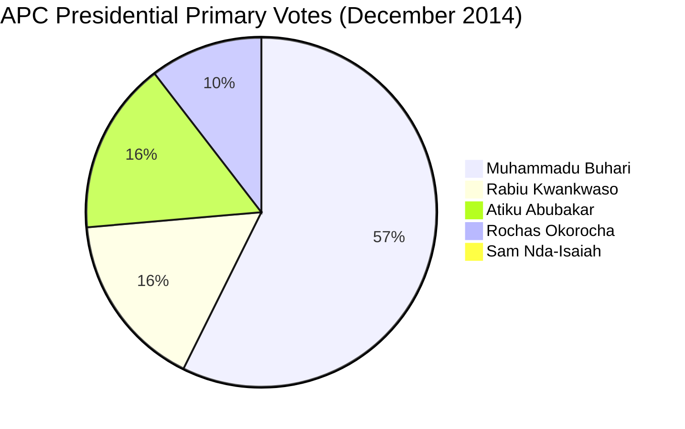

| Candidate | Delegate Votes | Percentage | Outcome |
| :--- | :--- | :--- | :--- |
| **Muhammadu Buhari** | **3,430** | 57.24% | Won APC Ticket |
| **Rabiu Musa Kwankwaso** | **974** | 16.25% | Runner-up |
| **Atiku Abubakar** | **954** | 15.92% | 3rd Place |
| **Rochas Okorocha** | **624** | 10.41% | 4th Place |
| **Sam Nda-Isaiah** | **10** | 0.17% | 5th Place |
| **Total Valid Votes** | **5,992** | 100.0% | — |

Despite outspending his rivals significantly in logistics and delegate engagement, Atiku was squeezed out: Northern governors rallied behind Buhari, while Tinubu directed the Southwest bloc exclusively to Buhari. Atiku conceded gracefully and funded aspects of the APC general election campaign, but he was immediately sidelined by the Buhari Presidency once power was captured in May 2015.

---

### 1.5 Forensic Analysis of Party Defections: Opportunism vs. Pragmatism (1998–2023)

No metric in Nigerian political analysis generates more debate than Atiku Abubakar’s cyclical movements across party lines:

| Transition | From | To | Year | Stated Justification | Realpolitik Driver |
| :--- | :--- | :--- | :--- | :--- | :--- |
| **Phase 1** | PDP | **AC** | **2006** | Totalitarian takeover of PDP by Obasanjo; deregistration of supporters. | Escape disqualification and arrest; secure a platform for the 2007 presidential election. |
| **Phase 2** | AC | **PDP** | **2009** | Reorganization of PDP under Umaru Yar'Adua; return to "founding home". | AC lacked a pan-Nigerian apparatus outside the Southwest; PDP held federal power. |
| **Phase 3** | PDP | **APC** | **2013–14** | Rebellion against Goodluck Jonathan’s corruption, authoritarianism, and zoning breach. | Calculated that Northern anger and Tinubu’s SW machine would unseat Jonathan. |
| **Phase 4** | APC | **PDP** | **2017** | APC’s failure to deliver economic growth, infrastructure, or youth inclusion. | Realization that Buhari's cabal would never permit him to contest the 2019 APC ticket. |

#### The Duality of the "Party Hopper" Label:
1. **The Opportunist Critique (The "Perpetual Vagabond"):** Critics argue that Atiku lacks ideological fidelity. Whenever a party machinery refuses to hand him the presidential ticket, he abandons it, treating political parties not as philosophical institutions but as rental vehicles (*"kabu-kabu"*) purely for presidential transit.
2. **The Pragmatic Defense (The "Constitutional Crusader"):** Atiku’s defenders argue that Nigerian political parties possess zero genuine ideological differentiation. His defections were defensive maneuvers against dictatorial party bosses: in 2006 against Obasanjo's tenure elongation; in 2013 against Jonathan's crushing of internal democracy; and in 2017 against Buhari’s economic paralysis and cabal governance.

---

## SECTION 2: THE 2019 CAMPAIGN & THE BREAKTHROUGH WASHINGTON D.C. VISIT

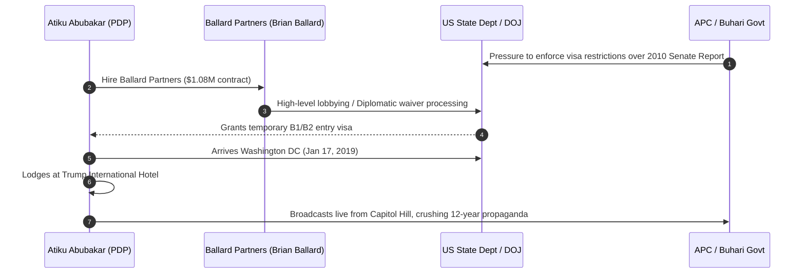

---

### 2.1 The October 2018 Port Harcourt Primary & The Peter Obi Choice
On October 6–7, 2018, at the Adokiye Amiesimaka Stadium in Port Harcourt, Rivers State, Atiku Abubakar scored a decisive victory at the PDP National Convention:
- **Atiku Abubakar:** 1,532 votes
- **Aminu Tambuwal:** 693 votes
- **Bukola Saraki:** 317 votes
- **Rabiu Kwankwaso:** 158 votes
- **Ibrahim Dankwambo:** 111 votes

#### The Peter Obi Selection (October 12, 2018)
To the surprise of regional PDP party bosses, Atiku unilaterally chose **Peter Obi**, former Governor of Anambra State, as his running mate:
- **Strategic Calculation:** Obi brought unmatched fiscal conservatism, frugality, South-East regional loyalty, and immense credibility among the urban middle class and Christian South.
- **The Backlash:** South-East PDP chieftains—notably Governor Dave Umahi of Ebonyi, Governor Ifeanyi Ugwuanyi of Enugu, and Deputy Senate President Ike Ekweremadu—were outraged at not being consulted. While the rift was cosmetically healed, the seeds of South-East elite division were sown.

---

### 2.2 The Washington D.C. Breakthrough (January 17–19, 2019)

#### The 12-Year Visa Ban Narrative
Between 2007 and 2018, the ruling parties (first PDP under Jonathan, then APC under Buhari) maintained a lethal narrative: **Atiku Abubakar could never enter the United States of America because he was an indicted fugitive of the US Department of Justice (DOJ) facing arrest over the 2005 William Jefferson freezer cash scandal and the 2010 US Senate Levin Committee report.** APC Information Minister Lai Mohammed repeatedly challenged Atiku to visit the US if he dared.

#### The Ballard Partners Lobbying Blitz
To dismantle this narrative before the February 2019 election, Atiku’s political machine deployed elite Washington lobbying firm **Ballard Partners**, led by Brian Ballard (a top lobbyist and premier fundraiser for President Donald J. Trump).
- **The Contract:** In September 2018, the PDP retained Ballard Partners under an official Foreign Agents Registration Act (FARA) contract valued at **$90,000 per month ($1.08 million total)**.
- **The Diplomatic Maneuver:** Ballard’s team engaged key figures in the Trump Administration, securing an entry waiver and a US B1/B2 visa for Atiku as an official opposition presidential candidate.

#### The Trump International Hotel Masterstroke
On Thursday, January 17, 2019, Atiku Abubakar touched down at Washington Dulles International Airport, accompanied by Senate President Bukola Saraki.
- **The Residence:** In a politically charged move, Atiku checked into the **Trump International Hotel** on Pennsylvania Avenue, blocks from the White House.
- **The Engagements:** Atiku addressed the US-Nigeria Center for Strategic and International Studies (CSIS), held high-level meetings with US congressmen at Capitol Hill, and met with the Nigerian diaspora community.
- **The Media Fallout:** Images of Atiku standing in front of Capitol Hill and the Trump Hotel were transmitted across Nigerian television networks, instantly incinerating a decade of APC propaganda in a single 48-hour media cycle.

---

### 2.3 The 2019 General Election Results: Forensic Breakdown

The February 23, 2019 presidential election was a brutal, binary contest between the two Northern political giants: Muhammadu Buhari (APC) and Atiku Abubakar (PDP).

| Candidate | Party | Total Votes | Percentage | States Won |
| :--- | :--- | :--- | :--- | :--- |
| **Muhammadu Buhari** | **APC** | **15,191,847** | **55.60%** | **19 States** |
| **Atiku Abubakar** | **PDP** | **11,262,978** | **41.22%** | **17 States + FCT** |
| **Felix Nicolas** | PCP | 110,196 | 0.40% | 0 |
| **Obadiah Mailafia** | ADC | 97,874 | 0.36% | 0 |
| **Total Valid Votes** | — | **27,324,583** | 100.0% | 36 States + FCT |
| **Rejected Ballots** | — | **1,289,607** | — | — |
| **Total Votes Cast** | — | **28,614,190** | — | — |
| **Registered Voters** | — | **82,344,107** | Turnout: **34.75%** | — |

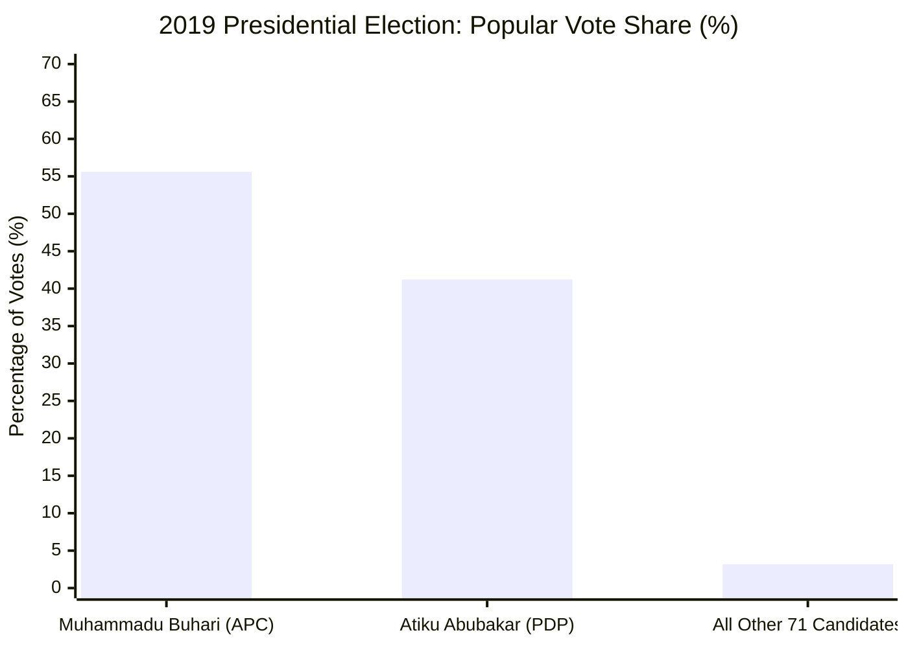

#### Regional Performance Patterns:
1. **The South-East & South-South Fortress:** With Peter Obi on the ticket, Atiku swept the South-East (over 75% in all five states) and South-South, accumulating massive margins in Rivers, Akwa Ibom, and Delta.
2. **The North-West Deficit:** Buhari’s overwhelming dominance in the North-West (capturing Kano, Katsina, and Kaduna by over 2.5 million aggregate votes) created an insurmountable barrier for Atiku.
3. **The Legal Challenge & The "INEC Server" Controversy:** Atiku challenged the result at the Presidential Election Petitions Tribunal (PEPT), claiming results extracted from an alleged internal "INEC Server" showed he defeated Buhari by 1.6 million votes (18,356,732 to 16,741,430). The Supreme Court, led by Chief Justice Tanko Muhammad, dismissed the petition on October 30, 2019, ruling that Atiku failed to prove the existence of an authorized central electronic transmission server under the Electoral Act 2010.

---

## SECTION 3: THE 2022–2023 PRIMARY WAR, G5 GOVERNORS, AND DEFEAT

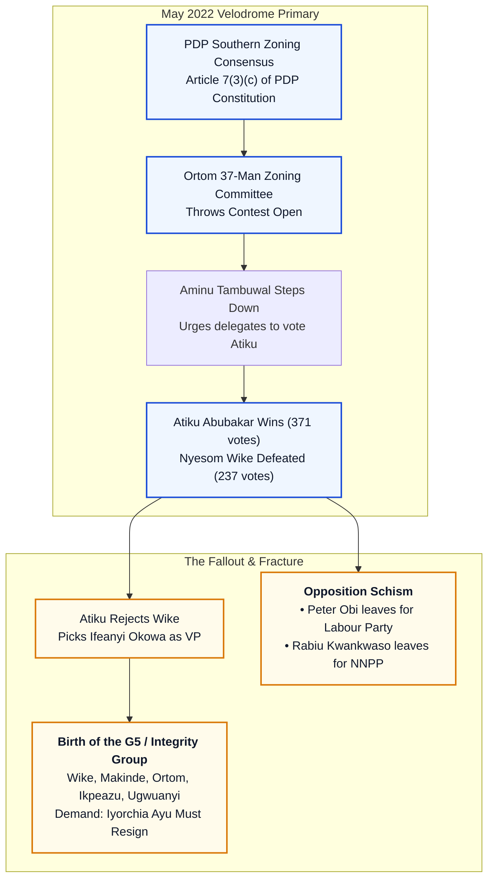

---

### 3.1 The Southern Zoning Crisis & The May 2022 Velodrome Primary
Following President Buhari’s eight-year tenure (2015–2023), Nigeria’s unwritten convention of North-South power rotation dictated that the presidency return to the Southern geopolitical zone. Within the PDP, **Article 7(3)(c)** of the party constitution explicitly affirmed the principle of rotational zoning.

#### The 37-Member Zoning Ambush
In October 2021, Dr. Iyorchia Ayu (from Benue State, North-Central) was elected PDP National Chairman on the explicit understanding that if a Northerner won the presidential ticket, Ayu would step down for a Southerner. However, in April 2022, the 37-member PDP Zoning Committee, chaired by Governor Samuel Ortom of Benue, recommended throwing the presidential contest open due to "exigencies of time."

#### The Velodrome Showdown (May 28–29, 2022)
At the Moshood Abiola National Stadium (Velodrome) in Abuja, Nyesom Wike, Governor of Rivers State, assembled a coalition of Southern governors and deep campaign funding, poised to clinch the ticket. At the 11th hour, Sokoto State Governor **Aminu Waziri Tambuwal** stepped to the podium, withdrew from the race, and instructed all his Northern delegates to vote for Atiku Abubakar.

| Candidate | Geopolitical Zone | Delegate Votes | Share (%) |
| :--- | :--- | :--- | :--- |
| **Atiku Abubakar** | North-East (Adamawa) | **371** | **48.62%** |
| **Nyesom Ezenwo Wike** | South-South (Rivers) | **237** | **31.06%** |
| **Dr. Bukola Saraki** | North-Central (Kwara) | **70** | **9.17%** |
| **Udom Emmanuel** | South-South (Akwa Ibom) | **38** | **4.98%** |
| **Bala Mohammed** | North-East (Bauchi) | **20** | **2.62%** |
| **Anyim Pius Anyim** | South-East (Ebonyi) | **14** | **1.83%** |
| **Sam Ohuabunwa** | South-East (Abia) | 1 | 0.13% |
| **Oliver Diana** | South-East | 1 | 0.13% |
| **Total Valid Votes** | — | **763** | 100.0% |

The Tambuwal maneuver left Wike deeply embittered, an insult compounded when PDP Chairman Iyorchia Ayu visited Tambuwal the next day, embracing him on camera and calling him the *"hero of the convention."*

---

### 3.2 The Running Mate Betrayal: Okowa over Wike & The G5 Revolt
To reconcile the party, Atiku established a 17-member Vice-Presidential Selection Committee comprising governors, National Working Committee (NWC) members, and BoT elders.
- **The Panel Vote:** The panel voted overwhelmingly (reported as **14 to 3**) in favor of nominating Nyesom Wike as running mate.
- **The Decision:** On June 16, 2022, Atiku bypassed Wike and announced Governor **Ifeanyi Arthur Okowa** of Delta State. Atiku believed Wike was volatile, undisciplined, and uncontrollable as a potential vice president.

#### The Revolt of the G5 (The "Integrity Group")
Wike forged an alliance with four other sitting PDP governors:
1. **Nyesom Wike** (Rivers State)
2. **Seyi Makinde** (Oyo State)
3. **Samuel Ortom** (Benue State)
4. **Okezie Ikpeazu** (Abia State)
5. **Ifeanyi Ugwuanyi** (Enugu State)

The G5’s non-negotiable demand: **National Chairman Iyorchia Ayu must resign** to ensure regional equity, as both the presidential candidate (Atiku) and the party chairman (Ayu) were Northern Muslims/Christians. Atiku and Ayu refused to yield, arguing that Ayu could only resign after Atiku won the presidency. The G5 boycotted Atiku’s campaign rallies, denied him logistical access in their states, and actively channeled state resources to rival candidates (Wike and Makinde backed Bola Tinubu; Ortom endorsed Peter Obi).

---

### 3.3 The Three-Way Opposition Schism: The Exodus of Obi and Kwankwaso
Atiku's determination to contest the 2022 primary shattered the PDP's 2019 coalition:
1. **Peter Obi’s Exit (May 25, 2022):** Sensing that money politics and regional delegate manipulation would disenfranchise him at the PDP primary, Peter Obi resigned from the PDP and joined the **Labour Party (LP)**. Within months, Obi catalyzed the youth-driven "Obidient" movement, dismantling the PDP’s traditional fortress in the South-East, South-South, and urban centers.
2. **Rabiu Kwankwaso’s Exit (March 2022):** Alienated by PDP national leadership, former Kano Governor Rabiu Musa Kwankwaso defected to the **New Nigeria Peoples Party (NNPP)**, locking down the massive voting population of Kano State with his red-cap *Kwankwasiyya* movement.

---

### 3.4 Forensic Breakdown of the February 25, 2023 Presidential Election

The splintered opposition transformed the 2023 presidential election into Nigeria’s first genuine four-horse race:

| Candidate | Party | Total Votes | Percentage | States Won |
| :--- | :--- | :--- | :--- | :--- |
| **Bola Ahmed Tinubu** | **APC** | **8,794,726** | **36.61%** | **12 States** (SW, NC, NW) |
| **Atiku Abubakar** | **PDP** | **6,984,520** | **29.07%** | **12 States** (NE, NW, SS) |
| **Peter Gregory Obi** | **LP** | **6,101,533** | **25.40%** | **11 States + FCT** (SE, SS, NC, Lagos) |
| **Rabiu Musa Kwankwaso** | **NNPP** | **1,496,687** | **6.23%** | **1 State** (Kano) |
| **Other 14 Candidates** | Others | 648,474 | 2.69% | 0 |
| **Total Valid Votes** | — | **24,025,940** | 100.0% | 36 States + FCT |
| **Rejected Ballots** | — | **939,278** | — | — |
| **Total Votes Cast** | — | **24,965,218** | Turnout: **26.71%** | — |

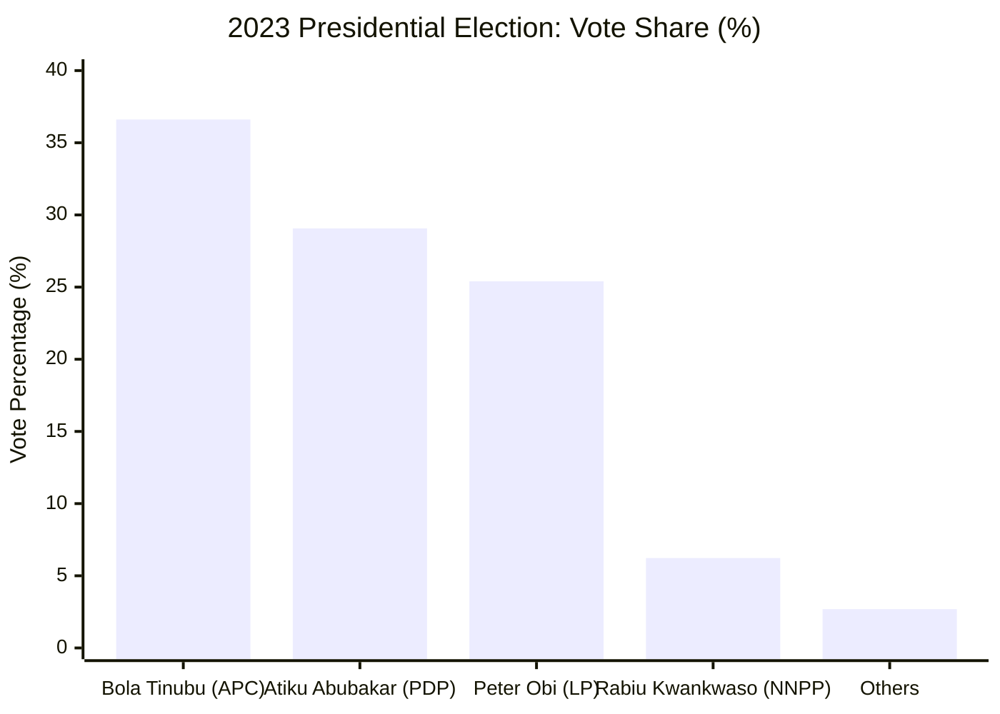

---

### 3.5 The "What If" Opposition Unity Analysis: How Atiku Lost the Presidency

The forensic arithmetic of the 2023 election confirms that **Atiku Abubakar and the fractured opposition defeated themselves.** 

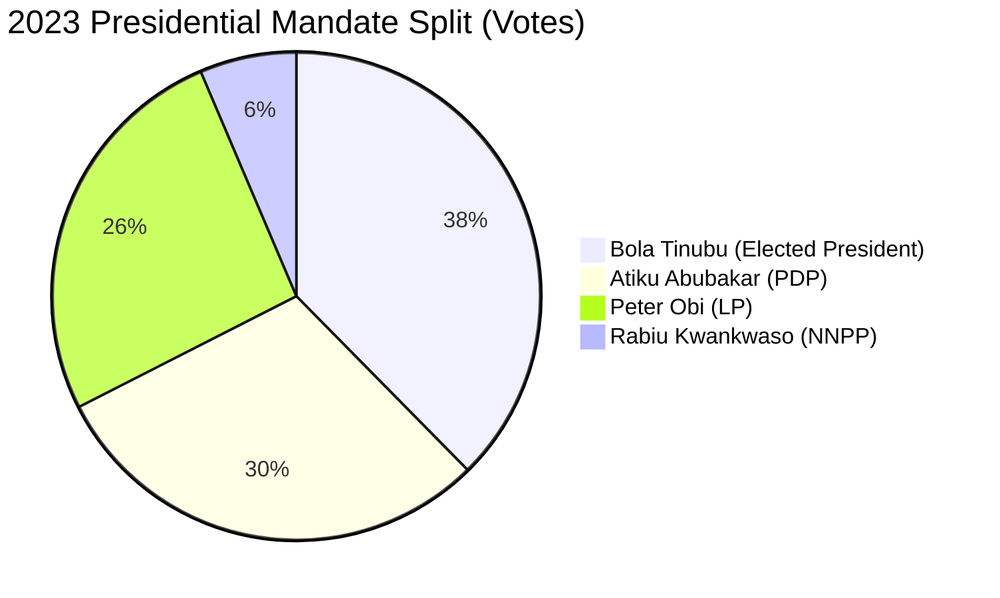

| Electoral Coalition | Combined Votes | Share of Total | Victory Margin over Tinubu |
| :--- | :--- | :--- | :--- |
| **Bola Ahmed Tinubu (APC Winner)** | **8,794,726** | **36.61%** | Baseline |
| **Atiku Abubakar + Peter Obi** | **13,086,053** | **54.47%** | **+4,291,327 votes** |
| **Atiku + Obi + Kwankwaso (Original 2019 Bloc)** | **14,582,740** | **60.70%** | **+5,788,014 votes** |

#### Key Takeaway:
Tinubu achieved victory with the lowest winning percentage (36.61%) in Nigerian presidential history. Over **63.39% of Nigerian voters rejected the ruling APC**, yet the opposition could not capitalize because Atiku refused to step aside for a Southern candidate, driving Obi into the Labour Party and alienating Wike's G5 bloc.

---

## SECTION 4: ECONOMIC & GOVERNANCE ROADMAP: IDEOLOGICAL BLUEPRINT

Unlike the vast majority of Nigerian politicians whose platforms consist of vague populist rhetoric, Atiku Abubakar has presented the most ideologically consistent, articulate **neoliberal free-market and federalist restructuring roadmap** in contemporary African governance. Outlined across his policy documents—*The Atiku Plan: Get Nigeria Working Again* (2019) and *My Covenant With Nigerians* (2023)—his blueprint rests upon three pillars:

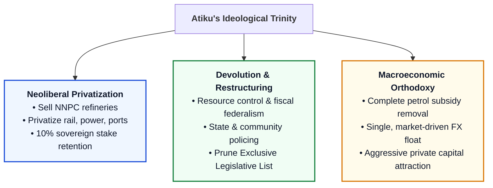

---

### 4.1 Unapologetic Neoliberal Privatization: "Sell NNPC Even If They Kill Me"
Drawing on his experience as Chairman of the National Council on Privatization (1999–2003), Atiku has argued that state enterprises are corrupt money sinks that cripple national productivity.

#### The Defining 2019 Lagos Declaration:
On January 16, 2019, during an interactive session with the business community at the Eko Hotel & Suites, Lagos, Atiku delivered his most famous economic pledge:
> *"I am committed to privatising NNPC, I said it. I swear. Even if they are going to kill me, I will do it. We must privatise it to break the cabal and turn it into a transparent, profitable commercial entity like Saudi Aramco."*

#### Key Structural Privatization Targets:
1. **The NNPC & Refineries:** Complete privatization of all four state-owned refineries (Port Harcourt I & II, Warri, Kaduna) which consumed billions of dollars in Turn-Around Maintenance (TAM) with zero output. Selling up to 90% of the Nigerian National Petroleum Corporation on the open market, retaining only a 10% sovereign equity holding.
2. **Infrastructure Concessions:** Concessioning transmission lines of the national electric grid, concessioning all major federal highways to private toll-road operators, and concessioning Nigerian ports and railway corridors.

---

### 4.2 Devolution of Powers & Restructuring: The 2016–2023 Manifesto
Starting in 2016 at a book launch in Kaduna, Atiku astonished the Northern conservative political establishment by becoming the foremost Northern champion of **National Restructuring** and **True Federalism**.

#### The Core Policy Commitments:
1. **Pruning the Exclusive Legislative List:** Amending the 1999 Constitution to transfer critical items from the 68-item Exclusive List to the Concurrent List—including railway infrastructure, mineral resources, environmental management, and internal security.
2. **State and Community Policing:** Dismantling the unitary, command-and-control Nigeria Police Force (NPF) to permit federating states to establish, fund, and control their own State Police services.
3. **Fiscal Federalism & Resource Control:** Incrementally increasing derivation revenues to mineral-producing regions (from 13% toward 50%), ending "feeding-bottle federalism" where states rely on monthly federal allocations from the Federation Account Allocation Committee (FAAC).

---

### 4.3 Monetary & Fiscal Orthodoxies: Subsidy Elimination and Naira Floatation
Long before President Bola Tinubu implemented "shock therapy" on May 29, 2023, Atiku had proposed the identical orthodox market package in his 2019 and 2023 manifestos:
1. **Petrol Subsidy Abolition:** Atiku repeatedly condemned the Premium Motor Spirit (PMS) subsidy as an institutionalized conduit for monumental treasury theft, pledging to eliminate it within his first 100 days and direct savings into education and infrastructure.
2. **Foreign Exchange Floatation:** Advocated the total collapse of the Central Bank of Nigeria's (CBN) corrupt multiple-window exchange rate regime in favor of a market-determined, unified floating exchange rate.
3. **The Contrast with Tinubu:** When Tinubu implemented these exact policies in 2023, Atiku sharply criticized not the *direction* of the reforms, but their *reckless execution*—decrying the total absence of cushioning social safety nets, macroeconomic sequencing, and transparent implementation.

---

## SECTION 5: BUSINESS EMPIRE, COMMERCIAL MONOPOLIES, AND PHILANTHROPIC FOOTPRINT

Atiku Abubakar is one of Nigeria's wealthiest private citizens, having built a sprawling commercial conglomerate spanning logistics, higher education, beverage manufacturing, agriculture, real estate, and media.

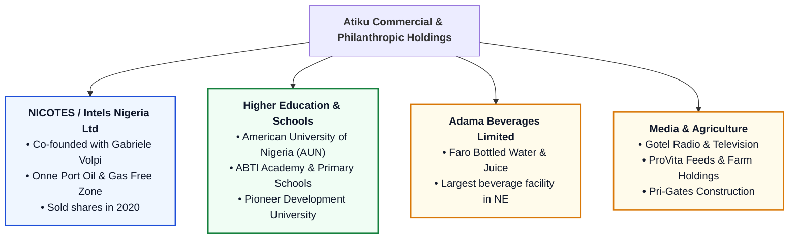

---

### 5.1 NICOTES / Intels Nigeria Limited: The Port Logistics Monopoly
In the early 1980s, while serving as a senior officer in the Department of Customs and Excise, Atiku co-founded **Nigeria Container Services (NICOTES)** with Italian-Swiss businessman **Gabriele Volpi**. 
- **The Transition to Intels:** NICOTES later rebranded as **Integrated Logistics Services (Intels)**, securing exclusive concession rights to operate oil service bases at Onne Port in Rivers State, Warri Port, and Calabar Port.
- **The Cash Cow:** Intels grew into an indispensable multi-billion-naira maritime monopoly, managing port handling, offshore platform logistics, and comprehensive pilotage services for international oil companies (IOCs) including Shell, Chevron, and ExxonMobil.
- **The Political Strangling (2017–2020):** Following Atiku's defection to the PDP in 2017, the Buhari administration launched a sustained offensive against Intels. The Nigerian Ports Authority (NPA), headed by Hadiza Bala Usman, cancelled Intels’ boat service monitoring contract and revoked its concession. In January 2021, Atiku announced he had divested all his equity holdings in Intels to Orlean Invest Group for hundreds of millions of dollars, accusing the APC regime of political persecution.

---

### 5.2 Education Footprint: American University of Nigeria (AUN), Yola
Founded in 2004 as ABTI-American University of Nigeria, **AUN** represents Atiku's most enduring philanthropic and educational legacy.
- **The American Partnership:** Established in formal academic affiliation with the **American University in Washington, D.C.**, AUN was structured as Africa's first "Development University"—focusing on entrepreneurship, STEM, technology, and community development.
- **Infrastructure & Innovation:** The university features one of the most advanced digital libraries in West Africa, massive solar power grids, and an international faculty body.
- **Chibok Girls Philanthropy:** Following the 2014 Boko Haram abduction of the Chibok schoolgirls, Atiku sponsored full academic scholarships, psychological rehabilitation, and tertiary education for dozens of escaped and released Chibok girls at AUN.

---

### 5.3 Corporate Holdings: Faro Water, Gotel Communications, & Agro-Allied Firms
1. **Adama Beverages Limited (Faro):** Located in Yola, Adama Beverages is the manufacturer of **Faro Water** (bottled water, sachet water) and Faro fruit juices. It is one of the largest modern bottling plants in Northern Nigeria, distributing products across Nigeria and into the neighboring Republic of Cameroon.
2. **Gotel Communications:** Operates Gotel Radio and Gotel Television broadcasting services from Yola and Abuja.
3. **ProVita Feeds:** Animal and livestock feed production company, supporting the cattle and livestock industry in the Northeast.
4. **Pri-Gates Limited:** Real estate and construction engineering firm executing private commercial developments across Abuja, Kaduna, and Yola.

---

### 5.4 Macroeconomic Employment Footprint in Adamawa & Northeast Nigeria
In Adamawa State and the wider Northeast geopolitical zone, Atiku Abubakar’s corporate footprint is structurally foundational:
- **Direct Employment:** His enterprises directly employ over **12,000 workers** across education, manufacturing, agriculture, media, and security services.
- **Indirect Livelihoods:** Over **50,000 indirect jobs** (distributors, farmers, suppliers, logistics contractors) depend directly on the operations of Adama Beverages, AUN, and his agricultural farms.
- **State Economic Status:** Outside of the Adamawa State Government itself, **Atiku Abubakar is the single largest employer of labor in Adamawa State**, injecting billions of Naira into the local economy every year.

---

## SECTION 6: THE FORENSIC HISTORICAL AUDIT: A BALANCED VERDICT

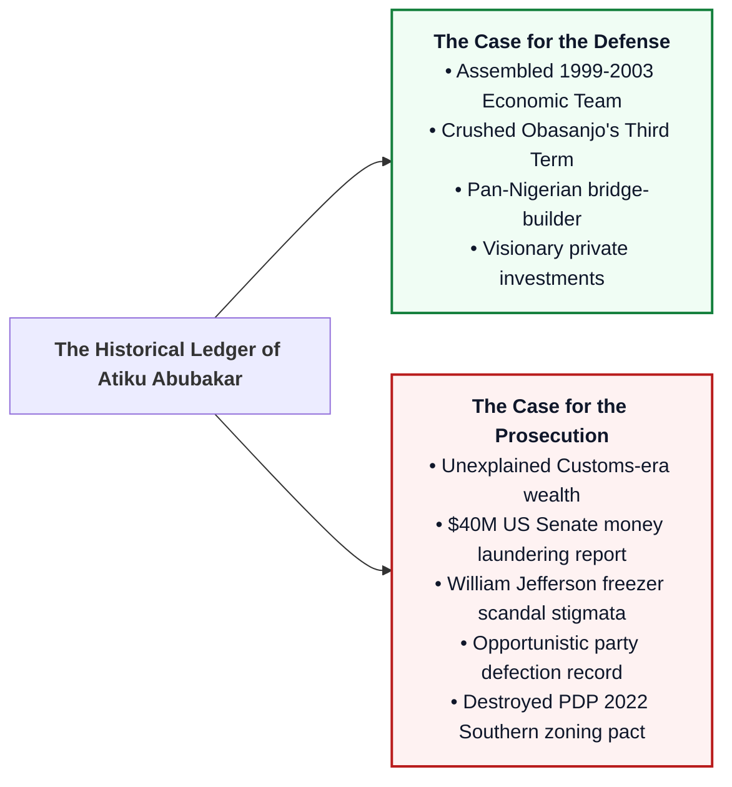

---

### 6.1 The Case for the Defense: Modernizer, Bridge-Builder, and Constitutional Guardian

#### 1. Architect of the Golden Age of Nigerian Economic Reform (1999–2003)
As Vice President and Chairman of the National Council on Privatization (NCP), Atiku Abubakar was the political shield and talent scout that assembled Nigeria's most celebrated economic management team:
- **Technocratic Recruitment:** Handpicked and supported Dr. Ngozi Okonjo-Iweala (Finance), Mallam Nasir El-Rufai (Bureau of Public Enterprises), Prof. Chukwuma Soludo (Economic Adviser / CBN), and Dr. Oby Ezekwesili (Due Process / Solid Minerals).
- **The GSM Revolution:** Oversaw the transparent, globally acclaimed 2001 Digital Mobile Licensing auction conducted by the Nigerian Communications Commission (NCC), which introduced GSM telephony to Nigeria and catalyzed the modern digital economy.
- **Economic Liberalization:** Commenced the deregulation of banking, cement, and pensions that laid the structural foundation for Nigeria's 6–8% annual GDP growth through the mid-2000s.

#### 2. The Savior of Nigerian Constitutional Democracy (The Third Term Battle)
Between 2005 and 2006, President Olusegun Obasanjo attempted to manipulate the National Assembly into altering the 1999 Constitution to grant him an unconstitutional third term. 
- Atiku Abubakar put his life, office, and political future on the line, openly breaking with Obasanjo.
- He bankrolled and organized the legislative resistance in the Senate and House of Representatives (coordinating with Senator Ken Nnamani, Aminu Bello Masari, and opposition governors), culminating in the historic defeat of the Third Term bill on May 16, 2006. 
- Without Atiku’s courage and delegate machinery, Nigeria might have devolved into a civilian autocracy.

#### 3. The Authentic Pan-Nigerian Bridge-Builder
In a nation fractured by toxic ethnic and religious chauvinism, Atiku is one of the few national figures whose social and political roots genuinely transcend the Niger and Benue rivers:
- **Marital Alliances:** Married across Nigeria’s cultural boundaries—Titilayo (Yoruba from Osun State), Laila (Moroccan), Jamila / Jennifer Douglas (Igbo from Anambra State), and Fatima (Kanuri/Fulani from Borno).
- **Political Coalitions:** Consistently capable of winning millions of votes in the South-East, South-South, and North-Central, maintaining relationships across every senatorial district in the federation.

---

### 6.2 The Case for the Prosecution: The Unanswered Questions

#### 1. The Mysterious Origins of Civil Service Wealth
Atiku joined the Department of Customs and Excise in 1969 and retired in 1989 as Deputy Director of Customs. While in active service, he co-founded NICOTES (Intels) and accumulated massive real estate and logistical holdings.
- **The Legal Violation:** The 1979 and 1999 Nigerian Constitutions and Civil Service Rules strictly prohibit full-time public officers from engaging in private commercial enterprises other than farming. Atiku’s rationalization that he was merely a shareholder fails to explain how a middle-ranking civil servant obtained the initial capital to co-own a port logistics monopoly.

#### 2. The 2010 US Senate Levin Committee Report ($40 Million Money Laundering)
On February 4, 2010, the **US Senate Permanent Subcommittee on Investigations**, chaired by Senator Carl Levin, published the forensic report: *“Keeping Foreign Corruption Out of the United States: Four Case Histories.”*
- **The Findings:** The report documented that between 2000 and 2008, Atiku’s fourth wife, Jennifer Douglas (a US citizen), funneled over **$40 million in suspect funds** into the United States via more than 30 bank accounts.
- **Offshore Shells:** Millions of dollars were wired through opaque offshore companies including *LetsGo Ltd. Inc.*, *Guernsey Trust Company Nigeria Ltd.*, and *Sima Holding Ltd.* 
- **Multinational Bribery:** The US Senate report documented that Siemens AG wired over $1.6 million in illicit bribes into Jennifer Douglas's US accounts as part of a global bribery scheme for telecom contracts in Nigeria.

#### 3. The Congressman William Jefferson Freezer Scandal (2005)
In 2005, the FBI raided the home of Louisiana Democratic Representative William J. Jefferson, famously discovering **$90,000 in cash wrapped in aluminum foil inside frozen food boxes in his freezer**.
- **The Investigation:** FBI wiretaps revealed Jefferson soliciting hundreds of thousands of dollars from businesswoman Lori Mody, claiming $100,000 was earmarked as a bribe for Vice President Atiku Abubakar to approve telecom licenses for iGate and NDTV in Nigeria.
- **The Reality:** Jefferson was convicted and sentenced to 13 years in federal prison. Although Atiku was never formally indicted by the DOJ—and Jefferson testified that he was merely "name-dropping" Atiku to extort money from Mody—the FBI raided Atiku's residence in Potomac, Maryland, cementing an enduring international cloud of suspicion.

#### 4. The 2022 Zoning Breach: Sowing the Seeds of PDP Self-Destruction
Atiku's refusal to respect the historic North-South power rotation in 2022 stands as his most disastrous strategic failure. By bulldozing his way to the PDP presidential nomination after eight years of Northern rule under Buhari, Atiku:
- Violated the fundamental equity pact that held the PDP together.
- Precipitated the exits of Peter Obi and Rabiu Kwankwaso.
- Provoked the implacable rebellion of the G5 governors.
- Directly enabled Bola Ahmed Tinubu to capture the presidency with a minuscule 36.6% mandate.

---

### 6.3 Comprehensive Forensic Scorecard

| Historical Domain | Score (1–10) | Forensic Assessment |
| :--- | :---: | :--- |
| **Economic Vision & Reform** | **8.5 / 10** | Unmatched ideological clarity; pioneer of privatization, telecom revolution, and fiscal orthodoxy. |
| **Constitutional Defense** | **9.0 / 10** | Stopped Obasanjo’s Third Term autocracy; established historic Supreme Court protections for candidacy and VP independence. |
| **National Bridge-Building** | **8.0 / 10** | Unrivalled cross-regional marital, commercial, and political network across all 36 states. |
| **Financial Transparency** | **3.0 / 10** | Indelibly tainted by Customs-era origins, the $40M US Senate report, Siemens bribes, and offshore trusts. |
| **Ideological & Party Loyalty** | **2.5 / 10** | Chronic serial party hopping (PDP → AC → PDP → APC → PDP); treated parties as disposable presidential vehicles. |
| **Realpolitik Strategy (2022–23)** | **2.0 / 10** | Fatal hubris; broke the zoning consensus, alienated the South-East, and gifted the presidency to Tinubu. |
| **Overall Historical Index** | **5.5 / 10** | **A visionary modernizer undone by insatiable ambition and ethical baggage.** |

---

### 6.4 Concluding Assessment: The Tragic Kingmaker Who Could Not Crown Himself

Atiku Abubakar’s political career is a classical tragedy of Shakespearean proportions. Blessed with an extraordinary intellect, immense private wealth, genuine cosmopolitan liberalism, and a deep appreciation for technocratic competence, he possessed all the tools to be one of Nigeria's most transformative presidents. He built kings: he funded M.K.O. Abiola in 1993, carried Olusegun Obasanjo to victory in 1999 and 2003, and provided the financial and logistical artillery that built the APC and made Muhammadu Buhari president in 2015.

Yet, he could never crown himself. 

His fatal flaw was an all-consuming, transactional ambition that prioritized the presidency above institutional cohesion, regional equity, and moral consistency. By repeatedly hopping from party to party whenever his ambitions were checked, he hollowed out the institutional fabric of Nigerian party democracy. And in 2022, when statesmanship demanded that he step aside and midwife a Southern succession to heal a fractured republic, he instead chose to grasp at power one last time. 

In doing so, he split his own party, alienated his most vital regional allies, and watched helplessly as the presidency slipped through his fingers forever—leaving him as the greatest president Nigeria never had.

---
*END OF INVESTIGATIVE DOSSIER • CIVIC LENS RESEARCH FLEET (AGENT 5)*
