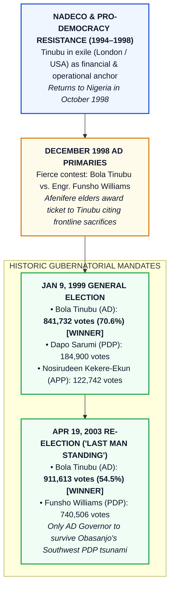
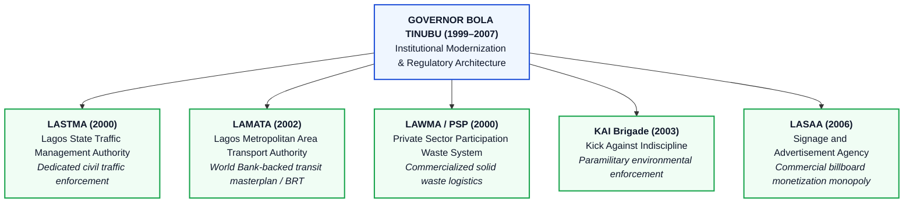
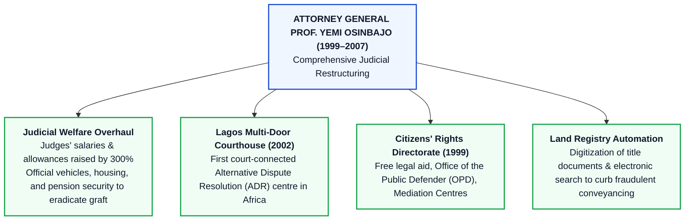
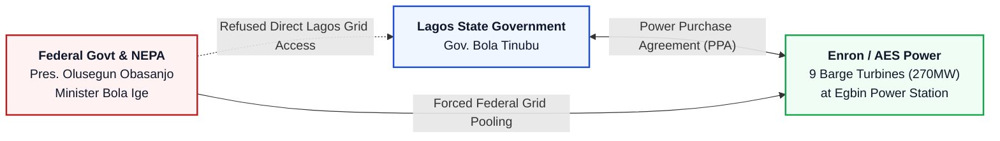
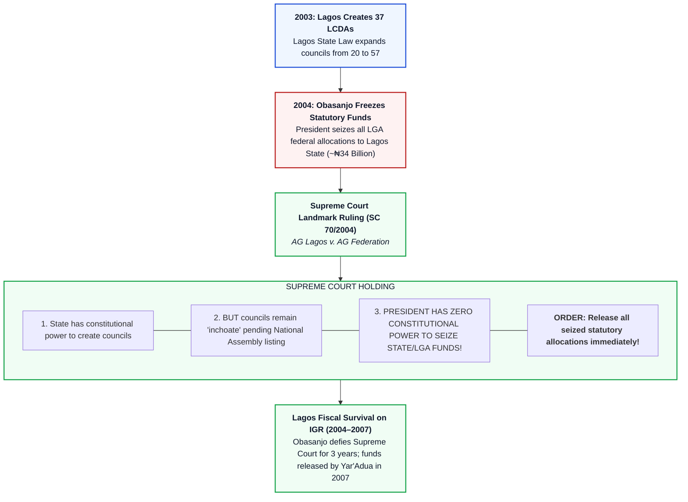
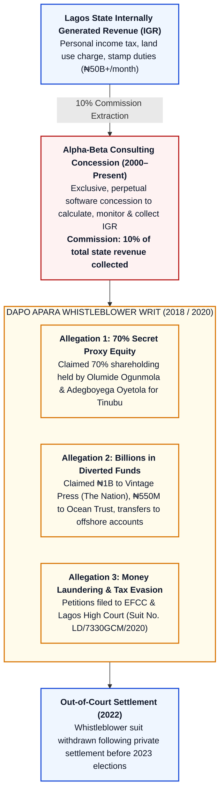
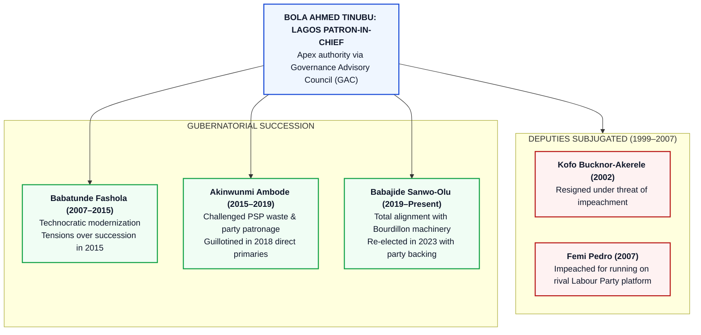

# CIVIC LENS INVESTIGATIVE DOSSIER & FORENSIC AUDIT
**TOPIC: Bola Ahmed Tinubu’s 8-Year Governorship of Lagos State (1999–2007) — Institutional Modernization vs. Godfatherism, State Capture, and Corruption Scandals**  
**CASE FILE: CL-INVESTIGATION-NIG-003**  
**PREPARED BY: Agent 3 (Civic Lens Investigative Research Fleet)**  
**TARGET: Editorial, Research & Documentary Scriptwriting Team**  
**DATE: October 2026**

---

## EXECUTIVE SUMMARY & INVESTIGATIVE PREMISE

> *"To understand contemporary Nigeria, one must understand Lagos. And to understand Lagos, one must untangle the paradox of Bola Ahmed Tinubu: the NADECO financier who built Africa's most formidable sub-national tax apparatus, resisted an imperial presidency, and created durable municipal institutions—while simultaneously establishing a private political monopoly, an opaque revenue concession yielding billions in private commissions, and an unbroken succession dynasty that reduced an entire mega-city to a family fiefdom."*

This forensic audit investigates the eight-year administration of **Bola Ahmed Tinubu** as the 12th Governor of Lagos State (May 29, 1999 – May 29, 2007) and examines the foundational structures he built that continue to govern Nigeria’s commercial nerve center.

The dossier analyzes two inextricably linked realities:
1. **The Modernization Blueprint:** How an embattled governor took a nearly bankrupt state generating only ~₦600 million monthly, surrounded by garbage mountains and gridlocked roads, and transformed it into a self-sustaining fiscal powerhouse through targeted institution-building (LASTMA, LAWMA, LAMATA, KAI, LASAA), judicial overhaul under Prof. Yemi Osinbajo, and groundbreaking constitutional warfare that redefined Nigerian federalism.
2. **The Forensic Dark Side:** How that very machinery of modernization was leveraged to birth a private tax monopoly (**Alpha-Beta Consulting**), capture prime waterfront and metropolitan real estate, enforce total political subjugation through the serial destruction of deputy governors and handpicked successors, and culminate in brazen displays of cash politics symbolized by the armored bullion vans at his Bourdillon residence.

---

## 1. 1999 ELECTION & POLITICAL EMERGENCE: NADECO CAPITAL TO STATE POWER

| Gubernatorial Contest | Candidates & Vote Figures | Strategic Outcome & Historical Significance |
| :--- | :--- | :--- |
| **Dec 1998 AD Primary** | Bola Tinubu vs. Engr. Funsho Williams | Disputed count overturned by Abraham Adesanya / Ayo Adebanjo elders, citing NADECO frontline sacrifices. |
| **Jan 9, 1999 Election** | **Bola Tinubu (AD): 841,732 (70.6%)** Dapo Sarumi (PDP): 184,900 Nosirudeen Kekere-Ekun (APP): 122,742 | Landslide victory; inaugurates Fourth Republic governance in Lagos State. |
| **Apr 19, 2003 Election** | **Bola Tinubu (AD): 911,613 (54.5%)** Funsho Williams (PDP): 740,506 | **'Last Man Standing'**: Obasanjo swept Ogun, Oyo, Osun, Ondo, Ekiti; Tinubu alone survived to preserve the opposition redoubt. |

### A. The Fierce Alliance for Democracy (AD) Primary (December 1998)
Upon his return to Nigeria from exile in October 1998 following the death of military dictator General Sani Abacha, Bola Ahmed Tinubu entered the gubernatorial race under the banner of the **Alliance for Democracy (AD)**, the dominant progressive Yoruba political party.

* **The Opponents:** His primary rival was **Engr. Anthony Olufunsho Williams**, a popular, soft-spoken former Lagos State Commissioner for Works under military administrator Col. Olagunsoye Oyinlola. Williams commanded a massive grassroots network known as the **Network Alliance** and enjoyed the staunch backing of the Lagos AD party establishment led by **Alhaji Ganiyu Dawodu** (Chairman of Lagos AD and leader of the PRIMROSE group). Other contestants included Senator Kofoworola Bucknor-Akerele and Dr. Wahab Dosunmu.
* **The Contested Primary:** In the December 1998 primaries, Funsho Williams initially surged ahead in official vote tallies across the local councils. However, the Tinubu campaign alleged massive electoral fraud and violence in Williams’ strongholds, specifically in Lagos Mainland, Ikorodu, and Epe.
* **The Afenifere Intervention:** The apex Yoruba socio-political organization, **Afenifere**—led by **Pa Abraham Adesanya**, Chief Ayo Adebanjo, Chief Solanke Onasanya, and Senator Abraham Adesanya—wielded absolute moral and political authority within the AD. The elders favored Tinubu for two primary reasons:
  1. *NADECO Solidarity:* Tinubu had heavily funded the National Democratic Coalition (NADECO), Radio Kudirat, and the pro-democracy struggle from exile at grave personal risk, while Williams had served within the military government.
  2. *Disqualification of Contested LGAs:* The party’s electoral appeals panel, influenced by the Afenifere leadership, invoked internal guidelines requiring the cancellation of results from wards and councils marred by violence.
* **The Aftermath:** With the votes from disputed areas excised, Bola Tinubu was officially declared the AD gubernatorial flagbearer. To bridge the bitter intra-party factional divide, the Afenifere leadership imposed **Senator Kofoworola Bucknor-Akerele** as his running mate. A disgruntled Funsho Williams and his supporters felt cheated of their mandate, triggering a deep political feud that led Williams to defect to the Peoples Democratic Party (PDP) in late 2001.

### B. The 1999 General Election Victory
The general election took place on **January 9, 1999**:
* **Bola Ahmed Tinubu (AD):** 841,732 votes (70.6%)
* **Dapo Sarumi (PDP):** 184,900 votes (15.5%)
* **Nosirudeen Kekere-Ekun (APP):** 122,742 votes (10.3%)
* **Returning Officer:** Prof. Jelili Omotola (Vice-Chancellor, University of Lagos).
* **Sworn in:** May 29, 1999, taking over from the last military administrator, Colonel Mohammed Buba Marwa.

### C. The 2003 PDP "Tsunami" & "The Last Man Standing"
Ahead of the April 2003 general elections, President Olusegun Obasanjo sought to consolidate the ruling PDP’s dominance across the Southwest, Obasanjo’s geopolitical home region where he had been rejected in 1999.

* **The Afenifere–Obasanjo "Pact":** The Afenifere elders entered an informal gentleman's agreement with Obasanjo: the AD governors would not field a presidential candidate against Obasanjo in exchange for the federal government allowing the five AD governors to retain their states without federal interference.
* **Tinubu’s Rejection of the Trap:** Tinubu alone smelled betrayal and warned his fellow Southwest governors (Chief Bisi Akande in Osun, Chief Olusegun Osoba in Ogun, Otunba Niyi Adebayo in Ekiti, Chief Adebayo Adefarati in Ondo, and Alhaji Lam Adesina in Oyo) that Obasanjo was executing a political ambush. The other five governors trusted the pact.
* **The April 19, 2003 Electoral Slaughter:**
  * **Ogun:** Gbenga Daniel (PDP) defeated Segun Osoba (AD).
  * **Osun:** Olagunsoye Oyinlola (PDP) defeated Bisi Akande (AD).
  * **Oyo:** Rashidi Ladoja (PDP) defeated Lam Adesina (AD).
  * **Ondo:** Olusegun Agagu (PDP) defeated Adebayo Adefarati (AD).
  * **Ekiti:** Ayodele Fayose (PDP) defeated Niyi Adebayo (AD).
* **Lagos Result:**
  * **Bola Ahmed Tinubu (AD):** 911,613 votes (54.5%)
  * **Anthony Olufunsho Williams (PDP):** 740,506 votes (44.3%)
* **Strategic Consequence:** Bola Tinubu survived as the **"Last Man Standing."** He became the sole progressive opposition governor in Nigeria’s richest and most populous state. This survival gave him complete control over the remnants of the AD, which he subsequently transformed into the **Action Congress (AC)** in 2006, then the **Action Congress of Nigeria (ACN)**, and ultimately merged into the **All Progressives Congress (APC)** in 2013.

---

## 2. INSTITUTIONAL & MODERNIZATION MILESTONES: THE "LAGOS MASTERPLAN"

When Tinubu assumed office on May 29, 1999, Lagos was on the verge of fiscal and municipal collapse:
- Monthly wage bill: ~₦800 million.
- Internally Generated Revenue (IGR): Barely ~₦600 million per month.
- Refuse disposal had completely collapsed; mountains of decaying garbage blocked commercial arteries in Oshodi, Mushin, and Ojuelegba.
- The state was reliant on unpredictable federal statutory allocations.

Tinubu’s administration responded with an aggressive modernization doctrine, convening the **Ehingbeti Lagos Economic Summit** in 2000 to formulate a 10-point economic agenda and long-term masterplan.

| Regulatory Institution | Year Established | Statutory Mandate & Institutional Legacy |
| :--- | :--- | :--- |
| **LASTMA** | 2000 | Created under Lagos State Law No. 9 to de-link traffic control from the corrupt Federal Police; empowered civil wardens to impound and fine offenders. |
| **LAMATA** | 2002 | Founded with World Bank technical backing to plan multi-modal transport; designed and executed Africa's first Bus Rapid Transit (BRT) corridor. |
| **LAWMA Modernization** | 2000 | Overhauled the state refuse disposal board into a modern waste regulator; franchised collection to 350+ private PSP operators. |
| **KAI Brigade** | 2003 | Enforced public health edicts, banned street hawking on expressways, and reclaimed pedestrian bridges from vagrants. |
| **LASAA** | 2006 | Centralized outdoor advertising; banned unauthorized street banners and generated billions annually in corporate signage royalties. |

### A. The Internally Generated Revenue (IGR) Trajectory
The core engine of Tinubu's governance model was the fiscal transformation of the tax collection machinery.

#### Verified Revenue Data (1999–2007 vs. Present Day):
* **1999 Baseline:** ~₦600 Million/month (~₦14.6 Billion total annual revenue; recurrent expenditure far outstripped local revenue).
* **2003 Mid-term:** ~₦2.5 Billion to ₦3.2 Billion/month.
* **2007 Handover:** ~₦7.5 Billion to ₦8.2 Billion/month (~₦83.6 Billion to ₦90 Billion annual IGR).
* **Long-term Legacy (2024–2026):** Over ₦55 Billion to ₦65 Billion/month (>₦800 Billion annually), accounting for over 70% of Lagos State’s annual recurrent revenue.

#### Foundational Structural Reforms:
1. **Autonomy for the Revenue Agency:** Enacted the **Lagos State Revenue Administration Law (2006)**, which transformed the civil-service-bound Lagos State Board of Internal Revenue into the semi-autonomous **Lagos State Internal Revenue Service (LIRS)**.
2. **Technological Centralization:** Introduction of the **Electronic Tax Clearance Certificate (e-TCC)** system and direct bank lodgment systems, closing leaky cash-handling loopholes.
3. **Private Tax Concession:** The controversial outsourcing of revenue assessment, monitoring, and database management to private technology consultant **Alpha-Beta Consulting** (detailed extensively in Section 4).

---

### B. Institutional Creations & Municipal Engineering

#### 1. LASTMA (Lagos State Traffic Management Authority) — Established July 15, 2000
* **Enabling Law:** Lagos State Traffic Management Authority Law No. 9 of 2000.
* **Context:** Lagos roads were plagued by complete vehicular chaos, notorious "go-slows" that cost billions in daily economic productivity, and an indifferent federal police force that refused to prioritize municipal traffic order.
* **Implementation:** Spearheaded by Commissioner for Transportation Chief Abiola Johnson and first led by retired Commissioner of Police **Young Arebamen** as CEO. LASTMA deployed thousands of young graduates in brown-and-yellow uniforms to take control of intersections, tow broken-down vehicles, and enforce traffic regulations.
* **Impact & Criticism:** Dramatically improved vehicular flow at critical bottlenecks (Marina, Oshodi, Ojuelegba, Ikorodu Road). However, LASTMA quickly developed a reputation for extortion, heavy-handed vehicle impoundments, and violent altercations with commercial drivers (*danfos*).

#### 2. LAWMA Modernization & Private Sector Participation (PSP) — 2000–2004
* **Context:** In 1999, international media labeled Lagos the "dirtiest city on earth." The state-owned Lagos State Waste Management Authority (LAWMA) had obsolete compactor trucks, irregular diesel supply, and mountains of rotting garbage at Ojuelegba and Oshodi dubbed "Mount Kilimanjaro."
* **The Reform:** Tinubu's administration fundamentally reorganized LAWMA from a direct-collection utility into a regulatory body. It established the **Private Sector Participation (PSP)** scheme, licensing over 300 private waste operators equipped with compactor trucks to collect residential and commercial waste.
* **Outcome:** Transformed waste management into an entrepreneurial municipal sector, launched massive clean-up campaigns, and rehabilitated the massive Olusosun dumpsite in Ojota.

#### 3. LAMATA (Lagos Metropolitan Area Transport Authority) — Established December 2002
* **Enabling Law:** LAMATA Law No. 6 of 2002.
* **Context:** In partnership with the **World Bank** under the **Lagos Urban Transport Project (LUTP)**, which provided an initial $100 million concessionary credit facility.
* **Implementation:** Led by **Dr. Dayo Mobereola** as Managing Director. LAMATA was given statutory authority to coordinate all public transport modes—road, rail, and water.
* **The Masterplan:** Designed the master blueprint for the **Bus Rapid Transit (BRT)** system. Designed the 22-kilometer segregated BRT Lite corridor from Mile 12 to CMS (which was finalized under Tinubu and officially launched by Governor Babatunde Fashola in March 2008). Developed the master plan for the Lagos Rail Mass Transit (LRMT) Blue (Marina–Okokomaiko) and Red (Marina–Agbado) rail lines.

#### 4. KAI (Kick Against Indiscipline) — Established November 2003
* **Context:** Established under the Ministry of the Environment, led by Commissioner **Tunji Bello**.
* **Mandate:** An environmental paramilitary force tasked with enforcing the Environmental Sanitation Law. KAI cleared illegal street traders off highway medians, demolished shanties along railway corridors, enforced the monthly sanitation exercise, and arrested pedestrians crossing expressways instead of using pedestrian bridges.
* **Impact:** Restored physical order along major highways (Ikorodu Road, Oshodi-Apapa Expressway) but drew harsh human rights condemnation for confiscating the inventory of petty traders and indigent street hawkers.

#### 5. LASAA (Lagos State Signage and Advertisement Agency) — Established 2006
* **Enabling Law:** Lagos State Structures for Signage and Advertisement Agency Law of 2006.
* **Implementation:** First led by **Makanjuola Alabi** as Managing Director.
* **Mandate:** Removed the visual blight of unregulated billboards, posters, and banners blanketing highway bridges and lampposts. LASAA instituted strict permits, size restrictions, and visual aesthetic standards, instantly turning billboard advertising into a massive multi-billion naira non-tax revenue stream for the state government.

---

### C. The Judicial Revolution: The Osinbajo-Led Reforms (1999–2007)
The appointment of **Prof. Yemi Osinbajo (SAN)**, an academic and human rights advocate, as Attorney General and Commissioner for Justice was universally regarded as the most transformative cabinet appointment of the Tinubu administration.

| Judicial Reform Pillar | Implementation Architecture | Systemic Impact & National Emulation |
| :--- | :--- | :--- |
| **Anti-Corruption & Welfare** | 300% judicial pay increase, provision of official SUVs and houses | Dramatically reduced bribery; institutionalized strict vetting and disciplinary actions. |
| **Multi-Door Courthouse (LMDC)** | Established in 2002 as Africa's premier court-connected ADR centre | Diverted commercial disputes from congested court dockets into binding mediation. |
| **Citizens' Rights Directorate & OPD** | Created in 1999 to provide free legal representation for poor citizens | Defended thousands of indigent accused persons and handled domestic violence mediation. |
| **Electronic Land Registry** | Digital scanning and indexing of over 100 years of land deeds | Slashed title search duration from months to hours and reduced fraudulent double-allocations. |

#### 1. Eradication of Judicial Corruption & Wage Overhaul
Prior to 1999, Lagos magistrates and judges earned meager salaries, conducted court proceedings in dilapidated rooms without electricity, and were notorious for bribe solicitation.
* **Pay & Conditions:** Lagos became the first state in Nigeria to dramatically increase judicial salaries and allowances (tripling remuneration packages), provide brand-new official cars, secure residences, and generate independent welfare packages for judges.
* **Disciplinary Clean-up:** Collaborated with the National Judicial Council (NJC) to investigate and remove corrupt magistrates and judges, establishing an anti-corruption reputation that attracted foreign commercial arbitration to Lagos.

#### 2. Access to Justice: Office of the Public Defender (OPD)
* **Established:** July 24, 2000.
* **Impact:** The first state-funded public defense institution in Nigeria. Provided free, high-quality legal representation to indigent accused persons who would otherwise languish in pre-trial detention at Kirikiri and Ikoyi prisons. Represented over 100,000 disadvantaged citizens within its first five years.
* **Citizens Mediation Centre (CMC):** Established to resolve landlord-tenant disputes, family inheritance quarrels, and debt claims through free alternative dispute resolution (ADR), diverting tens of thousands of matters away from clogged court dockets.

#### 3. Lagos Multi-Door Courthouse (LMDC) — Established June 2002
* **Significance:** The **first court-connected Alternative Dispute Resolution (ADR) centre in Africa**. Conceptualized in partnership with the Negotiation and Conflict Management Group (NCMG).
* **Impact:** Formally enacted into law in 2007. Enabled commercial litigants to resolve multi-million-dollar contractual disputes via court-enforced mediation and arbitration in days rather than waiting 10–15 years in regular court litigation.

#### 4. The 2004 High Court Civil Procedure Rules
* **The "Frontloading" Revolution:** Promulgated in 2004, these rules completely revolutionized Nigerian civil litigation. For the first time, litigants were required to file all written statements on oath, list of witnesses, and documents right at the start of the case (*frontloading*). This eradicated the rampant practice of lawyers seeking infinite adjournments, setting a legal benchmark that was subsequently copied by every other state in Nigeria and the Federal High Court.

---

### D. The Independent Power Project (IPP): Enron / AES Barge Experiment
In 1999, Lagos experienced catastrophic national grid failure under the National Electric Power Authority (NEPA). In December 1999, Tinubu signed a landmark agreement with multinational energy conglomerate **Enron Nigeria Power Holdings Ltd**.

| Project Dimension | Initial Enron Agreement (1999) | Final AES Compromise & Federal Bottleneck |
| :--- | :--- | :--- |
| **Original Blueprint** | $800M deal for 270MW emergency barge power + 540MW combined-cycle plant dedicated 100% to Lagos industry. | Scaled down to 270MW emergency barge turbines operating at Egbin. |
| **Federal Opposition** | President Obasanjo and World Bank argued Lagos sovereign guarantee violated national debt policies. | Federal Government blocked direct transmission into Lagos distribution circuits. |
| **Outcome** | AES power was forcibly fed into the national NEPA grid, diluting Lagos' exclusive energy dividend. | Laid early technical precedent for independent power production (IPP) in Nigeria. |

* **The Hardware:** The project consisted of **9 combustion turbines mounted on barges** stationed adjacent to the Egbin Power Station in Ikorodu, Lagos, with a combined capacity of **270–290 Megawatts (MW)**.
* **The Federal Clash:** The federal government, through President Olusegun Obasanjo and the management of NEPA, declared the Power Purchase Agreement (PPA) "inoperative" and unconstitutional. The federal government argued that power generation, transmission, and tariff regulation were strictly federal monopolies under the Exclusive Legislative List.
* **Corporate Transfer & Compromise:** Following Enron’s global corporate collapse, global energy giant **AES Corporation** acquired Enron’s interest in the project in 2000. Under heavy federal pressure, the PPA was renegotiated: the Lagos State Government had to agree that the 270 MW generated would not be fed exclusively to Lagos industries and residences, but would instead be injected directly into the **National Grid**.
* **Historical Significance:** Despite the fact that Lagosians did not enjoy exclusive access to the power, the Enron/AES IPP was the **first time a sub-national entity successfully challenged the federal monopoly on electricity generation**, providing the operational and legal template for the subsequent **Electric Power Sector Reform Act (EPSRA) of 2005** and the eventual unbundling of NEPA.

---

## 3. THE 37 LCDA CREATION & THE FEDERAL ALLOCATION SIEGE

The fiercest constitutional confrontation in Nigeria’s Fourth Republic was sparked by Tinubu’s creation of new local councils and President Olusegun Obasanjo’s retaliation.

| Constitutional Stage | Legal Claim & Judicial Disposition | Constitutional Significance |
| :--- | :--- | :--- |
| **Creation of 37 LCDAs (2003)** | Lagos Assembly enacts Local Government Creation Law 2003, creating 37 LCDAs from 20 LGAs. | Exercised Section 7 & 8(3) powers of the 1999 Constitution. |
| **Federal Allocation Seizure (2004)** | President Obasanjo directs Minister of Finance to withhold all statutory LGA allocations to Lagos. | Over ₦34 Billion in council revenue frozen for over 24 months. |
| **Supreme Court Judgment (*SC 70/2004*)** | Unanimous 7-man bench rules President acted unconstitutionally, orders immediate fund release. | Landmark precedent: Executive cannot impound statutory allocations without court order. |
| **Executive Defiance (2004–2007)** | Obasanjo refused to comply; President Umaru Musa Yar'Adua finally released ₦34B in July 2007. | Demonstrated Lagos' fiscal ability to run civil governance solely on internally generated revenue. |

### A. The Creation of 37 LCDAs (2002–2003)
Under Sections 7 and 8 of the 1999 Constitution, the Lagos State House of Assembly passed the **Creation of New Local Government Areas Law No. 5 of 2002 (amended in 2004)**.
* **The Expansion:** The law subdivided the existing 20 constitutionally recognized Local Government Areas (LGAs) into **57 Local Government Areas and Local Council Development Areas (LCDAs)** (20 LGAs + 37 LCDAs).
* **Justification:** Lagos State had a rapidly expanding population of over 15 million citizens served by only 20 LGAs, whereas Kano State (with comparable or lower population) had 44 LGAs (and Jigawa, carved out of Kano, had 27). This distribution resulted in northern states receiving vastly disproportionate shares of the Federation Account.
* **Elections:** In March 2004, the Lagos State Independent Electoral Commission (LASIEC) conducted council elections across all 57 LGAs and LCDAs.

### B. The Executive Blockade: Obasanjo Withholds ₦10.8 Billion+
In **April 2004**, President Olusegun Obasanjo issued a direct executive order instructing the Federal Ministry of Finance to withhold all statutory monthly allocations from the Federation Account destined for the Local Government Councils of Lagos State.
* **The Financial Impact:** The federal government withheld statutory allocations for **more than 24 months**, accumulating to over **₦10.8 Billion** in principal allocations (and exceeding ₦14 Billion when secondary claims were tallied).
* **The Ultimatum:** Obasanjo stated that the federal government would only release the money if Tinubu dismantled the 37 LCDAs and reverted to the 20 constitutionally recognized LGAs.

### C. The Supreme Court Showdown: *AG Lagos v. AG Federation [2004]*
Lagos State, represented by Attorney General Prof. Yemi Osinbajo (SAN), filed an original jurisdiction action directly at the Supreme Court of Nigeria: **Attorney-General of Lagos State v. Attorney-General of the Federation (2004) 18 NWLR (Pt. 904) 1; Suit No. SC 70/2004**.

On **December 10, 2004**, a full panel of the Supreme Court presided over by **Chief Justice Muhammadu Lawal Uwais (CJN)** delivered its landmark judgment:

1. **State Power to Create Councils:** The Supreme Court affirmed that the Lagos State House of Assembly acted completely within its constitutional competence under **Section 8(1) and (2)** of the 1999 Constitution in enacting laws to create new local government areas.
2. **The "Inchoate" Doctrine:** The Court ruled that although the law creating the new councils was valid, the creation process remained **"inchoate" (incomplete or in abeyance)**. It would only become legally operational and fully constitutional when the National Assembly amended **Section 3(6) and Part I of the First Schedule of the Constitution** to list the new local government areas. Consequently, only the original 20 LGAs could legally receive funds from the Federation Account.
3. **The Unconstitutionality of Executive Seizure:** Most critically, the Supreme Court held unanimously that **the President of Nigeria has NO power under Section 162(5) of the Constitution or any other law to suspend, seize, or withhold statutory funds allocated to a state's local governments**. Chief Justice Uwais held that executive orders could not override the constitutional mandate to disburse funds.
4. **The Order:** The Supreme Court ordered the Federal Government to immediately pay all withheld allocations to Lagos State.

### D. Obasanjo’s Defiance & Lagos Fiscal Resilience
In a display of executive impunity, President Obasanjo refused to comply with the Supreme Court judgment. Obasanjo released only a token portion through the Council of State and kept the vast majority withheld, insisting that elections had been held into 57 councils rather than the 20 constitutionally listed ones.
* **How Lagos Survived:** The economic siege became the crucible that forged modern Lagos's fiscal independence:
  * Tinubu diverted booming IGR collected through LIRS and Alpha-Beta to pay primary school teachers, local healthcare workers, and council staff across all 57 councils.
  * The state government implemented austerity measures, restructured commercial bank debts, and proved that a Nigerian state could survive without federal oil allocations.
* **The Release:** The siege lasted until **July/August 2007**, when newly inaugurated President **Umaru Musa Yar'Adua** ordered the Federal Ministry of Finance to comply with the 2004 Supreme Court ruling and disburse the accumulated ₦10.8 Billion in withheld funds to Lagos State.

---

## 4. THE DARK SIDE: ALPHA-BETA, CONCESSIONS & CORRUPTION SCANDALS

While the narrative of "The Last Man Standing" and the "Lagos Masterplan" solidified Tinubu's national reputation as an administrative visionary, forensic examination reveals that this institutional architecture was accompanied by entrenched financial extraction, opacity, and state capture.

| Dimension | Concession Agreement Terms | Whistleblower Allegations & Litigated Record |
| :--- | :--- | :--- |
| **Statutory Concession** | Exclusive tax-monitoring concession awarded in 2000; formalized under Lagos Revenue Administration Law. | Whistleblower Dapo Apara alleged the procurement breached competitive bidding laws. |
| **Revenue Commission** | 10% commission on all state revenue collected above baseline thresholds. | Over ₦150B – ₦250B+ in cumulative commissions estimated over 20+ years. |
| **Ownership Controversy** | Tinubu publicly denied ownership, describing firm as independent technocratic consultant. | Apara's 2020 High Court writ claimed Tinubu controlled 70% beneficial ownership through proxies. |
| **Judicial Outcome** | Whistleblower petition filed with EFCC (2018) and Lagos High Court writ (2020). | Suit abruptly withdrawn and resolved via confidential out-of-court terms in 2022. |

### A. The Alpha-Beta Consulting Monopoly

#### 1. Origins & The Concession
In 2000, the Lagos State Government contracted a private consulting firm, **Alpha-Beta Consulting Limited**, to computerize and manage the state’s tax administration, revenue tracking, and direct bank lodgment systems.
* **The Monopoly:** Under executive approvals signed during Tinubu’s tenure, Alpha-Beta was granted an exclusive, virtually un-cancellable contract to oversee all internally generated revenue (IGR) in Lagos State.
* **The Commission:** Alpha-Beta received an agreed commission of **10% of all IGR collected** (later reported to be structured between 5% and 10% depending on thresholds). As Lagos IGR expanded from ₦14 billion annually to over ₦500 billion annually under subsequent administrations, the cumulative commission paid to Alpha-Beta amounted to an estimated **₦100 Billion to ₦150+ Billion**.
* **Lack of Competitive Bidding:** The contract was awarded without public competitive procurement, in violation of standard public procurement tenets, creating an enduring private tollbooth over public revenues.

#### 2. The Whistleblower: Dapo Apara’s 2018 EFCC Petition & 2020 Lawsuit
The internal mechanics of Alpha-Beta were brought into public view by **Oladapo Apara**, a chartered accountant and former Managing Director/CEO of Alpha-Beta Consulting.

* **The 2018 EFCC Petition:** In July 2018, Apara’s legal representatives (Adetunji Shoyoye & Associates) submitted a formal petition to the Economic and Financial Crimes Commission (EFCC) accusing Alpha-Beta and Bola Tinubu of **tax evasion, money laundering, and the fraudulent diversion of over ₦100 Billion** of Lagos State funds.
* **The October 2020 High Court Writ:** In October 2020, Apara filed a Writ of Summons and Statement of Claim at the Lagos State High Court (**Suit No: LD/7330GCMW/2020**) against Alpha-Beta Consulting, Bola Ahmed Tinubu, and Akin Doherty (former Lagos Commissioner for Finance and then-MD of Alpha-Beta).

#### 3. Forensic Details of Apara's Statement of Claim:
* **The 70% Equity Demand:** Apara alleged that he had conceptualized the technology-driven tax collection platform in 2000. When he presented the proposal to Governor Bola Tinubu, Tinubu agreed to approve the contract on the strict condition that **70% of Alpha-Beta's equity be transferred to Tinubu’s designated nominees**.
* **The Nominees:** Apara testified in his sworn court filing that the 70% equity was allocated to Tinubu’s associates, specifically naming **Olumide Ogunmola** (who received 40%) and **Adegboyega Oyetola** (Tinubu’s cousin and later Governor of Osun State, who received 30%), while Apara held 30%.
* **The Siphons & Front Companies:** The statement of claim alleged that tens of billions of naira were systematically diverted from Alpha-Beta’s accounts to entities controlled by or associated with Tinubu, including:
  * **₦1 Billion** paid to **Vintage Press Limited** (the publishing company that prints *The Nation* newspaper).
  * **₦550 Million** paid to **Ocean Trust Limited**.
  * Multi-billion naira transfers into offshore accounts, real estate holdings, and aviation acquisitions.
  * Payments of millions of dollars converted into foreign exchange for luxury property purchases.

#### 4. The Response & The Quiet Out-of-Court Settlement
* **Tinubu & Alpha-Beta Defense:** Alpha-Beta’s management, led by Akin Doherty, vehemently denied the allegations, claiming Apara had been dismissed in 2018 for "fraudulent conversion" of company funds and was running an extortionist blackmail scheme.
* **The #EndSARS Setback:** Shortly after filing the suit in October 2020, the Lagos High Court building at Igbosere was burned down during the #EndSARS riots, destroying physical case files.
* **The 2022 Settlement:** In **September 2022**, just months before the February 2023 presidential election, Dapo Apara and Bola Tinubu reached an **out-of-court settlement**. All lawsuits, claims, and counter-claims were withdrawn, the terms were placed under non-disclosure agreements, and the EFCC inquiry was abandoned.

---

### B. The 2019 Bourdillon Bullion Vans Incident

> **THE 2019 BOURDILLON BULLION VANS: PRIMARY AUDIT & ON-CAMERA ADMISSION**
> 
> * **Date & Location:** Eve of 2019 Presidential Election (February 22, 2019), 26 Bourdillon Road, Ikoyi, Lagos.
> * **The Incident:** Two armored bank bullion vans belonging to a commercial bank entered Bola Tinubu's private compound in broad daylight, captured on video by citizens.
> 
> **Verbatim On-Camera Statement by Bola Tinubu (February 23, 2019):**
> > *"Excuse me, is it my money or government money? I don’t work for the government... I am not an agency of government. I have been in the private sector since 2007. What is your headache? If I like, if it is my money, if I want to give it to the people free of charge, what is your headache? Are they ballot papers? If I have money, if I like, I give it to the people free of charge. I haven’t done any government contract, and I didn’t take any government money since 2007."*
> 
> **Statutory Framework & Enforcement Outcome:**
> * **Money Laundering Act Violation:** Section 1 of the Money Laundering (Prohibition) Act 2011 explicitly prohibits cash payments exceeding ₦5 Million for individuals and ₦10 Million for corporate entities outside a financial institution.
> * **EFCC Action:** Despite formal petitions submitted by Deji Adeyanju and civil society coalitions in October 2019, the EFCC (under Ibrahim Magu and Abdulrasheed Bawa) initiated zero prosecution or asset seizure.

#### 1. The Incident
On Friday, February 22, 2019, on the eve of the rescheduled 2019 presidential election between Muhammadu Buhari and Atiku Abubakar, viral photographs and videos captured **two armored bullion vans from a commercial cash-in-transit firm driving through the gates of Bola Tinubu’s private residence at 26 Bourdillon Road, Ikoyi, Lagos**.

#### 2. The On-Camera Confession (February 23, 2019)
When journalists surrounded Tinubu after he cast his vote at Unit 047, Ward 3, Ikeja, on Saturday morning, February 23, 2019, and asked about the bullion vans, Tinubu made a defiant statement caught on camera:
> *"Excuse me, is it my money or government money? I don’t work for the government... I am not an agency of government. I have been in the private sector since 2007... What is your headache? But if I like, if it is my money, if I want to give it to the people free of charge, what is your headache? Are they ballot papers? If I have money, if I like, I give it to the people free of charge. I haven’t done any government contract, and I didn’t take any government money since 2007."*

#### 3. Legal & Forensic Implications
* **Money Laundering (Prohibition) Act 2011 (as amended):** Section 1 explicitly states that no person or corporate body shall make or accept cash payments exceeding **₦5,000,000 (for individuals)** or **₦10,000,000 (for corporate entities)**, except through a financial institution. The transit of armored bullion vans filled with physical cash into a private residence on election eve constituted a prima facie breach of anti-money laundering legislation.
* **The Civil Society Petition:** On **October 25, 2019**, activist **Deji Adeyanju** (Convener of Concerned Nigerians) submitted an official petition to the EFCC headquarters in Abuja, calling for an immediate investigation and prosecution of Tinubu under the Money Laundering Act and the Electoral Act for voter inducements.
* **EFCC Inaction:** Despite the petition and media inquiries, the EFCC—under Acting Chairman **Ibrahim Magu** and later under Chairman **Abdulrasheed Bawa**—took no investigative or prosecutorial action. In 2021, when asked about the petition, Bawa evasively stated that "investigations take time," but no charges were ever filed.

---

### C. Land Deals, Concessions & Real Estate Capture

Tinubu’s post-1999 political power was underwritten by sweeping commercial concessions and real estate allocations in Lagos.

#### 1. Lekki Concession Company (LCC) & The ₦25.3 Billion Buyback
* **The Concession (2006):** In 2006, the Lagos State Government granted a **30-year concession** to the **Lekki Concession Company (LCC)**—a consortium sponsored by **Asset & Resource Management Company (ARM)**—to reconstruct and expand the 49.4km Lekki-Epe Expressway and construct 30km of coastal road, financed through private equity and debt.
* **The Toll Gates:** LCC erected the **Admiralty Circle Toll Plaza (Km 3)** and **Conservation Toll Plaza (Km 12)**, charging tolls on the sole arterial road connecting the rapidly growing Lekki peninsula, sparking years of community resistance and protests.
* **The 2013 Buyback Controversy:** In August 2013, Governor Babatunde Fashola sent an amendment to the 2013 Appropriation Act to the Lagos State House of Assembly to **"buy back" the concession from LCC for ₦25.3 Billion** using public tax funds. The rationale was to shield citizens from escalating tolls driven by inflation and foreign exchange debt.
* **The Discrepancy:** Despite the government buying out the private investors and making LCC **100% state-owned by December 2014**, toll collection was never discontinued. Instead, public tolls continued to flow into the state-owned SPV, which later became the historic flashpoint of the **October 20, 2020 #EndSARS military shootings**.

#### 2. Eko Atlantic City & The Chagoury Partnership
* **The Project:** A mega-reclamation project designed to reclaim **10 million square meters (1,000 hectares)** of land lost to ocean surge along the Bar Beach shoreline on Victoria Island, fortified by the 8.5km-long concrete revetment known as "The Great Wall of Lagos."
* **The Concessionaire:** The Lagos State Government awarded the exclusive development concession to **South Energyx Nigeria Limited**, a subsidiary of the **Chagoury Group**, owned by Lebanese-Nigerian billionaire brothers **Gilbert and Ronald Chagoury**.
* **The Relationship:** The Chagourys were long-standing financial associates of Tinubu dating back to the late 1990s.
* **Controversies:**
  * The development created a luxury enclave for billionaires and multinational corporations exempt from ordinary municipal levies.
  * Environmentalists and coastal communities (Kuramo Beach, Alpha Beach, Okun Alfa) demonstrated that the construction of the Great Wall pushed destructive ocean surges downstream, washing away historic fishing communities and indigenous settlements.

#### 3. Capture of Prime State Real Estate
Investigative reports by civic organizations and opposition dossiers documented the systematic transfer of prime state assets into private commercial developments linked to Tinubu’s political machinery:
* **The Annex of Lagos State Polytechnic (LASPOTECH), Ikoyi:** Prime real estate situated in Ikoyi was decommissioned, carved up, and reallocated to high-profile political allies.
* **Strabag Yard, Alausa:** A sprawling prime industrial yard opposite the Lagos State Secretariat in Alausa was rezoned and redeveloped into private commercial complexes, including shopping malls.
* **Falomo Shopping Complex:** The prime commercial land at Awolowo Road, Ikoyi, was decommissioned and conceded by Ibile Holdings, sparking fierce public controversies between former tenants and the state government.
* **Media Real Estate:** The property housing **Continental Broadcasting Service (TVC, Max FM)** at Ikosi, Ketu, and **Vintage Press (*The Nation* newspaper)** at Fatai Atere Way, Mushin, were consolidated as media hubs directly serving Tinubu's political interests.

---

## 5. POLITICAL MONOPOLIZATION, SUCCESSION CONTROL & GODFATHERISM

Tinubu operated an unforgiving patronage system that demanded absolute fealty. Any deputy governor or successor who displayed independent ambition was systematically removed.

| Succession Era | Governor / Deputy | Conflict Dynamics & Political Outcome |
| :--- | :--- | :--- |
| **Deputies Clash** | Kofoworola Bucknor-Akerele (2002) / Femi Pedro (2007) | Both deputies attempted independent political posturing; both were stripped of official duties and removed. |
| **Fashola Era (2007–2015)** | Babatunde Raji Fashola, SAN | Built mega-city infrastructure; survived friction with Bourdillon patronage demands and completed 8 years. |
| **Ambode Fall (2015–2019)** | Akinwunmi Ambode | Displaced party-aligned PSP waste operators with Visionscape; denied second-term ticket at 2018 APC direct primaries. |
| **Sanwo-Olu Era (2019–Pres)** | Babajide Olusola Sanwo-Olu | Restored traditional patronage channels; operates under full consensus of the Governance Advisory Council (GAC). |

### A. The Elimination of Deputy Governors

#### 1. Senator Kofoworola Bucknor-Akerele (1999–2002)
* **The Conflict:** Bucknor-Akerele was imposed on Tinubu by Afenifere elders in 1999 to balance the AD ticket. Almost immediately, an acrimonious battle broke out. She accused Tinubu of operating an authoritarian administration and marginalizing her office.
* **The Humiliation:** Bucknor-Akerele was routinely locked out of executive council meetings at the State Secretariat, Alausa. Her official convoy was withdrawn, her allowances were delayed, and she was physically barred by security guards from attending official state events.
* **The Resignation:** On **December 16, 2002**, as the Lagos State House of Assembly (under Speaker Olorunnimbe Mamora) initiated impeachment proceedings against her for "gross misconduct," Bucknor-Akerele tendered her resignation. A dispute ensued over procedural delivery of her letter to the Speaker versus the Governor, but her exit cleared the way for Tinubu's absolute control over his administration.

#### 2. Otunba Femi Pedro (2003–2007)
* **The Succession Conflict:** Femi Pedro, a former Managing Director of First Atlantic Bank, was tapped as deputy governor in 2003 to provide technocratic fiscal balance. In 2006, as Tinubu's second term drew to a close, Pedro expressed ambition to contest the governorship.
* **The Betrayal:** Tinubu bypassed his deputy and all senior cabinet commissioners, handpicking his private Chief of Staff, **Babatunde Raji Fashola (SAN)**, as the Action Congress gubernatorial candidate.
* **The Labour Party Defection:** Feeling betrayed, Pedro defected to the **Labour Party (LP)** in early 2007 to contest the governorship against Fashola.
* **The Retaliatory Impeachment:** On **May 10, 2007**—just **19 days before the expiration of his constitutional term**—the Lagos State House of Assembly impeached Pedro on charges of gross misconduct, despite Pedro having submitted a resignation letter on May 9, 2007. The vindictive impeachment stripped him of all pension benefits and former deputy governor privileges. (Eight years later, in December 2015 under Governor Akinwunmi Ambode, the Lagos Assembly passed a resolution invalidating Pedro's impeachment after Pedro demonstrated public loyalty to Tinubu).

---

### B. The Succession Monopolies: From Fashola to Ambode and Sanwo-Olu

#### 1. Babatunde Raji Fashola (2007–2015): The Godfather vs. Technocrat Feud
* **The Installation:** In 2007, Tinubu deployed his formidable political machine to install his Chief of Staff, Babatunde Raji Fashola, as Governor.
* **The Tensions:** Fashola’s technocratic, performance-driven governance—clearing Oshodi, transforming the Marina waterfront, and constructing modern infrastructure—earned him widespread international acclaim. Fashola’s surging independent popularity caused deep friction with Tinubu’s Bourdillon court, which feared losing political leverage.
* **The "True Face of Lagos" Crisis (2010):** A shadowy front group calling itself the "True Face of Lagos" published petitions accusing Fashola of multi-billion naira financial recklessness and unauthorized spending. The Lagos State House of Assembly moved to probe Fashola with the aim of denying him the 2011 second-term ticket.
* **The Compromise:** Intense public backlash from Lagos civil society and business elites forced Tinubu to back down and endorse Fashola for a second term in 2011, though Tinubu ensured that loyalists filled the House of Assembly and cabinet positions to check Fashola’s autonomy.

#### 2. Akinwunmi Ambode (2015–2019): The 2018 Guillotine
The case of **Akinwunmi Ambode** represents the most dramatic demonstration of godfatherism in Nigerian political history.

* **The Selection:** Ambode, a former Accountant-General of Lagos State who had helped manage state finances during the federal allocation seizure, was handpicked by Tinubu in 2015 to succeed Fashola.
* **The Breach:** In office, Ambode attempted to dismantle entrenched patronage structures that fed the Bourdillon machine:
  1. *The Waste Sector Overhaul:* Ambode canceled the monopoly of the local **PSP waste operators**—many of whose companies were owned by APC party stalwarts, ward chairmen, and members of the **Governor’s Advisory Council (GAC)**. He replaced them with a $500 million concession to an international consortium, **Visionscape Sanitation Solutions**. The transition failed catastrophically, leaving Lagos buried in refuse and alienating party loyalists who lost lucrative revenues.
  2. *Sidelining Party Leaders:* Ambode alienated the political structure by refusing to distribute state patronage to the GAC and party chieftains, preferring to deal directly through technocrats.
  3. *Reforming Revenue Channels:* Ambode attempted to scrutinize and reform the operations of the Lagos State Internal Revenue Service (LIRS) and the collection contracts handled by Alpha-Beta.
* **The Historic Denial of Second Term:** In September 2018, Tinubu made the decision to deny Ambode the APC gubernatorial ticket—making Ambode the **first sitting Lagos governor in the Fourth Republic to be denied a second-term ticket by his party**.
* **The Explosive World Press Conference (September 30, 2018):** In a desperate attempt to save his political career, Ambode held a live world press conference at the Alausa Government House, directly attacking Tinubu’s anointed successor, **Babajide Sanwo-Olu**:
  > *"We know that the aspirant being put up by our leaders in the party has been arrested before for spending fake American dollars in a nightclub in the United States... He is also known to have undergone rehabilitation at the Gbagada General Hospital. He is not fit to govern Lagos."*
* **The October 2, 2018 Direct Primary:** Tinubu ignored the outburst. In an open-ballot direct primary (Option A4) where voters physically lined up behind photographs of candidates, the Bourdillon machinery delivered a humiliating verdict:
  * **Babajide Sanwo-Olu:** 970,851 votes.
  * **Akinwunmi Ambode:** 72,901 votes.
* Ambode conceded defeat on October 3, 2018, served out his final months in total political isolation, and was replaced by Sanwo-Olu.

#### 3. Babajide Sanwo-Olu (2019–Present): Total Fealty to Bourdillon
With Sanwo-Olu’s installation, the Bourdillon machinery restored total control over the state apparatus:
* The failed Visionscape contract was immediately canceled, and the PSP operators were reinstated.
* The Governor’s Advisory Council (GAC) was re-established as the de facto politburo of Lagos State, with authority over legislative nominations, cabinet appointments, and policy directions.
* The state's tax apparatus and patronage pipelines were protected, providing the financial, organizational, and logistics engine that propelled Bola Ahmed Tinubu’s successful campaign for the Presidency of the Federal Republic of Nigeria in 2023.

---

## 6. FORENSIC SYNTHESIS: ARCHITECT VS. EMPEROR

| Dimension | The Builder Narrative (Achievements & Reforms) | The Forensic Dark Side (Corruption & Godfatherism) |
| :--- | :--- | :--- |
| **Fiscal Management** | Revolutionized IGR from ~₦600M/month in 1999 to over ₦7.5B+/month by 2007 (and >₦60B/month today), creating a self-sustaining fiscal base. | Handed an exclusive, perpetual revenue collection concession to **Alpha-Beta Consulting**, taking a 10% commission worth ₦100B–₦150B+ in state revenues. |
| **Federalism & Rule of Law** | Successfully fought 30+ constitutional suits; won landmark *AG Lagos v. AG Federation [2004]* ruling declaring Obasanjo's fund seizure unconstitutional. | Operated with brazen disregard for campaign finance laws, epitomized by armored **bullion vans** entering 26 Bourdillon Road on 2019 election eve. |
| **Municipal Institutions** | Built lasting institutions (LASTMA, LAWMA, LAMATA, KAI, LASAA) and the BRT masterplan that modernized Africa's largest metropolis. | Instrumentalized state agencies for political patronage and harassment; converted regulatory control over signage and sanitation into party revenue. |
| **Justice Sector** | Collaborated with Prof. Yemi Osinbajo to create the OPD, Multi-Door Courthouse, frontloading civil procedure, and higher judicial pay. | Orchestrated unconstitutional, vindictive impeachments of deputy governors (Kofo Bucknor-Akerele, Femi Pedro) who challenged his dominance. |
| **Infrastructure & Real Estate** | Pioneered sub-national IPPs (Enron/AES) and conceived the coastal protection of Victoria Island (Eko Atlantic City). | Monopolized public infrastructure: executed a controversial **₦25.3B public buyback of LCC** while retaining private tolls; captured prime waterfront land for associates. |
| **Party Politics** | "The Last Man Standing" in 2003; nurtured Nigeria’s only viable national opposition alliance (AD ➔ AC ➔ ACN ➔ APC). | Replaced internal democracy with absolute godfatherism; publicly humiliated and removed an incumbent governor (Ambode) for challenging Bourdillon patronage. |

---

## 7. DOCUMENT REGISTRY & PRIMARY LEGAL CITATIONS

1. **Supreme Court Judgments:**
   * *Attorney-General of Lagos State v. Attorney-General of the Federation* (2004) 18 NWLR (Pt. 904) 1; SC 70/2004 (Holding that the President has no power to withhold statutory local government allocations under Section 162).
   * *Attorney-General of the Federation v. Attorney-General of Lagos State* (2006) 4 NWLR (Pt. 970) 180 (Supreme Court ruling affirming Lagos State’s constitutional jurisdiction over physical planning, building permits, and urban development).
2. **Statutory Instruments & Laws:**
   * *Lagos State Traffic Management Authority Law No. 9 of 2000* (Establishment of LASTMA).
   * *Lagos Metropolitan Area Transport Authority Law No. 6 of 2002* (Establishment of LAMATA).
   * *Creation of New Local Government Areas Law No. 5 of 2002* (as amended in 2004) (Creation of 37 LCDAs).
   * *Lagos State Revenue Administration Law (2006)* (Autonomous establishment of LIRS).
   * *Lagos State High Court (Civil Procedure) Rules 2004* (The frontloading doctrine).
   * *Money Laundering (Prohibition) Act 2011 (as amended)* (Sections 1 & 16: cash limits and violations).
3. **Court Filings & Whistleblower Petitions:**
   * *Oladapo Apara v. Alpha-Beta Consulting Limited, Bola Ahmed Tinubu, and Akin Doherty*, High Court of Lagos State, Suit No: LD/7330GCMW/2020 (Writ of Summons and Statement of Claim).
   * *Adetunji Shoyoye & Associates (Solicitors to Dapo Apara) Petition to the Acting Chairman, EFCC*, July 6, 2018 (Petition alleging tax fraud, money laundering, and diversion of ₦100B+).
   * *Deji Adeyanju (Concerned Nigerians) Petition to the EFCC*, October 25, 2019 (Petition requesting probe of bullion vans at No. 26 Bourdillon Road, Ikoyi).
4. **Historical Election Records:**
   * Independent National Electoral Commission (INEC) Official Results, Lagos State Gubernatorial Elections: 1999, 2003, 2007, 2011, 2015, 2019.
