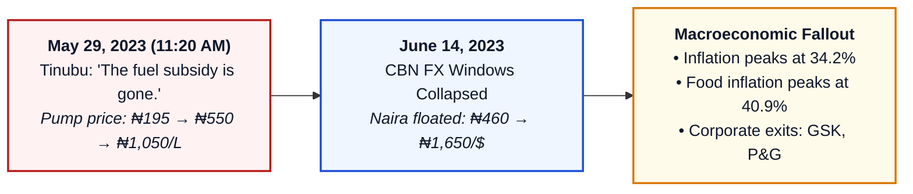
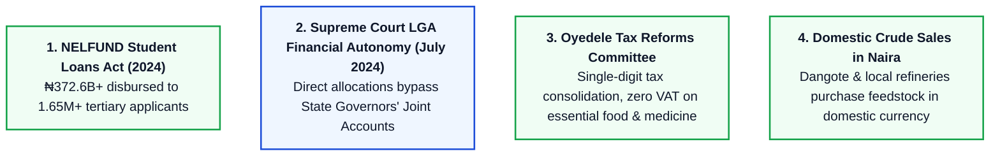
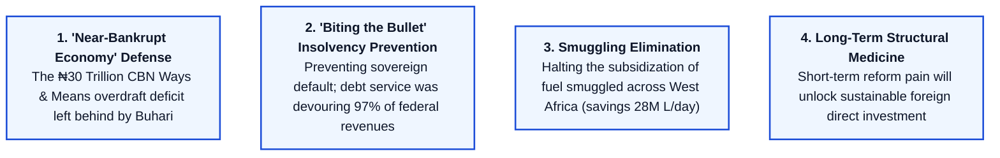

# CIVIC LENS FORENSIC INVESTIGATIVE DOSSIER
**SUBJECT: The Presidency of Bola Ahmed Tinubu (May 29, 2023 – Present)**  
**FILE CODE: CL-INV-NGA-2023-BAT-005**  
**PREPARED BY: Civic Lens Investigative Research Fleet (Agent 5)**  
**DATE OF INVESTIGATION: October 2026**  
**PRIMARY INVENTORY: Economic Shockwaves, Structural Reforms, Human Costs, Fiscal Contradictions, and Official Defenses**

---

## EXECUTIVE SUMMARY & INVESTIGATIVE PREMISE

On May 29, 2023, President Bola Ahmed Tinubu assumed the leadership of Africa's most populous nation and largest democracy with the campaign mantra *"Renewed Hope"*. Within twenty minutes of his inaugural address at Eagle Square, Abuja, the administration initiated one of the most aggressive economic "shock therapy" experiments in modern developing world history:
1. The instantaneous, unscripted abolition of Nigeria's fifty-year-old petrol subsidy regime.
2. The rapid collapse and unification of Nigeria's multiple foreign exchange windows into a managed float.

What followed was a tectonic economic realignment. While international multilateral lenders (the International Monetary Fund, World Bank) and Western financial institutions applauded the bold orthodox market restructuring, the domestic impact was catastrophic for ordinary citizens. In less than eighteen months:
- Premium Motor Spirit (PMS) prices escalated by over **430%**, moving from ₦195 per litre to over ₦1,030–₦1,200 per litre across the Federation.
- The official exchange rate collapsed from **₦461/$** to beyond **₦1,650/$**, vaporizing the purchasing power of the middle class and poor.
- Headline inflation spiked to a three-decade record peak of **34.19%**, with food inflation breaching **40.87%**, thrusting an estimated 104 million Nigerians into multidimensional poverty.
- Multinational industrial conglomerates that had operated in Nigeria for over half a century (GlaxoSmithKline, Procter & Gamble, Sanofi, Kimberly-Clark) shuttered their factories and fled.

Concurrently, the administration executed seminal institutional structural reforms—engineering a historic Supreme Court victory granting direct financial autonomy to 774 Local Government Areas, creating the student loan agency (NELFUND), initiating domestic crude oil sales in Naira to indigenous refiners, and proposing radical tax harmonization bills.

However, the administration’s moral authority to preach austerity was fatally undermined by lavish, opaque state expenditures: the acquisition of a **₦150 Billion ($100M+) Airbus A330 presidential jet**, the **₦21 Billion VP residence**, the **₦15 Trillion sole-sourced Lagos-Calabar Coastal Highway** awarded to a long-time personal business associate, and the appointment of the largest, most bloated cabinet (48 ministers) in Nigeria’s democratic history.

This dossier provides an exhaustive forensic investigation into the policies, macroeconomic data, public protests, fiscal contradictions, and official administration defenses characterizing the Tinubu presidency.

---

## 1. THE DAY-ONE ECONOMIC SHOCKWAVES

| Date & Policy Directives | Implementation Action | Direct Macroeconomic & Consumer Impact |
| :--- | :--- | :--- |
| **May 29, 2023 (Inaugural Speech)** | Off-script declaration: *"The fuel subsidy is gone."* | NNPC pump price jumped immediately from ₦195/L to ₦488–₦557/L, later exceeding ₦1,050/L. |
| **June 14, 2023 (FX Floatation)** | Central Bank of Nigeria collapsed all exchange rate tiers into a single market-determined window. | Official Naira rate devalued from ~₦461/$ to over ₦1,650/$, causing historic imported inflation. |
| **August 2023 – July 2024** | Cost-of-living crisis, transport fare hikes of 250%+, extreme purchasing power erosion. | Triggered the #EndBadGovernance nationwide protests in August 2024. |

### 1.1 The Inaugural Pronouncement: "The Subsidy is Gone"
- **The Event:** On Monday, May 29, 2023, during his inaugural address at Eagle Square, Abuja, President Bola Ahmed Tinubu deviated from his prepared written text to issue the fateful declaration:
  > *"We commend the decision of the outgoing administration in phasing out the petrol subsidy regime which has increasingly favoured the rich more than the poor. Subsidy can no longer justify its ever-increasing costs in the wake of drying resources. We shall instead re-channel the funds into better investment in public infrastructure, education, health care and jobs that will materially improve the lives of millions... The fuel subsidy is gone."*
- **The Mechanism & Context:** While the Petroleum Industry Act (PIA) 2021 had legally stipulated full deregulation of the downstream petroleum sector, and the Buhari administration's 2023 budget only appropriated subsidy funding up to June 30, 2023, market operators had anticipated a phased transition or palliative framework. Tinubu's unilateral, instantaneous cancellation triggered immediate panic-buying, hoarding, and speculative pricing within hours of the speech.
- **The Immediate Aftermath:** Petrol stations across the 36 states and the Federal Capital Territory (FCT) immediately shut their gates or jacked prices from ₦185–₦195 to ₦500–₦700 per litre before regulatory adjustments were announced. On May 31, 2023, the Nigerian National Petroleum Company Limited (NNPC) released an official revised price template pegging pump prices between ₦488 (Lagos) and ₦557 (Maiduguri).

### 1.2 The Relentless Pump Price Escalation (₦195 to >₦1,030/L)
Over the subsequent 18 months, the pump price of PMS underwent repeated shocks, moving from a regulated social commodity to full import-parity pricing:
1. **Pre-Inauguration Baseline (May 2023):** ₦185 – ₦195 / litre.
2. **First Formal Shock (May 31, 2023):** ₦488 – ₦557 / litre (+180%).
3. **Second Formal Shock (July 18, 2023):** ₦617 / litre across NNPC retail outlets, as the initial devaluation of the Naira raised landing costs.
4. **The "Under-Recovery" Re-emergence (Late 2023 – Mid 2024):** Between August 2023 and July 2024, the government secretly resumed paying quasi-subsidies (under-recoveries) through NNPC, accumulating an estimated ₦6 Trillion ($3.8 Billion) in debt to international commodity traders.
5. **The Final De-capping (September – October 2024):** On September 3, 2024, NNPC raised its pump price to ₦855–₦897/L. By October 9, 2024, NNPC fully ended its role as sole off-taker for the Dangote Refinery, driving prices to **₦998 – ₦1,030/L in Lagos** and **₦1,060 – ₦1,250/L in Northern and Eastern states**.
- **Net Price Shock:** A **428% to 540% nominal increase** in transport and domestic energy costs within 16 months.

### 1.3 Currency Floatation & FX Unification: The Collapse of the Naira
- **The Institutional Purge:** On June 9, 2023, President Tinubu suspended Godwin Emefiele as Governor of the Central Bank of Nigeria (CBN). Emefiele was immediately detained by the Department of State Services (DSS) and later charged with procurement fraud, criminal breach of trust, and unlawful printing of currency. In September 2023, former Citibank executive Dr. Olayemi Cardoso was formally confirmed as CBN Governor.
- **The June 14, 2023 Directive:** Acting CBN Governor Folashodun Shonubi issued circular TED/FEM/PUB/FPC/001/007, abolishing the segmentation of the official FX market:
  - Collapsed all windows (Wholesale, Retail SMIS, Investors & Exporters, Bureau De Change) into the **Investors and Exporters (I&E) Window** (now the Nigerian Foreign Exchange Market - NAFEM).
  - Re-introduced the "Willing Buyer, Willing Seller" market pricing model.
  - Abolished the arbitrary ₦461/$ peg.
- **The Free-Fall:**
  - *June 14, 2023:* Rate jumped from ₦461/$ to ₦664/$.
  - *December 2023:* Rate depreciated to ₦899/$.
  - *January 29, 2024:* CBN directed banks to eliminate arbitrary reporting caps, causing a second precipitous devaluation to ₦1,450/$.
  - *February 2024:* Naira plunged to an all-time intraday low of **₦1,900/$ in the parallel market** before monetary tightening clawed it back to a volatile corridor of **₦1,550 – ₦1,680/$**.
- **The Magnitude of Depreciation:** The Naira lost over **70% of its external purchasing value** in under 12 months, marking the steepest currency collapse in modern Nigerian financial history.

---

## 2. THE HUMAN AND MACROECONOMIC CRISIS

| Economic Metric | May 2023 Baseline (Inherited) | Peak Crisis Level (2024) | Direction & Systemic Impact |
| :--- | :--- | :--- | :--- |
| **Headline Inflation** | 22.41% | **34.19%** (June 2024) | +1,178 bps surge driven by transport & energy costs |
| **Food Inflation** | 24.82% | **40.87%** (June 2024) | Severe calorie deficit; staple prices surged 200–300% |
| **Official Exchange Rate** | ₦461 / $1 | **₦1,660 / $1** (Feb 2024) | Over 70% currency depreciation; massive FX losses |
| **National Debt Burden** | ₦87.38 Trillion | **₦134.3 Trillion** (Q2 2024) | Devaluation inflated foreign-currency debt components |
| **Corporate Divestments** | Operating multinationals | **GSK, Sanofi, P&G exit** | Major pharmaceutical & consumer goods operations shut |
| **Statutory Minimum Wage** | ₦30,000 / month (~$65) | **₦70,000 / month** (~$42) | Higher nominal wage, but purchasing power fell by ~35% |

### 2.1 The Hyper-Inflationary Surge & Poverty Explosion
- **NBS Statistical Reality:** According to the National Bureau of Statistics (NBS), headline consumer inflation surged from 22.41% in May 2023 to an official peak of **34.19% in June 2024**—the highest rate recorded in 28 years.
- **The Food Security Emergency:** Food inflation hit an unprecedented **40.87% in June 2024**. Prices of daily staples skyrocketed:
  - 50kg bag of local rice: rose from ₦32,000 in May 2023 to **₦85,000 – ₦100,000** in mid-2024.
  - 1 bag of garri (poor man's staple): rose from ₦18,000 to **₦55,000**.
  - Tubers of yam: surged from ₦800 to **₦3,500 – ₦5,000**.
- **World Bank Multidimensional Poverty Assessment:** In its June 2024 Nigeria Development Update, the World Bank reported that an additional **10 million to 14 million Nigerians** fell below the national poverty line in the first year of Tinubu’s administration, bringing total poverty headcount to over 104 million citizens (47% of the total population).
- **Public Calamity:** Incidents of mass looting of government grain silos and commercial food delivery trucks occurred across Abuja, Suleja, Ibadan, and Kaduna in February and March 2024. In February 2024, a stampede at the Nigeria Customs Service zonal headquarters in Yaba, Lagos, over discounted rice sales killed seven people, including pregnant women.

### 2.2 The Multinational Exodus & De-Industrialization
Faced with acute FX illiquidity, inability to repatriate trapped capital, massive FX paper translation losses, and vanishing consumer purchasing power, several blue-chip multinationals completely halted operations:
1. **GlaxoSmithKline (GSK) Consumer Nigeria Plc (August 2023):** Ended 51 years of direct pharmaceutical and healthcare manufacturing in Nigeria, shifting to an import/third-party distributor model. Prices of life-saving inhalers (Ventolin, Seretide) surged from ₦2,500 to ₦55,000+, putting asthmatic and pulmonary patients at fatal risk.
2. **Sanofi-Aventis (November 2023):** The French pharmaceutical giant ceased direct commercial operations, appointing local distributor Biostadt, causing prices of essential insulin and antibiotics to spike tenfold.
3. **Procter & Gamble (P&G) (December 2023):** Shuttered its $300 Million state-of-the-art manufacturing plant in Agbara, Ogun State (opened only six years earlier in 2017), ending domestic production of Pampers, Always, and Ariel detergent, converting to an import-only structure.
4. **Kimberly-Clark (May 31, 2024):** Closed its $100 Million diaper and sanitary hygiene manufacturing plant in Ikorodu, Lagos, terminating over 1,000 direct and indirect jobs just two years after commissioning.
5. **Equinor (November 2023):** Sold its 53.85% stake in the Agbami offshore oil field and exited Nigeria after 30 years of operations.
6. **Unilever Nigeria:** Ceased production of legendary home-care brands (Omo, Sunlight) to stem mounting operational losses.

### 2.3 The Minimum Wage Paradox: Real-Terms Devaluation
- **The Battle:** Following months of paralyzing strikes by the Nigeria Labour Congress (NLC) led by Joe Ajaero and the Trade Union Congress (TUC) led by Festus Osifo—which culminated in a total shutdown of the national power grid and international airports on June 3, 2024—the Tripartite Committee reached a compromise.
- **The Act:** On July 29, 2024, President Tinubu signed the **National Minimum Wage Act, 2024**, increasing the federal baseline wage from ₦30,000 to **₦70,000 per month** and shortening the review cycle from five years to three years.
- **The Forensic Economic Reality:**
  - In 2019, the ₦30,000 minimum wage was equivalent to **$83.30 USD** (at ₦360/$1).
  - In July 2024, the new ₦70,000 minimum wage was equivalent to only **$43.75 USD** (at ₦1,600/$1).
  - *Purchasing Power Parity:* In 2019, a worker earning ₦30,000 could buy **206 litres of petrol** (at ₦145/L). In late 2024, a worker earning ₦70,000 could buy barely **68 litres of petrol** (at ₦1,030/L). The real-term economic value of the minimum wage had suffered an effective **67% purchasing power destruction**.

### 2.4 State Violence & Political Persecution: The #EndBadGovernance Protests
- **The Uprising (August 1–10, 2024):** Youth, civil society coalitions, and organized trade groups took to the streets across Lagos, Abuja, Kano, Kaduna, Jos, Port Harcourt, and Maiduguri under the banner **#EndBadGovernanceInNigeria** and **#DaysOfRage**. Demands included:
  1. Full reversal of the fuel price hikes.
  2. Concrete emergency interventions to stem hunger.
  3. Reduction in the exorbitant cost of governance.
  4. Restoration of free tertiary education.
- **The Crackdown:**
  - State security forces utilized tear gas, live ammunition, and arbitrary detention.
  - According to **Amnesty International**, at least **24 peaceful protesters were killed** by security forces within the first four days, primarily in Kano, Katsina, Jigawa, and Niger states.
  - Over 1,000 protesters were arrested nationwide.
- **Geopolitical Alarm (The Russian Flags):** In Northern cities (Kano, Kaduna, Katsina), desperate youths hoisted Russian flags and chanted slogans calling for military intervention, reflecting deep anti-establishment rage, economic alienation, and regional insecurity.
- **The Treason Charge Debacle & Minors Arraignment:**
  - On September 2, 2024, the Federal Government arraigned 10 protest organizers (including Michael Adaramoye, alias "Lenin") before Justice Emeka Nwite on charges of treason and attempting to overthrow the government.
  - On November 1, 2024, the administration reached a low point of public ignominy when police arraigned **76 protesters, including 32 emaciated, malnourished minors (ages 14 to 17)** before Justice Obiora Egwuatu at the Federal High Court, Abuja.
  - Several minors collapsed from exhaustion and malnutrition inside the courtroom dock.
  - Facing volcanic domestic and international condemnation, President Tinubu was forced on November 4, 2024, to order Attorney-General Lateef Fagbemi (SAN) to file a *nolle prosequi* and immediately release all detained minors.

---

## 3. NOTABLE POLICY ACCOMPLISHMENTS & STRUCTURAL REFORMS

Despite severe macroeconomic dislocation, the Tinubu administration executed four fundamental structural reforms with long-term institutional significance:

| Reform Pillar | Statutory Basis & Milestone | Operational & Fiscal Impact |
| :--- | :--- | :--- |
| **NELFUND Student Loans** | Student Loans (Access to Higher Education) Act 2024 | Disburses interest-free tuition and stipends across 319 tertiary institutions. |
| **LGA Direct Financial Autonomy** | Supreme Court ruling (*SC/CV/343/2024*, July 11, 2024) | Prohibits state governments from withholding allocations belonging to 774 Local Councils. |
| **Fiscal Policy & Tax Reforms** | Presidential Committee chaired by Taiwo Oyedele | Proposes single-digit tax streamlining, zero VAT on essential food/health goods, ₦800K income exemption. |
| **Dangote Crude in Naira** | Federal Executive Council directive (Oct 2024) | Eliminates bilateral FX pressures for domestic refinery feedstock purchases. |

### 3.1 Higher Education Democratization: The Student Loans Act & NELFUND
- **The Legislative Overhaul:** After an initial poorly drafted Act signed on June 12, 2023 (which imposed unworkable family income ceilings of <₦500,000/yr and required level-12 civil servant guarantors), Tinubu signed the **Student Loans (Access to Higher Education) (Repeal and Re-enactment) Act, 2024** on April 3, 2024.
- **Key Provisions:**
  - Removed all family income caps and guarantor requirements.
  - Established the **Nigerian Education Loan Fund (NELFUND)** as a statutory body corporate headed by Managing Director Akintunde Sawyerr.
  - Ring-fenced funding: 1% of all taxes, levies, and duties collected by the Federal Inland Revenue Service (FIRS), plus petroleum profit contributions.
  - Zero interest; repayment commences two years after completion of the mandatory National Youth Service Corps (NYSC), deducted at 10% of beneficiary salary, with exemption provisions for documented unemployment.
- **Operational Scale (as of October 2026):**
  - **Total Disbursed:** Over **₦372.62 Billion**.
  - **Institutional Tuition Fees:** ₦192.89 Billion (disbursed directly to 319 public universities, polytechnics, and colleges of education).
  - **Monthly Upkeep Stipends:** ₦179.73 Billion (paid directly to students at ₦20,000/month).
  - **Applications Processed:** 1,659,853 students across all six geopolitical zones.

### 3.2 Dismantling State Feudalism: The Supreme Court LGA Autonomy Judgment
- **Case Citation:** *Attorney-General of the Federation v. Attorney-General of Abia State & 35 Ors* (Suit No: **SC/CV/343/2024**).
- **The Historic Ruling (July 11, 2024):** A seven-member panel of the Supreme Court, led by Justice Garba Lawal, with the lead judgment delivered by **Justice Emmanuel Agim (JSC)**, delivered a revolutionary constitutional ruling:
  1. **Direct FAAC Allocations:** Declared that statutory allocations from the Federation Account belonging to the 774 Local Government Areas (LGAs) must be paid directly into the accounts of the LGAs, strictly barring transfer to state-controlled State Joint Local Government Accounts (SJLGA).
  2. **Unconstitutionality of Caretaker Committees:** Declared that no state governor has the constitutional power to dissolve democratically elected local government councils or appoint unelected "Caretaker Committees".
  3. **Funding Withholding:** Directed the Accountant-General of the Federation to immediately cease disbursing statutory funds to any LGA run by an unelected caretaker committee.
- **Systemic Impact:** Effectively broke the decades-old financial stranglehold exercised by 36 state governors, who historically diverted, pocketed, or starved third-tier administrations of hundreds of billions of Naira monthly.

### 3.3 Fiscal Modernization & Tax Streamlining: The Taiwo Oyedele Committee
In August 2023, Tinubu inaugurated the **Presidential Committee on Fiscal Policy and Tax Reforms**, chaired by former PwC Africa Tax Leader **Taiwo Oyedele**. 

In October 2024, the administration submitted four sweeping tax reform bills to the National Assembly:
1. **The Nigeria Tax Bill, 2024:** Consolidates all fiscal statutes into a single, coherent tax code; repeals obsolete colonial and military levies.
2. **The Nigeria Tax Administration Bill, 2024:** Standardizes tax procedures, dispute resolution, and filing compliance nationwide.
3. **The Nigeria Revenue Service (Establishment) Bill, 2024:** Repeals the Federal Inland Revenue Service (FIRS) Act, renaming and restructuring the agency into the Nigeria Revenue Service (NRS) with integrated cross-border and digital capabilities.
4. **The Joint Revenue Board (Establishment) Bill, 2024:** Coordinates federal, state, and local revenue bodies to eliminate duplicate taxation.

**Key Revolutionary Reforms Proposed:**
- **Zero VAT on Essentials:** Formal 0% VAT rate on food items, healthcare, educational services, pharmaceuticals, and public mass transit.
- **Tax Exemption for Vulnerable Citizens:** Complete personal income tax exemption for anyone earning minimum wage or up to ₦800,000–₦1,000,000 annually (relieving the bottom 30% of workers).
- **Corporate Tax Relief for MSMEs:** Complete exemption from Companies Income Tax (CIT) and withholding tax for small businesses with annual turnover below ₦50 Million.
- **Harmonization of Taxes:** Reducing Nigeria's crippling array of over 60 informal/nuisance taxes to less than 10 single-digit levies.
- **Political Clash:** The proposed transition from an HQ-remittance VAT model to a **derivation/consumption-based VAT model** triggered fierce resistance from the Northern Governors Forum and the National Economic Council (NEC) in late 2024, with Northern leaders fearing revenue loss. Tinubu resisted political pressure to withdraw the bills, insisting on democratic legislative debate.

### 3.4 Domestic Energy Decoupling: Crude Oil Sales in Naira to Local Refineries
- **The Policy Shift:** On July 29, 2024, the Federal Executive Council (FEC) approved the sale of Nigerian crude oil to domestic refineries—chiefly the **650,000 barrels-per-day Dangote Petroleum Refinery**—in local currency (Naira), rather than US Dollars.
- **Commencement Date:** Formally took effect on **October 1, 2024**, coordinated by an implementation technical committee chaired by Finance Minister Wale Edun and FIRS Executive Chairman Zacch Adedeji.
- **Strategic Impact:**
  - Eliminates the absurdity of Nigeria spending up to **30%–40% of its foreign exchange reserves (over $7.3 Billion annually)** importing refined petroleum products from Europe.
  - Insulates domestic refined petrol, diesel, and aviation fuel distribution from international FX volatility and shipping freight charges.
  - Guaranteed minimum supply of 385,000 barrels per day to domestic plants.

---

## 4. EGREGIOUS EXPENDITURES & FISCAL HYPOCRISY

While President Tinubu and his cabinet ministers consistently admonished citizens to "make sacrifices", endure austerity, and accept economic misery as "unavoidable medicine", the presidency engaged in an unprecedented spree of luxury expenditures and opaque capital contracts:

| Expenditure Item | Public Cost | Context & Public Outrage |
| :--- | :--- | :--- |
| **Airbus A330 Presidential Jet** | **₦150 Billion ($100M+)** | Acquired secretly during nationwide #EndBadGovernance economic hardship protests in August 2024. |
| **VP Abuja Residence Renovation** | **₦21 Billion** | Massive renovation bill for Vice President's lodge amidst calls for severe government austerity. |
| **Lagos–Calabar Coastal Highway** | **₦15 Trillion** | Awarded to Hitech Construction (owned by Gilbert Chagoury) without competitive open bidding; demolished Landmark Beach. |
| **Expansion of Federal Cabinet** | **48 Ministers** | Largest cabinet in Nigeria's Fourth Republic history, contradicting official austerity rhetoric. |

### 4.1 The ₦150 Billion ($100M+) Flying Palace: Airbus A330-200
- **The Purchase:** In August 2024—the exact month security forces were shooting anti-hunger protesters in Northern Nigeria—President Tinubu took delivery of a newly acquired luxury **Airbus A330-200 presidential aircraft** (registration: **5N-FGA**, formerly VP-CAC).
- **The Cost:** Estimated by international aviation brokers and domestic watchdogs at between **$100 Million and $150 Million (₦150 Billion – ₦240 Billion)**.
- **The Administration's Justification:** Special Adviser Bayo Onanuga argued that the Presidential Air Fleet (PAF) flagship—a 19-year-old Boeing 737-700 Business Jet (BBJ) purchased under President Olusegun Obasanjo—had become functionally unsafe and incurred prohibitive maintenance costs, citing incidents where mechanical faults grounded the President in Saudi Arabia and Vice President Shettima on an official trip to the US.
- **Public Outrage:** The optics of spending ₦150 Billion on a flying palace while citizens were dying in stampedes over subsidized rice became an indelible symbol of elite insensitivity.

### 4.2 The ₦21 Billion Vice-Presidential Palace Renovation
- **The Project:** On June 7, 2024, President Tinubu formally commissioned the official residence of the Vice President in the Three Arms Zone, Abuja.
- **The Cost:** The FCT Administration, under Minister Nyesom Wike, spent **₦21 Billion** to complete and furnish the structure, which had been abandoned since 2010.
- **The Irony:** Following its extravagant commissioning, media investigations revealed the palatial residence remained largely unoccupied for several months, with Vice President Shettima continuing to operate out of his temporary residence.

### 4.3 The ₦15 Trillion Lagos-Calabar Coastal Highway: The Chagoury Crony Contract
- **Project Scope:** A 700-kilometre, 10-lane concrete coastal highway linking Victoria Island, Lagos, to Calabar, Cross River State, traversing nine coastal states.
- **Contract Cost:** Estimated at **₦15 Trillion** (~₦4.33 Billion per kilometre), making it the single most expensive public works project in Nigerian history. Section 1 (47.47km in Lagos) was awarded at **₦1.06 Trillion**.
- **The Public Procurement Violation:** The mega-contract was awarded via an Engineering, Procurement, Construction and Financing (EPC+F) model to **Hitech Construction Company Limited**, an entity owned by Lebanese-Nigerian billionaire brothers **Gilbert and Ronald Chagoury**.
  - *The Conflict of Interest:* Gilbert Chagoury is a known decades-long business associate and financial backer of Bola Ahmed Tinubu dating back to his 1999–2007 tenure as Governor of Lagos State.
  - *Procurement Law Breach:* The contract was awarded without competitive public international bidding, violating the mandatory transparent procurement provisions of the **Public Procurement Act, 2007**. Works Minister Dave Umahi admitted on national television that the project was awarded under "restrictive procurement".
- **The Destruction of Landmark Beach Resort:**
  - In April and May 2024, federal bulldozers flattened major portions of **Landmark Beach Resort** at Oniru, Victoria Island, a premier $100 Million beachfront recreation and tourism hub.
  - The demolition eliminated over 80 commercial enterprises, destroyed an estimated 4,000 direct and indirect jobs, and wiped out billions of Naira in domestic hospitality investments—despite Landmark management presenting alternative technical route proposals using the median reserve that would have spared beachfront investments.

### 4.4 The Most Bloated Cabinet in Democratic History (48 Ministers)
- **The Record:** Despite championing the implementation of the Stephen Oronsaye Report on Civil Service Rationalization, President Tinubu constituted a cabinet of **48 Ministers**—surpassing the 43 ministers appointed by Muhammadu Buhari and the 42 appointed by Goodluck Jonathan.
- **Portfolio Proliferation:** Created multiple redundant, overlapping ministries to satisfy political patronage networks:
  - Ministry of Marine and Blue Economy.
  - Ministry of Regional Development (swallowing Niger Delta and regional commissions).
  - Ministry of Livestock Development.
  - Ministry of Art, Culture, and Creative Economy.
- **The Cost of Executive Excess:** Each minister was provided with a convoy of bulletproof SUVs (Lexus LX 600, Toyota Land Cruiser 300), security details, special assistants, personal aides, and international travel allowances, driving federal overhead expenditures to all-time highs.

---

## 5. THE ADMINISTRATION'S OFFICIAL DEFENSES & EXCUSES

Confronted with public outrage and macroeconomic shocks, President Tinubu, Finance Minister Wale Edun, CBN Governor Olayemi Cardoso, and presidential spokesmen (Ajuri Ngelale, Bayo Onanuga) consistently deployed four core structural defenses:

| Villa Defense Line | Official Administration Argument | Counter-Criticism & Scrutiny |
| :--- | :--- | :--- |
| **1. Ways & Means Overdraft Deficit** | Buhari regime printed ₦30 Trillion illegally via CBN overdrafts, destroying monetary stability. | Tinubu supported Buhari's fiscal agenda for 8 years and appointed many same officials. |
| **2. Sovereign Insolvency Avoidance** | Without subsidy removal, debt servicing (97% of revenue) would have triggered sovereign default. | Timing of twin shocks without functional safety nets plunged 30M+ citizens into deep poverty. |
| **3. Anti-Smuggling Rationale** | Subsidized fuel was illicitly smuggled to Benin, Togo, and Cameroon at Nigerian expense. | Price hikes penalized domestic consumers rather than addressing border policing failures. |
| **4. Structural Medicine Rationale** | Painful reforms are necessary foundations for sustainable long-term economic growth. | Elite political profligacy (jets, yachts, mansions) directly contradicts sacrifices demanded from citizens. |

### 5.1 The "Near-Bankrupt Economy" Narrative & The ₦30 Trillion Ways & Means Deficit
- **The Argument:** The administration repeatedly asserted that it inherited an economic wasteland brought to the verge of insolvency by eight years of the Buhari administration's reckless fiscal and monetary distortions.
- **The ₦30 Trillion Ways & Means Overdraft:** Finance Minister Wale Edun revealed that between 2015 and 2023, the CBN under Godwin Emefiele illegally printed and advanced over **₦22.7 Trillion to ₦30 Trillion** to the Federal Government through the Ways & Means overdraft facility without legislative appropriation or productivity backing. Edun characterized this as:
  > *"Eight years of printing money without productivity. That liquidity overhang flooded the system with unbacked fiat currency, creating the hyper-inflationary tsunami that exploded in 2023 and 2024."*
- **Sovereign Insolvency Warning:** Vice President Kashim Shettima stated publicly that Nigeria's sovereign debt service-to-revenue ratio had reached an untenable **97% to 100%** by May 2023, meaning virtually every kobo earned by the Nigerian state was consumed paying interest on past borrowings, leaving zero funds for capital development.

### 5.2 The "Biting the Bullet" Defense: Imminent Sovereign Default
- **The Argument:** Maintaining the fuel subsidy regime and artificial FX peg was mathematically impossible. If Tinubu had not eliminated them on Day One, Nigeria would have suffered complete sovereign bankruptcy and debt default within six months.
- **Fiscal Bleeding:** In 2022 alone, fuel subsidy payments consumed **₦4.39 Trillion**, exceeding the combined federal budgets for health, education, and defense. By mid-2023, subsidy costs were projected to surpass **₦400 Billion monthly (₦6 Trillion annually)**.
- **Tinubu's Defense (Address to the Nation, August 4, 2024):**
  > *"For decades, our economy has remained anaemic and taken the wrong direction. We could not afford to continue on that track. The fuel subsidy was a noose around the neck of our nation’s economy. The multi-tiered foreign exchange windows served only currency arbitrageurs and rent-seekers while starving our industries of real liquidity. We had to dismantle the cartels that fed on the lifeblood of our nation, or watch Nigeria drown in debt."*

### 5.3 Curbing the Cross-Border Fuel Smuggling Cartel
- **The Data:** The administration justified the subsidy cancellation by demonstrating that Nigeria was subsidizing cheap petrol for entire West and Central African nations (Benin, Togo, Cameroon, Niger, Chad, Mali).
- **The NNPC Evidence:** Following subsidy removal:
  - Nigeria’s daily truck-out evacuation of PMS dropped precipitously from **66 Million – 68 Million litres per day** to approximately **46 Million – 48 Million litres per day** (a drop of over 20 Million litres daily).
  - This verified that an estimated **30% of all fuel imported into Nigeria was being smuggled across borders** by organized criminal syndicates reaping astronomical arbitrage profits.
- **Regional Price Equalization:** Within days of Tinubu's declaration, petrol pump prices in Cotonou (Benin), Lomé (Togo), and Douala (Cameroon) doubled or tripled, proving that the Nigerian Treasury had essentially been sustaining the economies of neighboring countries at the expense of domestic public schools and healthcare.

### 5.4 The "Surgery vs. Disease" Rhetoric: Short-Term Pain vs. Structural Recovery
- **The Metaphor:** In multiple national broadcasts, Tinubu presented the economic measures as non-negotiable surgical interventions:
  > *"The reforms we are executing are like painful surgical procedures to remove a malignant tumor. You cannot cure a life-threatening ailment with sugar-coated tablets. There is no doubt that the pain is immediate and severe, but the recovery will be permanent. We are building the foundations of a trillion-dollar economy."*
- **Claimed Macroeconomic Dividends (Mid-2024 – 2026):**
  - **Debt Service Ratio Reduction:** Reduction of the sovereign debt-service-to-revenue ratio from 97% to approximately **65%–68%**.
  - **Surging FAAC Allocations:** Monthly revenue distributed by the Federation Accounts Allocation Committee (FAAC) to federal, state, and local governments surged from ~₦700 Billion in early 2023 to **₦1.2 Trillion – ₦1.4 Trillion monthly**, providing state governors with unprecedented nominal liquidity.
  - **Foreign Reserves Rebound:** Gross foreign exchange reserves recovered from a precarious net deficit under Emefiele to over **$38 Billion – $40 Billion** by late 2024/2025.
  - **Current Account Surplus:** Transitioning from structural trade deficits to continuous current account surpluses driven by non-oil exports and reduced refined fuel importation.

---

## 6. FORENSIC SCORECARD: TINUBU PRESIDENCY (2023–2026)

| Policy / Action Area | Administration Rationale | Forensic Reality / Execution | Human / Economic Impact | Verdict |
| :--- | :--- | :--- | :--- | :--- |
| **Fuel Subsidy Removal** | Eliminate fiscal waste; stop cross-border smuggling; redirect funds to infrastructure. | Immediate, crude abolition without palliatives or transit safety nets; secret under-recoveries returned before final ₦1,030/L spike. | 430%+ jump in fuel; transport inflation; widespread food poverty. | **Macro-Necessary / Execution Catastrophic** |
| **FX Unification** | Eliminate currency arbitrage; attract foreign direct investment (FDI); float currency. | Ill-managed float; lack of reserve backing triggered a 70% collapse of the Naira from ₦461 to ₦1,650/$. | Complete erosion of middle-class savings; corporate exits (GSK, P&G). | **Severe Systemic Shock / Fragile Stabilization** |
| **Local Govt Autonomy** | Restore grassroots governance; dismantle state governors' joint account looting. | Swift, brilliant legal strategy via Supreme Court Suit SC/CV/343/2024. | Direct FAAC funds to 774 LGAs; banned illegal caretaker committees. | **Unqualified Constitutional Triumph** |
| **Student Loans (NELFUND)**| Democratize tertiary education; support indigent students with zero-interest loans. | Repealed flawed 2023 act; successfully disbursed ₦372B+ to 1.6M+ students. | Buffer against tuition fee increases; provides ₦20k monthly upkeep. | **Major Social Policy Success** |
| **Tax Reforms (Oyedele)** | Harmonize 60+ taxes to single digits; 0% VAT on essentials; exempt poor workers. | 4 comprehensive bills; strong technocratic design; faced fierce Northern resistance. | Huge potential relief for low-income earners and MSMEs once fully enacted. | **Progressive Structural Reform** |
| **Crude Sales in Naira** | Conserve FX; support domestic refining; decouple from international shipping costs. | FEC approved July 2024; operationalized October 2024 for Dangote & local plants. | Reduces national FX demand by $7.3B/yr; guarantees domestic fuel supply. | **Strategic Energy Milestone** |
| **Lagos-Calabar Highway** | National infrastructural masterwork connecting 9 coastal states. | ₦15 Trillion contract sole-sourced to Gilbert Chagoury (Hitech); Landmark Beach destroyed. | Extreme procurement opacity; demolished $100M+ tourism hub; crony capitalism. | **Egregious Procurement Scandal** |
| **Presidential Jet Acquisition** | Old Boeing 737 was unsafe and grounded; presidential security necessity. | Secretly bought ₦150B ($100M+) Airbus A330 during peak public hunger protests. | Severe moral disconnect; hypocritical violation of preached austerity. | **Brazen Fiscal Tone-Deafness** |
| **Human Rights & Protests** | Maintain national security; prevent coup plots and violent insurrection. | Security forces shot 24+ peaceful protesters; charged 32 minors with capital treason. | International humiliation; erosion of democratic credibility; dropped under pressure. | **Authoritarian Repression** |

---

## 7. KEY CITATIONS & PRIMARY SOURCES

1. **Federal Republic of Nigeria Official Gazette:** *The Inaugural Address of President Bola Ahmed Tinubu*, Eagle Square, Abuja, May 29, 2023.
2. **Supreme Court of Nigeria:** *Attorney-General of the Federation v. Attorney-General of Abia State & 35 Ors* (Suit No: SC/CV/343/2024, Judgment delivered July 11, 2024, per Agim, JSC).
3. **National Bureau of Statistics (NBS):** *Consumer Price Index (CPI) and Inflation Reports (May 2023 – August 2024)*, Federal Republic of Nigeria.
4. **Central Bank of Nigeria (CBN):** *Circular TED/FEM/PUB/FPC/001/007: Operational Changes to the Foreign Exchange Market*, June 14, 2023.
5. **Nigerian Education Loan Fund (NELFUND):** *Official Disbursement and Operations Audit Report*, October 3, 2026.
6. **National Assembly of the Federal Republic of Nigeria:** *National Minimum Wage Act, 2024* (Assented July 29, 2024); *Students Loans (Access to Higher Education) (Repeal and Re-enactment) Act, 2024* (Assented April 3, 2024).
7. **Presidential Committee on Fiscal Policy and Tax Reforms:** *Executive Summary and Draft Legislative Package (Nigeria Tax Bill, Nigeria Tax Administration Bill, Nigeria Revenue Service Bill, Joint Revenue Board Bill)*, October 2024.
8. **World Bank Group:** *Nigeria Development Update: Turning the Corner (From Short-term Agony to Long-term Dividend)*, June 2024.
9. **Amnesty International Nigeria:** *Forensic Field Report on Security Force Fatalities during the #EndBadGovernance Protests*, August 2024.
10. **Federal Ministry of Works:** *Public Briefing on the Lagos-Calabar Coastal Highway EPC+F Procurement Framework*, Minister Dave Umahi, May 2024.
